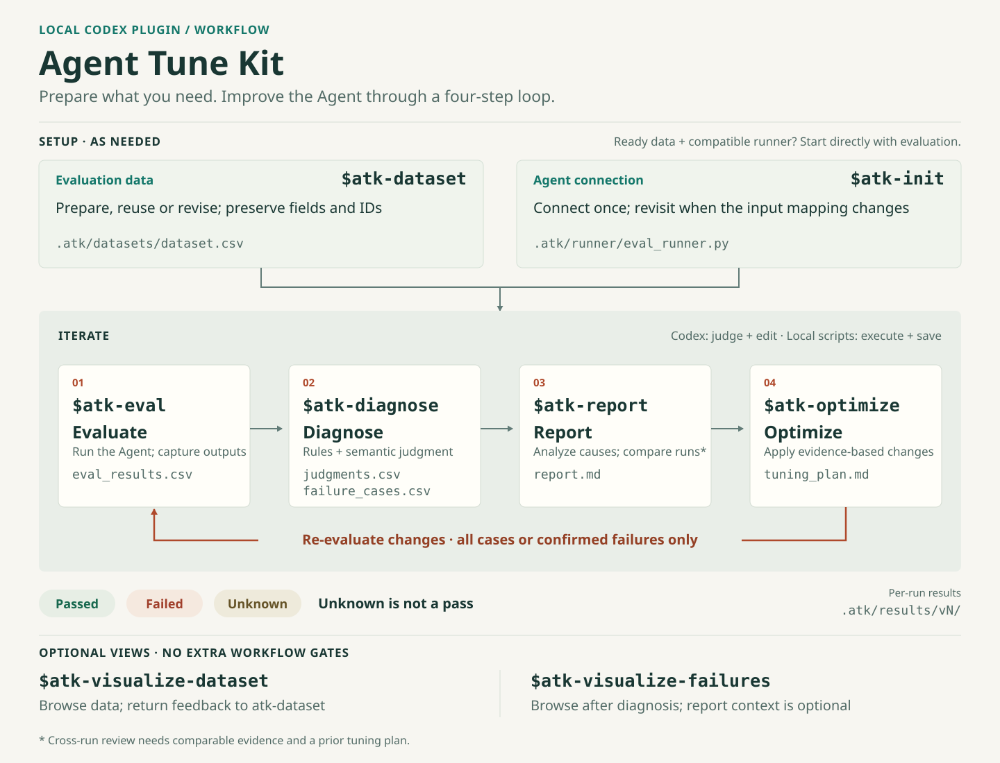

# Agent Tune Kit

English | [简体中文](README.md)

[](https://pypi.org/project/agent-tune-kit/)

Agent Tune Kit is a **local Codex plugin** that helps you evaluate an existing Agent, identify failures, and tune prompts, code, parameters, or tool configuration from the results.

Use it to prepare evaluation data, test your Agent in batches, review failures and reports, then check whether your changes help in the next evaluation. Each round keeps its results and tuning notes for review and comparison.

## Before You Start

- A local Agent project that Codex can read and edit, such as a chatbot, tool-using Agent, or RAG Agent.
- Evaluation data, preferably CSV; 5 to 20 examples are enough to start. If you have no dataset yet, start with business examples.
- A basis for judging results, such as expected answers, labels, or acceptance criteria.

## Install and Enable

Install ATK and its bundled Skills in your terminal:

```sh
uv tool install agent-tune-kit
atk install
```

In Codex, enter `/plugins`, select and enable `Agent Tune Kit`, then restart Codex and open a new session.

<details>
<summary>Other installation options: pipx or local source</summary>

With pipx:

```sh
pipx install agent-tune-kit
atk install
```

From local source: update your chosen branch, then run these commands from the **ATK repository root**. Rerun them after source updates; changes are reinstalled even when the version is unchanged.

```sh
uv tool install --reinstall .
atk install
```

</details>

Finish active ATK tasks before reinstalling, and open a new session afterward to load updates. If installation fails, run `atk status` and see the [installation and cache notes](docs/skill-template-pack-usage.md#local-plugin-install-and-smoke). A successful check does not confirm that the plugin is enabled in your current session.

## Complete Your First Evaluation and Tuning Round

**Open your own Agent project in Codex**, then send the Skill instructions below. Installation commands run in a terminal; `$atk-…` instructions belong in your Codex conversation.

### 1. Prepare Data as Needed

Skip to the next step if you already have suitable data. To organize a dataset or fill gaps in evaluation criteria:

```text
$atk-dataset Prepare data/eval.csv for evaluation. Preserve existing fields and answers; fill only grounded gaps in the judgment criteria.
```

You can also provide business examples or request a correction, such as changing the expected result for atk_id 7. Fixed column names and exported feedback files are not required. Answers without trustworthy support remain gaps rather than being invented.

Use `$atk-visualize-dataset` when you want a local page for browsing and reviewing data, then give feedback to `$atk-dataset`. Data preparation does not run the Agent.

### 2. Connect Your Agent

Tell Codex where your Agent entry point and evaluation data are:

```text
$atk-init My Agent entry point is scripts/agent.py and the evaluation dataset is data/eval.csv
```

Codex reads the project, prepares the adapter, and organizes a runnable dataset. If your Agent is already connected through a compatible adapter, go straight to evaluation.

Evaluation appends five reserved output columns: `agent_output`, `output_status`, `error_type`, `error_message`, and `log_path`. Managed V1/V2 adapters and `atk eval --check` reject name collisions before calling the Agent or allocating a result version; the error lists the dataset path and conflicting columns. For example, after confirming the change, rename a business `output_status` field to `review_status` and update adapter and judgment-rule references. ATK never renames fields or overwrites source values automatically; data preparation may still preserve these business columns unchanged. Old standalone runners need a separate check or migration to the shared engine.

### 3. Evaluate, Diagnose, and Read the Report

Send these instructions in order:

```text
$atk-eval
$atk-diagnose
$atk-report
```

| Instruction | What you get |
| --- | --- |
| `$atk-eval` | Actual Agent outputs and execution records for each sample |
| `$atk-diagnose` | Passed, failed, or unknown judgments with reasons and an initial investigation of failures |
| `$atk-report` | Main issues, cause analysis, and tuning recommendations |

Use `$atk-visualize-failures` for a local offline page to search, filter, and review individual failures.

**Unknown does not count as passed.** Missing answers, criteria, or valid judgment records cannot establish that the Agent behaved correctly.

### 4. Tune from the Results

```text
$atk-optimize
```

Codex uses the report and failures to edit your Agent's prompts, code, parameters, or tool configuration. It records why it made changes and what to verify next. Save your current code with Git before tuning so you can compare and restore it.

### Workflow



## Review Results and Verify Improvement

Each round saves results under `.atk/results/vN/` in your Agent project. Start with `report.md` for the main findings, use `failure_cases.html` to review individual failures, and read `tuning_plan.md` for the changes and their rationale.

After tuning, you can first rerun the previous round's confirmed failures:

```text
$atk-eval --only-failures
$atk-diagnose
$atk-report
```

A new evaluation does not overwrite existing nonempty result directories. From the second round onward, when prior tuning notes exist and conditions are comparable, the report identifies target issues as resolved, partially resolved, unresolved, or impossible to judge.

**Rerunning failures does not measure the full-dataset pass rate.** To check effects on other samples, run `$atk-eval` again, then diagnose and report for a full regression check. Changing data or evaluation criteria alone does not prove Agent improvement.

### Complete Output Structure

This tree lists persistent evaluation outputs and optional files produced by the latest version. They appear as the corresponding steps and configuration require, rather than all being created at installation.

```text
.atk/
├── context.md                 # Optional: agreed goals, standards, and human feedback
├── datasets/
│   ├── dataset.csv            # Prepared data with sample IDs (atk_id)
│   ├── dataset.html           # Optional dataset browser
│   └── dataset_review.csv     # Optional: human-exported feedback placed here
├── runner/
│   ├── eval_runner.py         # Agent adapter
│   └── failure_rule.py        # Project judgment rule, generated as needed
└── results/
    ├── v1/
    │   ├── eval_results.csv    # Actual outputs and execution status per sample
    │   ├── run.json            # Round status and evidence index
    │   ├── run-events.jsonl    # As needed: events outside individual executions
    │   ├── executions/
    │   │   └── <execution-id>/ # One execution; may serve multiple samples
    │   │       ├── execution.json
    │   │       ├── input.json
    │   │       ├── output.json
    │   │       ├── context/
    │   │       │   ├── samples.json
    │   │       │   ├── environment.json
    │   │       │   └── snapshot-<N>
    │   │       ├── events.jsonl
    │   │       ├── app.log
    │   │       └── artifacts/  # Additional saved artifacts, as needed
    │   ├── judgments.csv       # Per-sample judgments and reasons
    │   ├── judgment-history/   # Previous judgments saved on reassessment
    │   │   └── <hash>.csv
    │   ├── failure_cases.csv   # Confirmed failures
    │   ├── failure_cases.html  # Optional failure browser
    │   ├── report.md           # Analysis and cross-round validation
    │   └── tuning_plan.md      # Tuning changes and verification targets
    └── v2/
        └── ...                # Later rounds follow the applicable layout
```

| File or directory | When and why to use it |
| --- | --- |
| `datasets/dataset.csv`, `dataset.html` | Review inputs and expected results. The browser is optional; exported review CSVs can also be imported from Downloads |
| `context.md` | Optionally keep agreed goals, behavior standards, and feedback for future tuning; no manual run statistics are needed |
| `runner/` | Connect or adjust Agent invocation; Skills use these files during routine evaluation |
| `eval_results.csv` | Read source fields, actual `agent_output`, execution status `output_status`, and `log_path` |
| `judgments.csv`, `failure_cases.csv` | Read individual judgments and confirmed failures. Unknowns stay outside the failure set; reassessments preserve old records in `judgment-history/` |
| `report.md`, `failure_cases.html`, `tuning_plan.md` | Read analysis, review failures, inspect changes, and choose the next verification targets |
| `run.json`, `executions/`, `run-events.jsonl` | Investigate a run using saved status, inputs, outputs, context, events, and additional artifacts |

Within each execution, `context/` holds relevant samples, environment details, and snapshots such as the adapter file. `app.log` is a view of captured logs and may be empty. Detailed model and tool traces depend on project instrumentation; calls are not all recorded automatically.

Failed or interrupted executions may leave only partial files; a directory does not prove completion. Evidence-only imports may have no `eval_results.csv` and cannot be scored directly. Execution evidence can contain project data, so confirm retention and redaction needs during setup.
