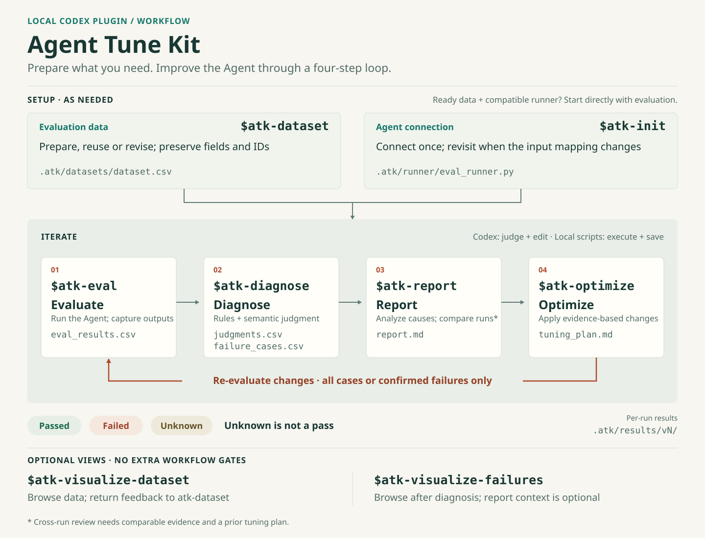

# Agent Tune Kit

English | [简体中文](README.md)

[](https://pypi.org/project/agent-tune-kit/)

Agent Tune Kit is a **local Codex plugin** for batch Agent evaluation and session trace tuning: identify issues, investigate causes, change prompts, code, parameters or tools, and verify the candidate.

Use batch evaluation to compare results across a dataset, or start from a Session ID to investigate one problematic conversation. Both workflows share one installation while retaining separate evidence and results.

## Before You Start

- A local Agent project that Codex can read and edit, such as a chatbot, tool-using Agent, or RAG Agent.
- For batch evaluation: data, preferably CSV; 5 to 20 examples are enough to start. Without a dataset, start with business examples.
- For trace tuning: an explicit Session ID, source, and supported local traces or read-only Langfuse v4 configuration. A dataset or runner is unnecessary.
- A basis for judging results, such as expected answers, labels, or acceptance criteria.

## Install and Enable

Install ATK and its bundled Skills in your terminal:

```sh
uv tool install agent-tune-kit
atk install
```

In Codex, enter `/plugins`, select and enable `Agent Tune Kit`, then restart Codex and open a new session.

<details>
<summary>Other installation options: pipx or local source</summary>

With pipx:

```sh
pipx install agent-tune-kit
atk install
```

From local source: update your chosen branch, then run these commands from the **ATK repository root**. Rerun them after source updates; changes are reinstalled even when the version is unchanged.

```sh
uv tool install --reinstall .
atk install
```

</details>

Finish active ATK tasks before reinstalling, and open a new session afterward to load updates. If installation fails, run `atk status` and see the [installation and cache notes](docs/skill-template-pack-usage.md#local-plugin-install-and-smoke). A successful check does not confirm that the plugin is enabled in your current session.

## Tune from a Problematic Session

Open your Agent project in Codex and send the Skill instructions below. Start with the native Session ID and its source. Use Trace IDs to locate evidence within the session.

Run `atk trace --help` to check whether your CLI supports trace tuning. If the command is unavailable, follow the local source installation steps above with a version that supports trace tuning, then open a new Codex session.

### 1. Prepare the Session Trace

- **Langfuse v4**. Use `$atk-trace-init` to record project and source settings on first setup. Configuration references credentials by environment-variable name. Then send `$atk-trace-capture Download session <session-id> from <start time> to <end time>`.
- **Local files**. Send `$atk-trace-capture Import traces for session <session-id> from <file path>, with source <source>`. You can also provide files that can be verified as belonging to the session in the next step and let detection import them. Analyze an already archived session directly.

Capture only downloads or imports data. Before saving, decide which content to retain and which fields to redact. ATK adds `.atk/traces/` to the project's `.gitignore`. See the [trace tuning guide](docs/trace-tuning.md) for configuration and supported formats.

### 2. Analyze and Review Evidence

```text
$atk-trace-detect Check whether session <session-id> completed its task correctly. List issues, evidence, and what you did not inspect.
$atk-visualize-trace Open the execution lanes for session <session-id> and jump from issues to the relevant trace segments and evidence fields.
```

Detection normally delivers a list of issues with evidence and inspection coverage. The preview is saved as `.atk/traces/<session_id>/preview.html`. You can generate it once traces are available, including for sessions with no analysis or no findings. Review the HTML before sharing it because it may contain retained content.

### 3. Investigate, Fix, and Verify an Issue as Needed

```text
$atk-trace-diagnose Investigate ISSUE-001 in session <session-id> and propose a repair and verification plan.
$atk-trace-optimize Implement the selected plan for ISSUE-001 in session <session-id>.
$atk-trace-verify Verify the candidate for ISSUE-001 in session <session-id> and check relevant behavior that should still work.
```

Start with diagnosis when you already have a specific issue and session evidence. Each verification records a conclusion per issue. If candidate loading or essential verification conditions cannot be established, the outcome is `inconclusive`.

## Complete Your First Batch Evaluation and Tuning Round

**Open your own Agent project in Codex**, then send the Skill instructions below. Installation commands run in a terminal; `$atk-…` instructions belong in your Codex conversation.

### 1. Prepare Data as Needed

Skip to the next step if you already have suitable data. To organize a dataset or fill gaps in evaluation criteria:

```text
$atk-dataset Prepare data/eval.csv for evaluation. Preserve existing fields and answers; fill only grounded gaps in the judgment criteria.
```

You can also provide business examples or request a correction, such as changing the expected result for atk_id 7. Fixed column names and exported feedback files are not required. Answers without trustworthy support remain gaps rather than being invented.

Use `$atk-visualize-dataset` when you want a local page for browsing and reviewing data, then give feedback to `$atk-dataset`. Data preparation does not run the Agent.

### 2. Connect Your Agent

Tell Codex where your Agent entry point and evaluation data are:

```text
$atk-init My Agent entry point is scripts/agent.py and the evaluation dataset is data/eval.csv
```

Codex reads the project, prepares the adapter, and organizes a runnable dataset. If your Agent is already connected through a compatible adapter, go straight to evaluation.

Evaluation appends five reserved output columns: `agent_output`, `output_status`, `error_type`, `error_message`, and `log_path`. Managed V1/V2 adapters and `atk eval --check` reject name collisions before calling the Agent or allocating a result version; the error lists the dataset path and conflicting columns. For example, after confirming the change, rename a business `output_status` field to `review_status` and update adapter and judgment-rule references. ATK never renames fields or overwrites source values automatically; data preparation may still preserve these business columns unchanged. Old standalone runners need a separate check or migration to the shared engine.

### 3. Evaluate, Diagnose, and Read the Report

Send these instructions in order:

```text
$atk-eval
$atk-diagnose
$atk-report
```

| Instruction | What you get |
| --- | --- |
| `$atk-eval` | Actual Agent outputs and execution records for each sample |
| `$atk-diagnose` | Passed, failed, or unknown judgments with reasons and an initial investigation of failures |
| `$atk-report` | Main issues, cause analysis, and tuning recommendations |

Use `$atk-visualize-failures` for a local offline page to search, filter, and review individual failures.

V2 shows start/completion progress by default, counting executions and scored samples separately for grouped cases. Progress goes to stderr so `--json` stdout remains valid JSON. Use `--no-progress` to suppress it; `--check` emits no execution progress.

**Unknown does not count as passed.** Missing answers, criteria, or valid judgment records cannot establish that the Agent behaved correctly.

### 4. Tune from the Results

```text
$atk-optimize
```

Codex uses the report and failures to edit your Agent's prompts, code, parameters, or tool configuration. It records why it made changes and what to verify next. Save your current code with Git before tuning so you can compare and restore it.

### Batch Evaluation Workflow



## Review Batch Results and Verify Improvement

Each round saves results under `.atk/results/vN/` in your Agent project. Start with `report.md` for the main findings, use `failure_cases.html` to review individual failures, and read `tuning_plan.md` for the changes and their rationale.

After tuning, you can first rerun the previous round's confirmed failures:

```text
$atk-eval --only-failures
$atk-diagnose
$atk-report
```

A new evaluation does not overwrite existing nonempty result directories. From the second round onward, when prior tuning notes exist and conditions are comparable, the report identifies target issues as resolved, partially resolved, unresolved, or impossible to judge.

**Rerunning failures does not measure the full-dataset pass rate.** To check effects on other samples, run `$atk-eval` again, then diagnose and report for a full regression check. Changing data or evaluation criteria alone does not prove Agent improvement.

Execution summaries and `atk results inspect` expose `technical_failures` and `technical_failure_ids`, separately from business judgments. They count reported `output_status=error` rows; a V2 mapper must explicitly translate failures embedded in business outputs. ATK does not guess domain field meanings. Technical errors do not automatically become business failures or enter `--only-failures`.

Use `$atk-eval --ids 7 9` to revisit unknown or selected samples. Managed V1/V2 filter IDs in canonical dataset order before offset/limit; grouped adapters retain full case context. Missing IDs stop execution, and `--ids` is mutually exclusive with `--only-failures`. A selected rerun is not a full regression run.

## Complete Output Structure

Batch evaluation saves each round under `.atk/results/vN/`. Trace tuning saves each session under `.atk/traces/<session_id>/`. These are the main outputs of both workflows. Which files appear depends on the steps you run and your configuration.

```text
.atk/
├── context.md                 # Optional: agreed goals, standards, and human feedback
├── datasets/
│   ├── dataset.csv            # Prepared data with sample IDs (atk_id)
│   ├── dataset.html           # Optional dataset browser
│   └── dataset_review.csv     # Optional: human-exported feedback placed here
├── runner/
│   ├── eval_runner.py         # Agent adapter
│   └── failure_rule.py        # Project judgment rule, generated as needed
├── results/
│   └── vN/                    # One directory per round, such as v1 or v2
│       ├── eval_results.csv   # Sample outputs and execution status
│       ├── judgments.csv      # Per-sample judgments and reasons
│       ├── judgment-history/  # Previous judgments saved on reassessment
│       ├── failure_cases.csv  # Confirmed failures
│       ├── failure_cases.html # Optional failure browser
│       ├── report.md          # Analysis and cross-round validation
│       ├── tuning_plan.md     # Tuning changes and verification targets
│       ├── run.json           # V2 execution status and evidence index
│       ├── run-events.jsonl   # Run-level events, saved as needed
│       └── executions/        # V2 inputs, outputs, context, and logs per execution
└── traces/
    ├── config.json            # Source settings and retention policy
    ├── project.md             # Project context for trace tuning
    └── <session_id>/
        ├── session.json       # Source, capture scope, and detection coverage
        ├── raw/<trace_id>.json # Retained trace by Trace ID
        ├── preview.html       # Optional session lanes and issue browser
        └── issues/<issue-id>/
            ├── issue.json     # Issue description, status, and evidence references
            ├── diagnoses/<diagnosis-id>.md # Cause, repair plan, and verification plan
            └── changes/<change-id>/
                ├── change.json # Actual changes and candidate identity
                └── verifications/<verification-id>/result.json
```

- To investigate a batch run, follow the sample's `log_path` in `eval_results.csv`. V2 logs are in `executions/<execution-id>/app.log`. V1 may save logs under the round's `logs/` directory or in its `app.log`. Interrupted runs may leave partial files. Evidence-only imports may lack `eval_results.csv`. Scoring requires sample outputs. See the [execution evidence documentation](docs/execution-evidence-and-tracing-plan.md) for the files in each execution.
- To review a session, open `preview.html` for the execution lanes or browse `issues/<issue-id>/` for diagnoses, changes, and verification attempts. Each `result.json` records execution status, per-issue conclusions, and evidence references. See the [trace tuning guide](docs/trace-tuning.md#archive-layout-and-separation) for the archive layout.

Product direction: [ATO and ATK project boundary recommendation](docs/ato-atk-project-boundary-recommendation-2026-11-05.md) (proposal, in Chinese).
