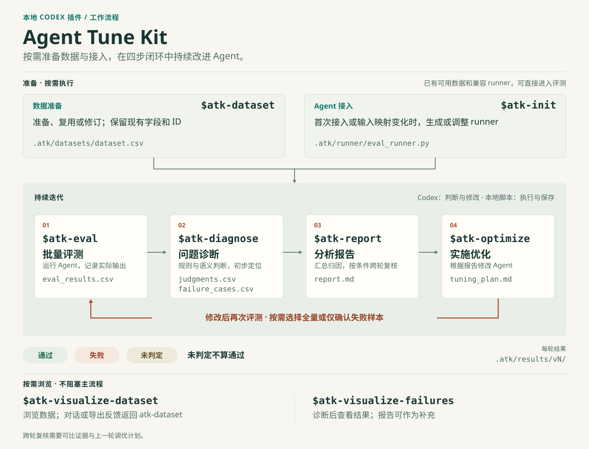

# Agent Tune Kit

简体中文 | [English](README.en.md)

[](https://pypi.org/project/agent-tune-kit/)

Agent Tune Kit 是一个**本地 Codex 插件**，支持批量评测已有 Agent，也支持围绕单个会话的执行轨迹发现问题、调查原因、修改并验证 prompt、代码、参数或工具配置。

有评测数据时，使用批量评测流程比较多轮结果；有问题会话时，通过 Session ID 进入轨迹调优，按 issue 保存诊断、修改和验证。两条流程统一安装，分别保存证据与结果。

## 开始前准备什么

- 一个 Codex 可以读取和修改的本地 Agent 项目，例如聊天机器人、工具调用 Agent 或 RAG Agent。
- 批量评测需要评测数据，推荐 CSV，5 到 20 条样例就能开始；没有现成数据也可以先提供业务示例。
- 轨迹调优需要明确的 Session ID、来源，以及可读取的支持格式轨迹或 Langfuse v4 只读配置；无需先准备数据集或 runner。
- 判断结果好坏的依据，例如期望答案、标签或可验收的行为标准。

## 安装与启用

在终端安装 ATK 和配套 Skills：

```sh
uv tool install agent-tune-kit
atk install
```

在 Codex 中输入 `/plugins`，选择并启用 `Agent Tune Kit`，然后重启 Codex 并新建会话。

<details>
<summary>其他安装方式：pipx 或本地源码</summary>

使用 pipx：

```sh
pipx install agent-tune-kit
atk install
```

使用本地源码：更新所需分支的代码后，在 **ATK 仓库根目录**运行以下命令；后续更新源码时重新执行即可，同版本改动也会重新安装。

```sh
uv tool install --reinstall .
atk install
```

</details>

重装前请先结束正在运行的 ATK 任务，安装后新建会话以加载更新。安装有问题时可运行 `atk status` 检查，并参考[安装与缓存说明](docs/skill-template-pack-usage.md#local-plugin-install-and-smoke)；检查通过不代表插件已在当前会话启用。

## 从问题会话开始轨迹调优

在 Codex 中打开自己的 Agent 项目，再发送下面的 Skill 指令。先确定原始 Session ID 和来源，Trace ID 用于在会话内定位证据。

可用 `atk trace --help` 检查当前 CLI 是否支持轨迹调优。如果命令不可用，按上面的本地源码方式安装支持轨迹调优的版本，再新建 Codex 会话。

### 1. 准备会话轨迹

- **Langfuse v4**：首次接入可用 `$atk-trace-init` 记录项目和来源配置。配置只引用凭据的环境变量名。然后发送 `$atk-trace-capture 下载 <session-id> 的会话，时间范围是 <开始时间> 到 <结束时间>`。
- **本地文件**：发送 `$atk-trace-capture 从 <文件路径> 导入 <session-id> 的轨迹，来源是 <来源>`。也可以在下一步直接提供可验证会话归属的文件，由分析流程导入。已归档的会话可直接分析。

采集只下载或导入。保存前确认哪些正文可以留存、哪些字段需要脱敏。`.atk/traces/` 会加入项目的 `.gitignore`。具体配置和支持格式见[轨迹调优指南](docs/trace-tuning.md)。

### 2. 分析并查看证据

```text
$atk-trace-detect 分析 <session-id> 的任务结果是否正确，列出问题、证据和未检查的范围。
$atk-visualize-trace 打开 <session-id> 的执行泳道，从问题跳到相关轨迹片段和证据字段。
```

分析默认交付带证据的问题清单和检查范围。预览保存在 `.atk/traces/<session_id>/preview.html`，有轨迹即可生成，包括尚未分析或未发现问题的会话。HTML 可能包含留存的正文，分享前请核对内容。

### 3. 按问题调查、修复和验证（按需）

```text
$atk-trace-diagnose 调查 <session-id> 的 ISSUE-001，给出修复和验证方案。
$atk-trace-optimize 实施 <session-id> 的 ISSUE-001 已选定的方案。
$atk-trace-verify 验证 <session-id> 的 ISSUE-001 对应候选，并检查相关正常行为。
```

已有明确问题和会话证据时，可以从调查开始。每次验证按问题保存结论，无法确认实际加载的候选或关键验证条件时，效果记为 `inconclusive`（无法判断）。

## 完成第一轮批量评测与调优

**在 Codex 中打开你自己的 Agent 项目**，再发送下面的 Skill 指令。安装命令在终端运行，`$atk-…` 指令在 Codex 对话中使用。

### 1. 准备数据（按需）

已有合适的数据可以直接进入下一步。需要整理数据或补充评测标准时：

```text
$atk-dataset 使用 data/eval.csv 准备评测数据，保留原字段和已有答案，只补充缺失且有依据的判断标准。
```

也可以提供业务示例，或直接提出修订，例如“修改 atk_id 为 7 的预期结果”。无需固定列名，也无需先导出反馈文件。缺少可信依据的答案会保留为空缺，不会编造。

需要人工浏览和复核时，可使用 `$atk-visualize-dataset` 生成本地数据浏览页，再把反馈交给 `$atk-dataset`。准备数据不会运行 Agent。

### 2. 接入 Agent

告诉 Codex 你的 Agent 入口和评测数据位置：

```text
$atk-init 我的 Agent 入口是 scripts/agent.py，评测数据是 data/eval.csv
```

Codex 会读取项目、准备接入文件并整理可运行的数据集。已经完成接入且仍兼容时，可直接开始评测。

评测会追加 `agent_output`、`output_status`、`error_type`、`error_message`、`log_path` 五个保留输出列。共享引擎的 V1/V2 接入及 `atk eval --check` 都会在调用 Agent、创建结果版本前检查重名，报错会列出数据集路径和冲突列。例如，业务中的 `output_status` 可在确认后改为 `review_status`，并同步适配器和判定规则的字段引用。ATK 不会自动改名或覆盖原值；数据准备阶段仍可原样保留这些业务字段。旧的自管 runner 需单独核对或迁移到共享引擎。

### 3. 评测、诊断并查看报告

依次发送：

```text
$atk-eval
$atk-diagnose
$atk-report
```

| 指令 | 你会得到什么 |
| --- | --- |
| `$atk-eval` | 每条样本的 Agent 实际输出和执行记录 |
| `$atk-diagnose` | 通过、失败、未判定的结果及理由，以及失败原因的初步定位 |
| `$atk-report` | 本轮主要问题、原因分析和调优建议 |

需要逐条搜索、筛选和复核失败样本时，使用 `$atk-visualize-failures` 生成本地离线浏览页。

V2 执行时默认显示开始和完成进度，分别统计执行项与评分样本，避免把一个多样本病例算成一条。进度写到 stderr，`--json` 的 stdout 保持完整 JSON；可用 `--no-progress` 关闭进度，`--check` 不输出执行进度。

**未判定不算通过。** 缺少答案、判断依据或有效判定记录时，不能据此认为 Agent 表现正确。

### 4. 根据结果调优

```text
$atk-optimize
```

Codex 会根据报告和失败样本修改 Agent 的 prompt、代码、参数或工具配置，并记录改动原因和下一轮需要验证的问题。建议在调优前用 Git 保存当前代码，方便比较和恢复。

### 批量评测流程



## 查看批量评测结果与验证改善

每轮结果保存在 Agent 项目的 `.atk/results/vN/` 下。优先查看 `report.md` 了解主要问题，用 `failure_cases.html` 复核具体失败，用 `tuning_plan.md` 查看调优改动及其原因。

调优后，可以先重跑上一轮已确认的失败样本：

```text
$atk-eval --only-failures
$atk-diagnose
$atk-report
```

已有非空结果目录不会被下一轮评测覆盖。从第二轮开始，如果上一轮有调优记录且实验条件可比，报告会说明目标问题已解决、部分解决、未解决，还是无法判断。

**只重跑失败样本不能代表全量通过率。** 需要确认改动是否影响其他样本时，再运行 `$atk-eval` 并继续诊断、报告，完成全量回归。修改数据或评测标准本身，也不能证明 Agent 改善。

超时等技术失败与业务判定分开统计：运行摘要和 `atk results inspect` 提供 `technical_failures` 与 `technical_failure_ids`。它们只统计适配器已上报的 `output_status=error`；业务输出内部的失败需要 V2 mapper 显式映射，默认不会猜测字段含义。技术失败不会自动写成业务 failed，也不会自动进入 `--only-failures`。

要补测 unknown 或指定样本，可用 `$atk-eval --ids 7 9`。共享 V1/V2 按 canonical 数据集顺序筛选 ID，再应用 offset/limit；分组适配器仍保留完整病例上下文。未知 ID 会停止，`--ids` 与 `--only-failures` 不能同时使用；局部补测不代表完整回归。

## 完整输出结构

批量评测按轮次保存到 `.atk/results/vN/`，轨迹调优按会话保存到 `.atk/traces/<session_id>/`。以下是两条流程的主要产物，随所用步骤和配置生成。

```text
.atk/
├── context.md                 # 可选：已确认的调优目标、标准和人工反馈
├── datasets/
│   ├── dataset.csv            # 整理后的评测数据，包含样本标识 atk_id
│   ├── dataset.html           # 可选：数据集浏览页
│   └── dataset_review.csv     # 可选：人工导出并放回此处的复核反馈
├── runner/
│   ├── eval_runner.py         # Agent 接入文件
│   └── failure_rule.py        # 按需生成：项目判定规则
├── results/
│   └── vN/                    # 每轮一个目录，如 v1、v2
│       ├── eval_results.csv   # 样本输出与执行状态
│       ├── judgments.csv      # 逐条判定及理由
│       ├── judgment-history/  # 重判时保留的旧判定
│       ├── failure_cases.csv  # 已确认失败的样本
│       ├── failure_cases.html # 可选的失败样本浏览页
│       ├── report.md          # 本轮分析与跨轮验证
│       ├── tuning_plan.md     # 调优改动及验证目标
│       ├── run.json           # V2 执行状态与证据索引
│       ├── run-events.jsonl   # 按需保存的运行级事件
│       └── executions/        # V2 逐次执行的输入、输出、上下文和日志
└── traces/
    ├── config.json            # 来源配置与留存规则
    ├── project.md             # 轨迹调优所需的项目背景
    └── <session_id>/
        ├── session.json       # 会话来源、采集范围与检测覆盖记录
        ├── raw/<trace_id>.json # 按 Trace ID 保存的轨迹
        ├── preview.html       # 可选的会话泳道与问题浏览页
        └── issues/<issue-id>/
            ├── issue.json     # 问题描述、状态与证据引用
            ├── diagnoses/<diagnosis-id>.md # 原因分析与修复、验证方案
            └── changes/<change-id>/
                ├── change.json # 实际改动与候选版本
                └── verifications/<verification-id>/result.json
```

- 排查批量评测时，从 `eval_results.csv` 的 `log_path` 找到样本日志。V2 日志位于 `executions/<execution-id>/app.log`，V1 可能保存在轮次的 `logs/` 或 `app.log`。中断时可能只有部分文件。仅导入证据的轮次可能没有 `eval_results.csv`，评分需要另有样本输出。单次执行的文件说明见[执行证据文档](docs/execution-evidence-and-tracing-plan.md)。
- 复核会话时，从 `preview.html` 查看泳道，或从 `issues/<issue-id>/` 查看诊断、改动和各次验证。验证的执行状态、按问题得出的结论及证据引用保存在 `result.json`。归档细节见[轨迹调优指南](docs/trace-tuning.md#archive-layout-and-separation)。

产品方向讨论：[ATO 与 ATK 的项目边界选型建议](docs/ato-atk-project-boundary-recommendation-2026-11-05.md)（建议稿）。
