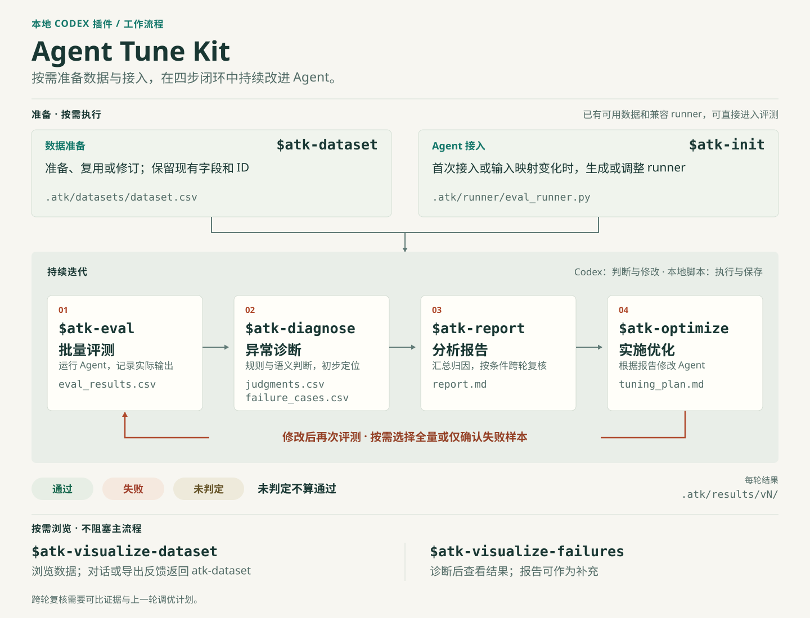

# Agent Tune Kit

简体中文 | [English](README.en.md)

[](https://pypi.org/project/agent-tune-kit/)

Agent Tune Kit 是一个**本地 Codex 插件**，帮助你评测已有 Agent、找出失败原因，并根据结果调优 prompt、代码、参数或工具配置。

你可以用它整理评测数据、批量测试 Agent、查看失败样本和分析报告，再通过下一轮评测验证改动是否有效。每轮结果和调优记录都会保留，便于回看与比较。

## 开始前准备什么

- 一个 Codex 可以读取和修改的本地 Agent 项目，例如聊天机器人、工具调用 Agent 或 RAG Agent。
- 一份评测数据，推荐 CSV，5 到 20 条样例就能开始；没有现成数据也可以先提供业务示例。
- 判断结果好坏的依据，例如期望答案、标签或可验收的行为标准。

## 安装与启用

在终端安装 ATK 和配套 Skills：

```sh
uv tool install agent-tune-kit
atk install
```

在 Codex 中输入 `/plugins`，选择并启用 `Agent Tune Kit`，然后重启 Codex 并新建会话。

<details>
<summary>其他安装方式：pipx 或本地源码</summary>

使用 pipx：

```sh
pipx install agent-tune-kit
atk install
```

使用本地源码：更新所需分支的代码后，在 **ATK 仓库根目录**运行以下命令；后续更新源码时重新执行即可，同版本改动也会重新安装。

```sh
uv tool install --reinstall .
atk install
```

</details>

重装前请先结束正在运行的 ATK 任务，安装后新建会话以加载更新。安装有问题时可运行 `atk status` 检查，并参考[安装与缓存说明](docs/skill-template-pack-usage.md#local-plugin-install-and-smoke)；检查通过不代表插件已在当前会话启用。

## 完成第一轮评测与调优

**在 Codex 中打开你自己的 Agent 项目**，再发送下面的 Skill 指令。安装命令在终端运行，`$atk-…` 指令在 Codex 对话中使用。

### 1. 准备数据（按需）

已有合适的数据可以直接进入下一步。需要整理数据或补充评测标准时：

```text
$atk-dataset 使用 data/eval.csv 准备评测数据，保留原字段和已有答案，只补充缺失且有依据的判断标准。
```

也可以提供业务示例，或直接提出修订，例如“修改 atk_id 为 7 的预期结果”。无需固定列名，也无需先导出反馈文件。缺少可信依据的答案会保留为空缺，不会编造。

需要人工浏览和复核时，可使用 `$atk-visualize-dataset` 生成本地数据浏览页，再把反馈交给 `$atk-dataset`。准备数据不会运行 Agent。

### 2. 接入 Agent

告诉 Codex 你的 Agent 入口和评测数据位置：

```text
$atk-init 我的 Agent 入口是 scripts/agent.py，评测数据是 data/eval.csv
```

Codex 会读取项目、准备接入文件并整理可运行的数据集。已经完成接入且仍兼容时，可直接开始评测。

评测会追加 `agent_output`、`output_status`、`error_type`、`error_message`、`log_path` 五个保留输出列。共享引擎的 V1/V2 接入及 `atk eval --check` 都会在调用 Agent、创建结果版本前检查重名，报错会列出数据集路径和冲突列。例如，业务中的 `output_status` 可在确认后改为 `review_status`，并同步适配器和判定规则的字段引用。ATK 不会自动改名或覆盖原值；数据准备阶段仍可原样保留这些业务字段。旧的自管 runner 需单独核对或迁移到共享引擎。

### 3. 评测、诊断并查看报告

依次发送：

```text
$atk-eval
$atk-diagnose
$atk-report
```

| 指令 | 你会得到什么 |
| --- | --- |
| `$atk-eval` | 每条样本的 Agent 实际输出和执行记录 |
| `$atk-diagnose` | 通过、失败、未判定的结果及理由，以及失败原因的初步定位 |
| `$atk-report` | 本轮主要问题、原因分析和调优建议 |

需要逐条搜索、筛选和复核失败样本时，使用 `$atk-visualize-failures` 生成本地离线浏览页。

**未判定不算通过。** 缺少答案、判断依据或有效判定记录时，不能据此认为 Agent 表现正确。

### 4. 根据结果调优

```text
$atk-optimize
```

Codex 会根据报告和失败样本修改 Agent 的 prompt、代码、参数或工具配置，并记录改动原因和下一轮需要验证的问题。建议在调优前用 Git 保存当前代码，方便比较和恢复。

### 使用流程



## 查看结果与验证改善

每轮结果保存在 Agent 项目的 `.atk/results/vN/` 下。优先查看 `report.md` 了解主要问题，用 `failure_cases.html` 复核具体失败，用 `tuning_plan.md` 查看调优改动及其原因。

调优后，可以先重跑上一轮已确认的失败样本：

```text
$atk-eval --only-failures
$atk-diagnose
$atk-report
```

已有非空结果目录不会被下一轮评测覆盖。从第二轮开始，如果上一轮有调优记录且实验条件可比，报告会说明目标问题已解决、部分解决、未解决，还是无法判断。

**只重跑失败样本不能代表全量通过率。** 需要确认改动是否影响其他样本时，再运行 `$atk-eval` 并继续诊断、报告，完成全量回归。修改数据或评测标准本身，也不能证明 Agent 改善。

### 完整输出结构

下面列出最新版本评测流程中持续保存的正式产物及可选文件。它们随对应步骤和配置生成，不会在安装后一次性出现。

```text
.atk/
├── context.md                 # 可选：已确认的调优目标、标准和人工反馈
├── datasets/
│   ├── dataset.csv            # 整理后的评测数据，包含样本标识 atk_id
│   ├── dataset.html           # 可选：数据集浏览页
│   └── dataset_review.csv     # 可选：人工导出并放回此处的复核反馈
├── runner/
│   ├── eval_runner.py         # Agent 接入文件
│   └── failure_rule.py        # 按需生成：项目判定规则
└── results/
    ├── v1/
    │   ├── eval_results.csv    # 每条样本的实际输出与执行状态
    │   ├── run.json            # 本轮执行状态与证据索引
    │   ├── run-events.jsonl    # 按需生成：未归属到单次执行的事件
    │   ├── executions/
    │   │   └── <execution-id>/ # 一次执行；可能关联多条样本
    │   │       ├── execution.json
    │   │       ├── input.json
    │   │       ├── output.json
    │   │       ├── context/
    │   │       │   ├── samples.json
    │   │       │   ├── environment.json
    │   │       │   └── snapshot-<N>
    │   │       ├── events.jsonl
    │   │       ├── app.log
    │   │       └── artifacts/  # 按需生成：额外保存的产物
    │   ├── judgments.csv       # 每条样本的判定及理由
    │   ├── judgment-history/   # 重判时保留的历史判定
    │   │   └── <hash>.csv
    │   ├── failure_cases.csv   # 已确认失败的样本
    │   ├── failure_cases.html  # 可选：失败样本浏览页
    │   ├── report.md           # 本轮分析与跨轮验证
    │   └── tuning_plan.md      # 本轮调优改动及验证目标
    └── v2/
        └── ...                # 后续轮次沿用相应结构
```

| 文件或目录 | 什么时候看、用来做什么 |
| --- | --- |
| `datasets/dataset.csv`、`dataset.html` | 检查测试输入和期望结果；浏览页按需生成，导出的复核 CSV 也可以从下载目录导入 |
| `context.md` | 可选保存已经确认的目标、行为标准和反馈，供后续调优复用；不需要手工维护运行统计 |
| `runner/` | 接入或调整 Agent 调用方式时使用，日常评测由 Skills 调用 |
| `eval_results.csv` | 查看样本原始字段、实际输出 `agent_output`、执行状态 `output_status` 和日志位置 `log_path` |
| `judgments.csv`、`failure_cases.csv` | 查看逐条判定和确认失败的样本；未判定不进入失败集，重判时旧记录保存在 `judgment-history/` |
| `report.md`、`failure_cases.html`、`tuning_plan.md` | 阅读分析、复核失败、检查改动，再确定下一轮验证目标 |
| `run.json`、`executions/`、`run-events.jsonl` | 需要排查某次运行时查看；保存状态、输入输出、上下文、事件和额外产物 |

执行目录中的 `context/` 保存相关样本、运行环境和接入文件等快照；`app.log` 是已采集日志的浏览视图，可能为空。模型和工具调用的详细轨迹取决于项目是否接入采集，并非所有调用都会自动记录。

执行失败或中断时，可能只有部分文件；有目录不等于运行完成。仅导入证据的轮次可能没有 `eval_results.csv`，也不能直接用于评分。执行证据可能包含项目数据，接入时应确认需要保留或脱敏的内容。
