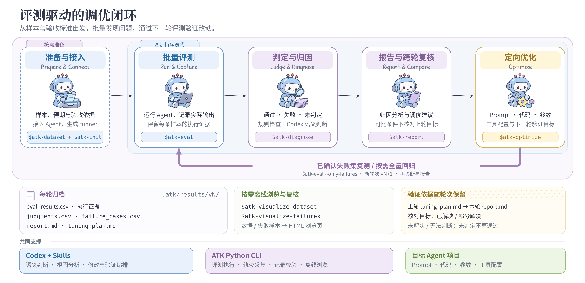
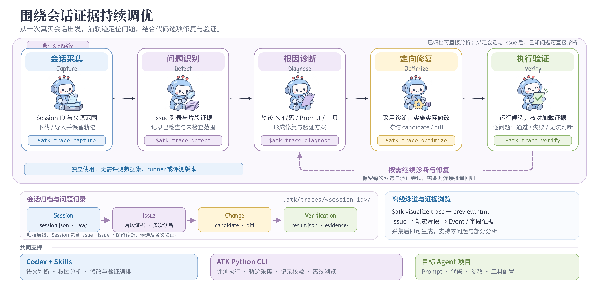

# Agent Tune Kit

简体中文 | [English](README.en.md)

[](https://pypi.org/project/agent-tune-kit/)

Agent Tune Kit 是一个**本地 Codex 插件**，用于调优 Agent 的提示词、代码、参数或工具配置。两条路线共用安装，安装后可按手头的材料独立使用。

- [评测调优](#评测调优)从一组样本和评测标准出发，批量运行 Agent，比较多轮结果并做回归验证。
- [轨迹持续调优](#轨迹持续调优)从一个已有会话出发，沿执行轨迹定位问题，逐项修复和验证。

## 安装与启用

在终端运行以下命令安装 ATK 和配套 Skills。

```sh
uv tool install agent-tune-kit
atk install
```

在 Codex 中输入 `/plugins`，选择并启用 `Agent Tune Kit`，然后重启 Codex 并新建会话。

<details>
<summary>使用 pipx 或本地源码安装</summary>

用 pipx 安装。

```sh
pipx install agent-tune-kit
atk install
```

从本地源码安装时，先更新所需分支，再在 **ATK 仓库根目录**运行以下命令。更新源码后可重新执行，包括版本号未变的情况。

```sh
uv tool install --reinstall .
atk install
```

</details>

重装前先结束正在运行的 ATK 任务。`atk install` 会直接更新并校验 Codex 的 ATK 缓存，完成后无需等待缓存重建。已读入对话的旧指令仍需新建会话加载；技能列表未刷新时重启 Codex。遇到安装问题时，运行 `atk status` 检查安装，并在 Codex 中确认插件已启用。[安装与缓存说明](docs/skill-template-pack-usage.md#local-plugin-install-and-smoke)

## 评测调优



用一组评测样本找出 Agent 的问题，并用后续评测验证改动。准备 Agent 的入口和一组样本，推荐用 CSV，5 到 20 条即可开始。每条样本可附上期望答案、标签或可验收的行为标准。

在 Codex 中打开 Agent 项目，在对话中发送下面的 `$atk-…` 指令。

### 1. 准备数据（按需）

已有合适的数据可直接接入 Agent。需要整理数据或补充评测标准时，可以发送以下指令。

```text
$atk-dataset 使用 data/eval.csv 准备评测数据，保留原字段和已有答案，只补充缺失且有依据的判断标准。
```

也可以从业务示例开始，或直接提出修订，例如“修改 atk_id 为 7 的预期结果”。沿用已有的业务列名。缺少可信依据的答案会留空。

需要人工浏览和复核时，可使用 `$atk-visualize-dataset` 生成本地数据浏览页，再把反馈交给 `$atk-dataset`。

### 2. 接入 Agent

告诉 Codex 你的 Agent 入口和评测数据位置。

```text
$atk-init 我的 Agent 入口是 scripts/agent.py，评测数据是 data/eval.csv
```

Codex 会读取项目、准备接入文件并整理可运行的数据集。已经完成接入且仍兼容时，可直接开始评测。

评测会追加五个保留列，即 `agent_output`、`output_status`、`error_type`、`error_message` 和 `log_path`。如果评测提示列名冲突，确认新的业务列名并同步适配器和判定规则中的引用。[保留列说明](docs/shared-versioning-and-confirmation.md#reserved-evaluation-output-columns)

### 3. 评测、诊断并查看报告

依次发送以下指令。

```text
$atk-eval
$atk-diagnose
$atk-report
```

| 指令 | 你会得到什么 |
| --- | --- |
| `$atk-eval` | 每条样本的 Agent 实际输出和执行记录 |
| `$atk-diagnose` | 通过、失败、未判定的结果及理由，以及失败原因的初步定位 |
| `$atk-report` | 本轮主要问题、原因分析和调优建议 |

需要逐条搜索、筛选和复核失败样本时，使用 `$atk-visualize-failures` 生成本地离线浏览页。

比较通过情况时，也要看判定覆盖范围。依据不足的样本会标为未判定。已记录的超时等技术失败单独统计，可用 `atk results inspect` 查看。

### 4. 根据结果调优

```text
$atk-optimize
```

Codex 会根据报告和失败样本修改 Agent，并记录改动原因和下一轮需要验证的问题。调优前可用 Git 保存当前代码，方便比较和恢复。

### 5. 重跑并验证改动

调优后，可以先重跑上一轮已确认的失败样本。

```text
$atk-eval --only-failures
$atk-diagnose
$atk-report
```

已有非空结果目录不会被下一轮评测覆盖。从第二轮开始，如果上一轮有调优记录且实验条件可比，报告会说明目标问题已解决、部分解决、未解决，还是无法判断。

如需补测未判定、技术失败或其他指定样本，可单独使用 `$atk-eval --ids 7 9`。需要确认改动对整组样本的影响时，运行不带筛选参数的 `$atk-eval`，再诊断和生成报告。

### 查看评测产物

每轮结果保存在 Agent 项目的 `.atk/results/vN/` 下，文件随对应步骤生成。

| 文件 | 用途 |
| --- | --- |
| `eval_results.csv` | 查看实际输出和执行状态，按 `log_path` 查找样本日志 |
| `judgments.csv`、`failure_cases.csv` | 复核逐条判定和已确认的失败。可用 `failure_cases.html` 浏览失败样本 |
| `report.md`、`tuning_plan.md` | 查看本轮问题、改动及验证目标。后续报告会在条件可比时核对这些目标 |

[更多批量评测运行选项和产物](docs/skill-template-pack-usage.md#manual-22--26-loop)

## 轨迹持续调优



从一个已有会话出发，结合实际执行轨迹判断任务是否完成，再按问题保存诊断、修复和验证记录。准备原始 Session ID、来源和可读取的轨迹，直接在 Codex 中打开 Agent 项目开始。无需评测数据集或 runner。

可用 `atk trace --help` 检查当前 CLI 是否支持轨迹调优。如果命令不可用，按上面的本地源码方式安装支持轨迹调优的版本，再新建 Codex 会话。

### 1. 准备会话轨迹

- **Langfuse v4**。首次接入可用 `$atk-trace-init` 记录项目和只读来源配置。配置只引用凭据的环境变量名。然后发送 `$atk-trace-capture 下载 <session-id> 的会话，时间范围是 <开始时间> 到 <结束时间>`。
- **本地文件**。发送 `$atk-trace-capture 从 <文件路径> 导入 <session-id> 的轨迹，来源是 <来源>`。也可在分析时提供可验证会话归属的文件，由分析流程导入。已归档的会话可直接分析。

采集步骤负责下载或导入。保存前确认哪些正文可以留存、哪些字段需要脱敏。`.atk/traces/` 会加入项目的 `.gitignore`。

### 2. 分析并查看证据

```text
$atk-trace-detect 分析 <session-id> 的任务结果是否正确，列出问题、证据和未检查的范围。
$atk-visualize-trace 打开 <session-id> 的执行泳道，从问题跳到相关轨迹片段和证据字段。
```

分析保留影响严重、反复出现、与你明确关注点相关，或有具体实现改进线索的问题，并说明保留理由、证据和检查范围。实现线索包括代码、配置、工具契约、Prompt 和 Skill；根因尚未确定也可进入后续诊断。轻微且无上述保留理由的观察不单独记录，没有保留问题不代表会话完全正确。

采集、分析、诊断、修复和验证 Skill 在阶段结束后默认生成或更新 `.atk/traces/<session_id>/preview.html`，不自动打开浏览器。需要打开时使用 `$atk-visualize-trace`；已打开的页面在文件更新后需刷新。初始化没有会话轨迹，不生成空页面。

这些阶段同时刷新项目大盘 `.atk/traces/index.html`，按会话或异常分类查看全部会话的问题和实际进度，并可跳回各会话页。需要打开时发送 `$atk-visualize-trace 打开轨迹大盘`。早于分类功能的问题显示为“未分类”，对应会话重新分析时补上。

可用 Trace ID 定位会话内的证据，在问题详情中查看保留理由。分享 HTML 前请核对其中留存的正文。

### 3. 按问题调查、修复和验证（按需）

```text
$atk-trace-diagnose 调查 <session-id> 的 ISSUE-001，给出修复和验证方案。
$atk-trace-optimize 实施 <session-id> 的 ISSUE-001 已选定的方案。
$atk-trace-verify 验证 <session-id> 的 ISSUE-001 对应候选，并检查相关正常行为。
```

已有明确问题和会话证据时，可以从调查开始。每次验证按问题保存结论。证据不足以确认实际加载的候选或关键验证条件时，效果记为 `inconclusive`（无法判断）。后续发现新的问题，可继续按问题处理，或用新会话的轨迹开始下一次分析。

### 查看轨迹产物

会话归档保存在 Agent 项目的 `.atk/traces/<session_id>/` 下，文件随对应步骤生成。项目大盘 `index.html` 和分类表 `categories.json` 位于 `.atk/traces/` 根目录。

| 文件或目录 | 用途 |
| --- | --- |
| `session.json`、`raw/` | 查看来源、采集范围、分析覆盖和保留的轨迹 |
| `preview.html` | 离线浏览：左侧问题栏、上方泳道、下方 Event；按 Issue 片段定位证据 |
| `issues/<issue-id>/` | 查看问题证据、诊断和改动。各次验证的 `result.json` 记录验证状态、结论和证据引用 |

[轨迹调优指南，包含来源配置、支持格式和归档结构](docs/trace-tuning.md)
