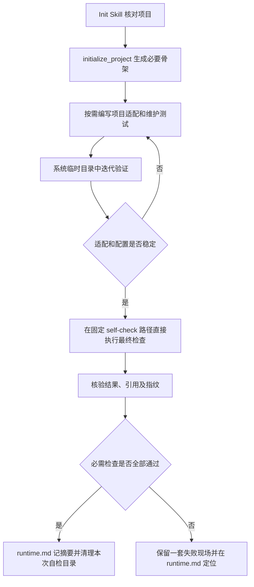

# ATK Init 产物精简实施方案

| 元信息 | 内容 |
| --- | --- |
| 状态 | 待用户确认；尚未开始实现 |
| 方案整理 | Codex；仓库所有者 yichi |
| 创建 / 核对日期 | 2026-10-18，Asia/Shanghai |
| 适用范围 | ATK 初始化实现、操作级文件锁移除、Skill、测试与使用文档 |
| 范围确认 | 用户明确要求“仅修改 ATK”，手术项目现有 `.atk` 由用户自行整理 |

## 1. 摘要

把新接入的常驻产物限制为运行配置、运行说明、runner、实际使用的日志辅助模块，以及必要的项目适配和维护测试。迭代自检使用会自动清理的临时目录；最终检查通过后清理全部自检现场，失败或中断时保留一套诊断现场。`runtime.md` 是面向人的唯一说明和验收摘要入口，不再默认长期保存初始化请求、回执及多份摘要。

成功清理、失败保留来自用户 2026-10-18 对方案的进一步建议；同日用户进一步明确按单人本地使用范围去除 `.operation.lock` 依赖。本方案据此取消操作级文件锁，不增加替代锁或开关；整体仍待用户确认。

实现复用现有 `initialize_project`、runner 和 pytest，不增加清理命令、证据协议或依赖。现有项目和正式封存证据不自动迁移。用户确认本方案后才开始修改实现、Skill 和测试。

本仓库没有 `research/` 或 `specs/`；按工作空间沿用既有结构的规则，将方案放在已有 `docs/`，不新增顶层目录。

## 2. 现状与问题

本次依据代码和实际产物核对，未重跑模型或测试，历史验收日期不变。

| 现状 | 证据与影响 |
| --- | --- |
| 初始化器无条件复制 `logging_json.py`；声明任意观测配置时还复制 `logging_capture.py` | [初始化实现](../src/agent_tune_kit/execution.py)；native 接入留下未使用的 JSON helper，无观测配置的接入也留下 helper |
| `initialization/` 和 `self-check/run-*` 并非初始化器固定产物 | 由会话组织接入和测试时保存；只改初始化器不足以解决数量问题 |
| 共享契约已经要求操作核对后清理临时请求、响应 | [共享契约](../skills/WORKFLOW.md)；Init 缺少明确的文件清单、最终证据位置和收尾顺序 |
| 手术示例有 110 个普通文件，其中三轮 pytest 现场共 96 个 | 仅作为本次需求的现状样本；本方案不修改该项目 |
| Record、配置和原生业务结果包含绝对路径及指纹 | [runner](../templates/runner.py)；搬迁目录或删掉被引用文件会留下失效证据 |
| 现有接口支持纯分析和后续 runtime 升级 | [生命周期测试](../tests/test_vnext_lifecycle.py)；精简不能使这些分支丢失原有数据 |
| `locked()` 在执行、检查点和治理模块中有 17 处调用 | 用户明确要求移除该依赖；需要连同公共实现、调用、测试和当前说明一起调整 |

相关既有方案：[Python 日志与证据方案](python-execution-evidence-plan.md)、[历史验收记录](python-execution-evidence-validation.md)。这些文档中的历史模型对比不作为本次实现完成的证据。

## 3. 目标与范围

### 完成定义

- 新 runtime 接入只生成所选模式实际需要的日志 helper，生成与执行前指纹校验的选择一致。
- Init 的迭代临时现场不累积在目标 `.atk`；必需检查全部通过后，不保留 `self-check/`，失败或中断时只保留一套有用现场。
- `runtime.md` 能直接回答当前接入状态、运行方法、已验证范围、限制和下一步；成功说明原始现场已清理，失败才链接实际保留的诊断材料。
- 初始化请求、响应、输入结构报告和重复验证摘要不再默认成为长期交付文件。
- 清理前核验最终结果及指纹；保留现场的路径可访问、内容指纹一致。未执行、失败和中断明确保留对应状态。
- 无观测、native、旧格式、纯分析及 runtime 升级分支通过对应回归；源码和分发安装路径一致。
- ATK 操作不再创建、读取或要求 `.operation.lock`，不依赖操作级文件锁；原子写入、内容校验、状态与 Git 基线检查继续有效。

### 边界

本次只修改 ATK 仓库。手术项目现有 `.atk`、业务代码、README 和其他状态文件均不在实施范围内。现有 ATK 项目不会因运行新版而自动删文件；正式 Dataset、EvidenceBatch、Assessment、Round 及恢复日志继续保留。

按单人、本地、同一项目顺序发起管理操作的使用方式设计，不再提供不同管理操作之间的跨进程互斥保证。同一批次 attempt 的既有并发和 runner 内部同步保持原有行为。

不新增通用垃圾回收器、Init 收尾 API、保留策略配置、自动迁移器或报告文件类型。不修改业务日志采集内容、runner 请求/响应协议、现有 CLI 参数和 `schema_version`；不安装、发布或推送新版本，也不更新父仓 gitlink。

## 4. 总体设计



分工沿用现状：Python 实现负责确定性的文件生成与指纹；Skill 负责调查、适配、验证安排和本次临时材料收尾。清理前读取 runner 原始输出完成核验；失败时保留原输出，不创造第二份证据正文。

## 5. 具体改动

### 5.1 初始化实现

修改 [execution.py](../src/agent_tune_kit/execution.py) 的 `initialize_project`，沿用现有资源定位和复制方式：

| 接入配置 | 新生成的日志 helper |
| --- | --- |
| 无 `observability` 或空对象 | 无 |
| `observability.format=native` | 仅 `logging_capture.py` |
| 旧 `atk_json`、`loguru_json`、`text` | 仅 `logging_json.py`，维持现有兼容与指纹约定 |
| 纯 `analysis_only=true`，未配置 runtime | 沿用仅生成 `project.json` 的行为 |

保留两种 helper 的源码和分发资源，只精简目标项目的复制结果。`run_evaluation` 已按相同模式选择校验对象，原则上复用现有逻辑；若实现时发现不一致，连同调用点修正，保留漂移阻断。

现有项目不自动删除多余 helper。`configure_runtime` 保留已有 Round、证据、脱敏键和升级检查，不扩大为清理入口。

### 5.2 Init Skill 的产物契约

修改 [atk-init/SKILL.md](../skills/atk-init/SKILL.md)，明确以下规则，并在 [WORKFLOW.md](../skills/WORKFLOW.md) 中只补充必要的一致性说明：

1. **初始化请求与响应放系统临时目录。** 首次调用前不在目标工程预建 `.atk/initialization/`，避免与既有目录冲突检查抵触；读取并核对响应后清理。
2. **适配代码按需编写，维护测试可以保留。** 不把某个项目的 adapter 文件名、输入格式或测试框架当成所有项目的固定模板。
3. **迭代测试使用自动清理的临时目录。** pytest 的 `--basetemp`、网络 guard、非法输入、合成索引和调试请求不默认持久化；失败时先调查，不创建不断增长的 `run-N` 目录。
4. **最终配置稳定后，在 `.atk/self-check/` 直接执行最后一轮接入检查。** 不再嵌套 `final/`。验收输入和请求仍放临时目录，使用现有 runner；不从临时目录搬运带绝对路径的输出。检查失败时可直接保留现场，引用路径不变化。
5. **只读核对最终输出后收尾。** 同时核对执行状态、必需日志/阶段、加载组件、文件引用与指纹；只有摘要或退出码不能替代这些检查。
6. **全部必需检查通过后，先把摘要写入 `runtime.md`，再清理本次自检目录。** 摘要包含实际运行命令、检查范围、结果、版本/指纹和“原始现场已清理”，不链接即将删除的文件。清理后核对目录和引用；清理失败时如实说明残留，不称已清理。
7. **失败或中断时保留一套有用现场。** 说明失败检查、退出码/中断状态和材料位置；没有执行任何检查时不强制创建空目录，仅记录未执行原因。不把 unknown 或部分通过视为全部通过。
8. **只清理本次生成且未被正式对象引用的临时材料。** 不扫描删除旧项目数据；遇到已有未知内容或正式封存对象时保留并说明冲突。

最终接入检查只运行已获准且隔离已核验的合成/测试输入。没有可核验的隔离时，记录未执行及原因；不能通过直接调用 runner 绕过正式评测的外部副作用门禁。正常、异常、并发和输入边界的检查应覆盖实际声明的能力，但不要求为每个断言永久保存整个测试工作目录。

### 5.3 成功目录与失败现场

以下是 Python native 可执行接入的示意；项目 adapter 和测试仅按需要存在：

```text
.atk/
  project.json
  runtime.md
  adapters/
    runner.py
    logging_capture.py
    <project_adapter>.py
    <existing_adapter_test>.py
```

上图是检查通过并收尾后的目录。维护测试遵循目标项目已有目录规范；允许沿用当前已存在的位置，不要求其他项目把新测试放进 `adapters/`。纯分析接入不强制生成 runtime、runner 或自检目录。

检查失败或中断时，另外保留 `.atk/self-check/` 中的 `checks.log`、`batch.json`、`records.jsonl` 和对应 `attempts/`；在产物尚未生成前失败，则只保留已有且有助于定位的材料，不补造文件。故障修复后须重新核验本次相关检查，全部通过且不再需要该现场时清理；不覆盖未知的旧现场。

- `checks.log` 保存最终验证命令、退出码、测试统计和门禁检查输出；不再次嵌入完整输入、模型输出、日志或审计正文，写入前排除秘密。
- `batch.json`、`records.jsonl` 和 `attempts/` 沿用现有 runner 原始格式；原生日志、加载证据、脱敏有效配置及业务结果仍在该套输出内。
- 一次接入检查可以包含其验证所必需的多个 attempt；不把“一套”限制成只能运行一个正常样例。
- 失败现场内不单独删除结果、日志或审计的引用目标。业务自身产生的必要 checkpoint、工作簿和原生审计随现场整体保留或在成功后整体清理，不修改业务流水线以抑制它们。
- 不默认新增 `verification.json`、`input-shape.json` 或独立保护门禁请求/响应文件。简短结论写入 `runtime.md`；只有后续流程明确需要时，才由对应阶段保存独立资产。
- 保留验证结论对应的最终配置、runner/helper/adapter 身份记录；稳定后又修改它们，需要重新验证，不能继续引用旧通过结论。

### 5.4 人的阅读入口与引用

`runtime.md` 开头采用简短、固定的阅读顺序：接入状态 → 运行入口和输入输出 → 验证摘要及清理状态（失败时加现场链接）→ 限制与下一步 → 必要环境细节。

机器配置以 `project.json` 为准；不在说明中再嵌入完整配置副本。成功清理后不链接已删除的 `effective-config.json`，失败时可链接仍存在的现场文件。运行所必需的约束和隔离依据仍在说明中保留，`external_effects.protection.evidence_ref` 对应章节不得删失。

成功摘要记录这次检查实际观察到的结果，不能宣称原始证据仍可访问或可独立复核；保留的适配代码、维护测试和运行命令用于之后重新验证。正式评测的证据保存策略不随本次自检清理改变。

同步调整使用指南、README 的产物说明及相关示例，删除当前说明中指向不再默认生成的过程文件的要求；历史验收记录保留原日期和原始口径。项目内部的新 Markdown 链接使用相对路径；runner 和原生证据中的绝对路径保持真实，不改写为伪造的相对路径。

### 5.5 移除操作级文件锁

按用户明确要求，整个 ATK 运行流程去除 `.operation.lock` 依赖，不仅调整 Init 目录展示。初始化和后续操作均不创建、读取、校验或依靠该文件；不换位置保存、不增加其他文件锁或可选开关。

| 位置 | 实施内容 |
| --- | --- |
| [core.py](../src/agent_tune_kit/core.py) | 删除 `locked()`、专用可重入状态 `_held_locks`，以及仅服务该实现的 `fcntl`、`threading` 和其他失去用途的导入 |
| [execution.py](../src/agent_tune_kit/execution.py) | 移除 2 处操作级锁调用及导入，保留预算、Case、组件、重放与结果完整性检查 |
| [checkpoints.py](../src/agent_tune_kit/checkpoints.py) | 移除 10 处调用及导入，保留 Git 现场校验、操作恢复日志、状态转换和失败恢复 |
| [governance.py](../src/agent_tune_kit/governance.py) | 移除 5 处调用及导入，保留诊断、知识、验证和决策各自的参数及状态检查 |
| [test_vnext_boundaries.py](../tests/test_vnext_boundaries.py) | 调整依赖“操作重叠必被锁拒绝”的测试，补顺序流程不创建也不依赖锁文件的回归 |
| 当前规则与说明 | 开发时同步 `AGENTS.md` 的模块职责、使用指南和当前实现状态说明；历史验收日期和原始口径保留 |

删除仅为加锁而存在的薄包装；相关内部函数若因去锁而改名，同步更新所有调用，不留下空操作的 `locked()` 兼容壳。检查锁上下文原先附带的目录创建等行为，保留实际写入需要的行为；异常处理和校验不随缩进整理丢失。

这里移除的是项目管理操作之间的文件锁。runner 管理并发 attempt、日志写入等内部同步不属于该文件锁，继续保留。`WORKSPACE_CONFLICT` 仍用于项目已存在、状态不允许等真实冲突，不因去锁而整体删除该错误码。

已有项目即使残留旧 `.operation.lock`，新版也忽略它，不自动清理用户旧文件。测试应覆盖这一兼容行为，不依靠多个同时写操作“恰好成功”来证明并发安全。

## 6. 方案取舍

| 方案 | 取舍 | 结论 |
| --- | --- | --- |
| 条件复制 helper + Skill 明确临时/最终产物生命周期 | 复用现有接口，改动集中；会话是否遵守仍需实际接入检查 | 采用 |
| 增加通用 finalize/cleanup API | 需要所有权、引用重写、失败恢复和旧数据兼容，扩大本次范围 | 本次不引入 |
| 成功检查也永久保留一套原始输出 | 可以事后复核，但继续增加日常阅读负担 | 按用户新建议调整为成功清理、失败保留 |
| 成功留摘要，失败保留原始现场 | 降低常驻文件数；成功后复查需重新运行 | 采用，摘要明确现场已清理 |
| 搬迁失败目录以压缩层级 | 文件内部仍含旧绝对路径与指纹，易造成引用失效 | 不采用；在可原地保留的路径执行 |
| 移除操作级文件锁 | 简化本地顺序工作流，不再生成锁文件；不保证管理操作的并发写入互斥 | 按用户明确要求采用 |

## 7. 风险与兼容性

- **隐性依赖：** 未声明观测配置却自行导入自动复制 helper 的新接入会受影响。使用指南要求显式配置所需采集模式；已有项目文件原样保留，不自动删除。
- **运行证据：** self-check 只证明接入和声明范围，不作为正式 EvidenceBatch、调优 Round 或业务质量提升的证据。无法安全运行时保留 unknown/未执行状态。
- **文件清理：** 仅本次临时文件可自动清理，正式对象及恢复信息继续受原有保护。摘要不得残留指向已清理现场的链接；旧项目残留锁文件不自动清理。
- **操作并发：** 移除文件锁后，同一项目的管理操作按顺序调用；重叠写入不再有跨进程互斥保证。既有原子写入、指纹和基线检查仍保留，但不将它们描述为完整并发保护。
- **失败调查：** 自检失败或中断时保留一套有用现场；正式评测仍保留全部应保留的 attempts，不套用成功清理或挑选最好一次的规则。
- **Skill 生效：** 修改源码 Skill 不证明当前会话已经加载新版。用户验证时需按现有本地安装说明刷新插件并打开新会话，核对实际 Skill 来源；不能只比较同为 `1.1.0` 的版本号。

## 8. 实施与验证

### 阶段一：实现与回归

产物复制改动集中在 `execution.py`、`tests/test_execution_observability.py`，按实际覆盖补充 `tests/test_vnext_lifecycle.py` 和 `tests/test_install_plugin.py`。先增加生成文件清单与 helper 指纹的行为回归，再改复制逻辑。去锁改动覆盖 5.5 列出的公共实现、17 处调用和边界测试。

| 检查 | 通过条件 |
| --- | --- |
| 无观测/native/三种旧格式 | 只生成对应 helper；runner 仍可执行，既有日志采集与漂移阻断有效 |
| 纯分析和 runtime 升级 | 纯分析不产生多余运行文件；升级不丢失已有数据或保护检查 |
| 源码和安装包 | 两种初始化资源路径的文件清单一致；wheel/sdist 继续包含兼容资源 |
| 去除操作锁依赖 | 接入、轮次、评测、诊断和决策的顺序流程不创建锁文件；预置旧锁文件不影响流程；既有内容漂移、Git 基线、原子写入和恢复回归继续有效 |

### 阶段二：Skill、文档与最终接入演练

更新 `skills/atk-init/SKILL.md`、必要的共享契约和 `docs/vnext-usage-guide.md`，README 说明与实现一致。保持七个公开 Skill，不增设入口。

在自动清理的合成本地 Agent 工程中演练新接入，核对成功后无 `initialization/`、`self-check/`、`run-N` 和 pytest 夹具残留；失败或中断时保留一套可定位现场，未执行时不产生空目录。检查摘要、清理失败处理、所有保留的引用和指纹；不创建或修改手术项目数据。

Skill 的自然语言约束需要实际接入演练和人工核对，不以“文件中含某段文字”的断言冒充行为验收。ATK 自身测试产物不复制到用户接入目录；删除原锁拒绝断言后，接入和完整顺序工作流的行为回归继续通过。

### 阶段三：工程门禁与交付

修改 Skill payload 和模板相关生成行为后，按仓库规则运行完整 pytest、Ruff、七 Skill 包校验；构建 wheel/sdist 并在临时位置验证分发初始化行为。执行 `git diff --check` 和改动文档链接检查。

开发完成后回写 ATK 项目中真正变化的实现状态和限制，只提交本次文件，不提交目标工程 `.atk`，不暂存父仓指针。交付中给出新生成清单和实际验收结果；不提前宣称手术项目已验证。

### 用户验证新版的清单

1. 确认使用修改后的 CLI 源码和实际加载的新 Init Skill。
2. 由用户自行整理旧 `.atk`，再按希望的方式重新接入；初始化器保持现有冲突保护，不覆盖旧数据。
3. native 接入不出现 `logging_json.py`，不累积初始化请求/回执、重复摘要和 `run-N` 目录。
4. `runtime.md` 能直接看懂状态与限制，且所有证据入口可访问。
5. 成功后没有 `self-check/`，摘要明确现场已清理；失败时现场引用与指纹可核验。
6. 初始化和后续 ATK 操作不生成 `.operation.lock`，旧文件不影响执行；没有额外真实模型调用或业务收益声明。

## 9. 待确认事项

- 已由用户明确：只修改 ATK；手术项目现有 `.atk` 的整理和新版本实测由用户负责，不属于本次开发。
- 按用户进一步建议修订：条件复制 helper、临时迭代、自检成功清理/失败保留、复用 runtime 摘要入口，不增加新 API。
- 用户已明确要求去除 `.operation.lock` 依赖：删除操作级文件锁及调用，不新增替代机制或开关，保留原子写入、校验和 runner 内部同步。
- 本方案整体待用户确认。确认前只维护方案文档和入口索引，不修改实现、Skill、测试或任何现有接入数据。
