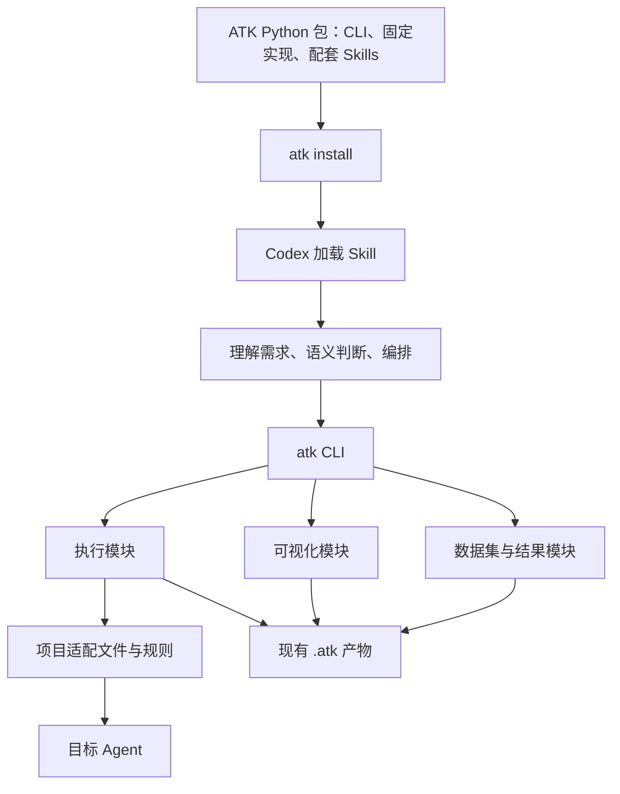

# ATK CLI 与 Skill 模块化实现方案

- 日期：2026-10-25（Asia/Shanghai）
- 状态：已按本方案实现；验证结果见实现交付记录。
- 基线：方案形成时仓库 2.0.0 的 CLI、8 个 Skill、模板、脚本和测试。
- 范围：统一固定能力的代码实现和 CLI 入口，保持现有整体功能及 Skill 职责不变。

本文汇总职责调整、模块组织、CLI 接口、兼容策略和实施验证方案。新增模块、函数和命令均为目标设计，具体可用命令见实现交付记录。现有 `atk install`、`preview`、`status`、`version` 和 `--version` 继续保留。

## 1. 目标与使用方式

ATK 采用 CLI 优先的交付方式：用户先安装 ATK Python 包，再通过 CLI 安装该包携带的配套 Skills。CLI 是 Skill 的运行前提；Skill 执行时发现 CLI 缺失，应引导安装，不临时生成另一套固定脚本绕过 CLI。

首次安装的推荐路径：

```sh
uv tool install agent-tune-kit
atk install
atk status
```

升级路径：

```sh
uv tool upgrade agent-tune-kit
atk install
```

继续支持 `pipx` 等现有持久安装方式。安装后按提示刷新 Codex 插件、确认启用并开启新会话。旧会话不会自动替换已加载的 Skill 指令。

推荐文档应将持久安装作为主路径，调整当前将 `uvx --from agent-tune-kit atk install` 放在首位的说明；无需删除已有一次性调用命令的兼容能力。

核心目标：

1. 固定能力只有一份实现，统一放在 `agent_tune_kit/`。
2. Skill 通过稳定的 CLI 操作调用这些能力，继续负责理解、判断、编排和解释。
3. 项目只保留确实需要定制的 Agent 适配代码、判定规则和现有工作产物。
4. 复用现有实现及测试，减少复制、行为漂移和模型重复生成固定代码。
5. 以既有行为兼容为验收依据，不借重构扩大产品范围。

不在本次范围内：通用工作流引擎、后台服务、自动调优闭环、远程调度、数据库、统一业务 Schema、新的 LLM 调用层、自动回滚或基线恢复。PyPI 构建和发布工具继续保留在维护者使用的 `scripts/`，不为目录统一而纳入用户 CLI。

## 2. 必须保持的行为

### 2.1 用户流程与产物

保留以下 Skill 入口及其职责：

`atk-dataset`、`atk-init`、`atk-eval`、`atk-diagnose`、`atk-report`、`atk-optimize`、`atk-visualize-dataset`、`atk-visualize-failures`。

保留项目内的现有路径与产物：

```text
.atk/
├── context.md                         # 可选，用户确认的持久标准与决策
├── datasets/
│   ├── dataset.csv
│   └── dataset.html                   # 可选
├── runner/
│   ├── eval_runner.py
│   └── failure_rule.py                # 按需
└── results/
    └── vN/
        ├── eval_results.csv
        ├── judgments.csv
        ├── failure_cases.csv
        ├── failure_cases.html         # 可选
        ├── report.md
        ├── tuning_plan.md
        ├── app.log                    # 按日志能力生成
        └── logs/                     # 按行日志能力生成
```

浏览器导出的 `dataset_review.csv`、`failure_cases_review.csv` 保留现有格式和下载方式。不新增必须持久化的 metadata、manifest、候选数据集、诊断注册表或额外准备报告。

### 2.2 数据、执行和判定

| 领域 | 兼容要求 |
| --- | --- |
| 数据集 | 保留原始业务字段、顺序、无关值及有效 `atk_id`；不静默重编号，不强制新增 `ground_truth` |
| 数据修订 | 保留定向更新、反馈范围检查、空更新值跳过、无变化不重写；不改写历史结果 |
| 输入映射 | 答案字段和 ATK 元数据不默认传给 Agent；字段语义由 Skill 确定 |
| 评测 | 保留同步／异步接入、并发、逐行写入与刷新、进度、失败重跑及可选日志 |
| 输出 | 保留源字段、`agent_output`、`log_path` 及已有执行状态／错误证据字段；结构化输出完整序列化，不新增 `agent_output_*` 拆分列 |
| 中断 | 已生成的部分结果保留并如实报告，不自动清理失败轮次 |
| 判定 | 保留 `passed`、`failed`、`unknown`；未知不计为通过或业务失败，不进入失败重跑集合 |
| 判定有效性 | 保留唯一 ID、有效 verdict、非空理由和来源结果 SHA-256 检查；缺失、过期或冲突记录不能证明通过 |
| 诊断 | 规则执行和语义判断仍由同一个 Skill 编排；不要求用户选择模式，不自动重跑 Agent |
| 报告与优化 | 保留报告、调优计划结构和证据要求；缺少历史材料时按原规则降级；不自动修改判定来配合报告 |
| 可视化 | 保留现有交互、质检、反馈导出、安全嵌入、离线资源和无前端安装要求 |
| 人工修改 | 保留覆盖保护，不静默覆盖用户编辑过的 runner、规则、HTML、报告或计划 |

`.atk/context.md` 的职责不变：仅保存用户确认的持久标准、反馈和决策。诊断不写入该文件；优化不修改 Ground Truth Standard，相关修订回到 `atk-dataset`。常规运行统计不写入上下文。

### 2.3 版本规则

统一复用当前规则，不重新定义版本语义：

- 当前版本是数值最大的有效 `vN`；需要的当前文件缺失时，不退回旧版本。
- 只有评测执行可以分配结果版本：无版本时创建 `v1`；当前存在 `eval_results.csv` 时创建下一版本；否则复用当前目录。
- 不要求用户在正常流程中指定版本号。
- `--only-failures` 在新轮次写入前，寻找最新的已有 `failure_cases.csv`，通过其 `atk_id` 回到规范数据集选行。
- 找不到失败文件、失败集合为空、缺少 ID 或 ID 无法映射时，保留原有失败行为，不退化成全量运行。
- `--offset`、`--limit` 在失败集合筛选后应用；保留 `limit >= 0`、`offset >= 0`、`concurrency >= 1` 的约定。
- `atk-init` 的静态检查不创建版本。确需有界真实试跑时，继续跟踪试跑前后状态，只清理可确认由本次 init 试跑独占的临时结果，不删除既有用户数据。

版本分配算法归 `results/versions.py`，调用权归 `execution/runner.py`；代码归属不改变“只有评测执行创建版本”的行为约束。

## 3. 职责分层



| 层次 | 职责 |
| --- | --- |
| Skill | 业务含义、字段角色、语义判定、归因、优化、何时调用操作，以及结果解释 |
| CLI | 参数解析、命令分发、输出呈现和退出码；不实现业务算法 |
| 业务模块 | 固定的数据处理、执行、校验、统计、写入与页面生成 |
| 项目适配文件 | 目标 Agent 的输入构造、调用方式、导入路径和特有配置；项目判定规则 |
| utils | 不理解 ATK 业务的通用文件和格式操作 |

业务模块之间直接调用 Python 接口，不通过子进程调用自己的 CLI。只有需要切换目标项目环境时，才由执行模块管理进程。

## 4. 模块化目录

以下是目标结构，随能力迁移逐步形成，不提前创建空模块或扩展框架。

```text
agent_tune_kit/
├── __init__.py
├── errors.py
├── workspace.py
├── installer.py
├── cli/
│   ├── __init__.py
│   ├── main.py
│   ├── dataset.py
│   ├── evaluation.py
│   ├── results.py
│   ├── visualize.py
│   └── output.py
├── utils/
│   ├── __init__.py
│   ├── files.py
│   └── csv_io.py
├── datasets/
│   ├── __init__.py
│   ├── prepare.py
│   ├── updates.py
│   └── validation.py
├── results/
│   ├── __init__.py
│   ├── versions.py
│   ├── judgments.py
│   └── summary.py
├── execution/
│   ├── __init__.py
│   ├── runtime.py
│   ├── runner.py
│   ├── logs.py
│   └── rules.py
└── visualize/
    ├── __init__.py
    ├── dataset.py
    ├── failures.py
    ├── history.py
    ├── fields.py
    ├── render.py
    └── assets/
        ├── dataset/
        │   ├── page.html
        │   ├── styles.css
        │   ├── app.js
        │   └── vendor/echarts.min.js
        └── failures/
            ├── page.html
            ├── styles.css
            └── app.js
```

### 4.1 公共基础模块

- `errors.py`：公开的用户输入／操作失败异常。CLI 负责转换成提示和退出码，通用 I/O 可以保留标准异常。
- `workspace.py`：项目工作位置和 `.atk` 固定路径。正常路径仍相对于目标项目 cwd，不自动向上猜测项目根目录。
- `installer.py`：保留安装、manifest 校验、marketplace 注册、缓存维护和安装状态检查。暂不为目录对称拆分。
- `utils/files.py`：原子写入、有字节限制的读取、必要的临时文件清理。
- `utils/csv_io.py`：只提取语义一致的 CSV 结构读取与写入，保留字段顺序；不处理 ID、答案语义或判定规则。

不增加兜底式 `utils/common.py`。单个业务包内部共享的能力留在该包内；几行标准库调用不为了“统一”单独增加包装层。

### 4.2 数据集与结果模块

| 文件 | 职责 |
| --- | --- |
| `datasets/prepare.py` | 创建、复用、显式替换或追加规范数据集 |
| `datasets/updates.py` | 读取反馈、构造修订上下文、应用指定字段更新，保留现有反馈发现能力 |
| `datasets/validation.py` | 数据集身份、更新范围和可执行数据约束 |
| `results/versions.py` | 版本枚举、当前／上一版本、必要文件检查和版本分配 |
| `results/judgments.py` | 严格校验新判定，容错读取旧判定，一致更新判定表和失败表 |
| `results/summary.py` | 文件状态、覆盖统计、样本关联、明确目标 ID 的跨轮计算 |

`results` 不负责启动项目解释器。规则代码的执行归 `execution/rules.py`，执行结果的校验和保存归 `results/judgments.py`。

### 4.3 执行模块

| 文件 | 职责 |
| --- | --- |
| `execution/runtime.py` | 项目解释器选择、ATK 执行代码定位、子进程启动、输出／退出状态传播 |
| `execution/runner.py` | 同步／异步运行、并发控制、失败集合筛选、版本分配、单写入路径和增量结果 |
| `execution/logs.py` | 全局日志、行上下文、并发行日志隔离和降级提示 |
| `execution/rules.py` | 加载项目规则、执行 `judge(row)`，调用统一判定保存接口 |

保留 Python logging 优先、stdout/stderr 或已有日志文件回退的策略。行日志只表示可信的活动行上下文中的同进程 Python 日志，不扩大到子进程、多进程或行结束后的后台日志。

### 4.4 可视化模块

对外只暴露 `generate_dataset()` 和 `generate_failures()` 两个完整操作。

| 文件 | 职责 |
| --- | --- |
| `visualize/dataset.py` | 数据集页面数据准备、质量检查和生成流程 |
| `visualize/failures.py` | 失败页面数据准备、判定状态展示、安全日志链接和生成流程 |
| `visualize/history.py` | 页面需要的历史聚合、报告摘录和调优计划上下文；保留有界、可降级的读取 |
| `visualize/fields.py` | 字段匹配算法及确实一致的字段处理；候选字段和优先级由各页面提供 |
| `visualize/render.py` | 包资源读取、HTML 模板处理、安全 JSON 嵌入和页面输出辅助 |

需要明确保留的差异：

- 数据集页面目前优先识别 `ground_truth`，失败页面目前优先识别 `expected`。共享算法不能改变候选顺序。
- 浏览页面允许展示 ID 缺失、重复等问题；不能调用评测入口的严格 ID 校验并直接拒绝生成。
- 当前浏览 CSV 会保留超出表头的值到 `__extra_values` 并提示；数据更新脚本会拒绝该输入。不能在提取公共解析器时统一成同一种行为。
- CSV 编码、表头处理、警告和容错差异先由基线测试记录；不因合并函数而隐式变更。
- 既有两个页面的数据结构、前端资源和交互分别保留，首轮不强行合并前端应用。
- 页面历史上下文的宽松 Markdown 解析只服务展示，不作为报告认定目标匹配或改善的权威依据。
- 判定有效性复用 `results`；可视化不再独立维护另一套通过／未知判断。

保留单文件离线 HTML、现有 ECharts 资源、字段切换、筛选分页、详情查看、反馈本地保存及 CSV 导出。保留 HTML/JSON 安全嵌入、危险日志链接限制、反馈导出防公式注入和可选历史读取上限。浏览器打开失败仍为非致命状态。

## 5. 依赖方向与公开接口

```text
cli → installer / datasets / results / execution / visualize

execution → datasets / results
visualize → results
datasets / results → workspace / utils
utils → Python 标准库
```

`visualize` 确需共享数据集纯读取能力时，可使用 `datasets` 的明确只读接口；不能调用更新操作。`results`、`datasets` 不依赖 `visualize`。业务包不依赖 `cli`。`results/judgments.py` 不反向依赖 `results/summary.py`。

包的 `__init__.py` 只导出少量稳定接口，不进行文件读取、环境探测或其他副作用。包内代码直接导入具体实现文件，避免通过包级重导出形成循环。

CLI 调用公开函数，不导入私有实现。业务函数接收明确参数，不接收 `argparse.Namespace`；返回业务结果，打印和 JSON 转换统一由 CLI 处理。不为此引入通用服务层、插件注册器或全局响应对象体系。

`cli.py` 改为 `cli/` 包后，由 `cli/__init__.py` 导出 `main`，保持现有 `agent_tune_kit.cli:main` 包入口不变。安装命令注册可继续放在 `cli/main.py`，转交 `installer.py`。

## 6. CLI 命令与模块映射

### 6.1 命令表

| 命令 | 公开接口／模块 | 产物或副作用 |
| --- | --- | --- |
| `atk install`、`preview`、`status`、`version`、`--version` | `installer.py` | 保持现有安装行为 |
| `atk dataset prepare` | `datasets.prepare_dataset()` | 创建、复用、显式追加或替换 `dataset.csv` |
| `atk dataset inspect` | `datasets.inspect_dataset()` | 只读检查及修订上下文 |
| `atk dataset update` | `datasets.update_dataset()` | 更新指定字段，不改无关数据 |
| `atk eval --check` | `execution.check_runner()` | 接入检查，不主动调用 Agent 入口，不创建版本 |
| `atk eval` | `execution.run_evaluation()` | 评测结果、版本及可选日志 |
| `atk results inspect` | `results.inspect_results()` | 只读版本、文件、统计和覆盖信息 |
| `atk results run-rule` | `execution.run_rule()` | 执行规则并保存其判定及失败表 |
| `atk results apply-judgments` | `results.apply_judgments()` | 保存 Codex 综合后的完整判定及失败表 |
| `atk results compare` | `results.compare_targets()` | 计算明确目标 ID 的跨轮状态，不写报告 |
| `atk visualize dataset` | `visualize.generate_dataset()` | `dataset.html` |
| `atk visualize failures` | `visualize.generate_failures()` | 当前 `failure_cases.html` |

不提供独立的“创建版本”“写失败表”等细碎命令。完整操作内部完成校验和写入，不把正确的执行顺序交给 Skill 临时拼接。

### 6.2 主要参数

```text
atk dataset prepare --source <csv>
    [--dataset-path <csv>]
    [--append | --overwrite]

atk dataset inspect
    [--dataset-path <csv>]
    [--review-path <csv> | --direct]
    [--field <name>] [--home-dir <directory>]
    [--json]

atk dataset update --updates-path <csv>
    [--dataset-path <csv>]
    [--field <name>]
    [--review-path <csv> | --direct]
    [--home-dir <directory>]
    [--json]

atk eval
    [--check]
    [--limit N] [--offset N]
    [--concurrency N] [--only-failures]
    [--no-progress]
    [--python <interpreter>]
    [--json]

atk results inspect
    [--results-dir <directory>] [--json]

atk results run-rule
    [--rule-path <python-file>]
    [--results-dir <directory>]
    [--python <interpreter>]
    [--json]

atk results apply-judgments --judgments-path <csv>
    [--source-results <eval_results.csv>]
    [--results-dir <directory>]
    [--json]

atk results compare --ids <id...>
    [--results-dir <directory>] [--json]

atk visualize dataset
    [--dataset-path <csv>]
    [--overwrite] [--open | --no-open]
    [--json]

atk visualize failures
    [--results-dir <directory>]
    [--overwrite] [--no-report] [--no-history]
    [--open | --no-open]
    [--json]
```

默认数据集为 `.atk/datasets/dataset.csv`，结果根目录为 `.atk/results`，规则为 `.atk/runner/failure_rule.py`，适配文件为 `.atk/runner/eval_runner.py`。保留已有安装参数，包括 `--copy`、marketplace/plugin-store 路径、`--smoke`、`--no-smoke` 及现有确认参数。

`--json` 用于新命令的机器可读输出；旧入口的输出兼容由薄入口维持。它不改变是否打开浏览器等业务默认值。

### 6.3 数据集操作约定

- `prepare` 接收 Skill 已准备好的 CSV，不生成领域事实或业务答案。非 CSV 来源仍由 Skill 理解并转换为可检查的输入。
- 新数据缺少 ID 时按现有规则创建；有效已有 ID 保留；非法或重复 ID 不静默修复。
- 规范内容一致时复用；存在不同内容时，只有显式授权的替换才使用 `--overwrite`。
- `--append` 保留原行、顺序和 ID，为无 ID 的新样本分配当前最大值之后的 ID；已有 ID 冲突需处理，不自动合并不同样本。
- 字段映射或追加字段存在歧义时交回 Skill，不引入统一业务 Schema。
- `update` 保留现有 `--field` 行为及 `ground_truth` 默认值；Skill 应显式选择已有答案字段。不得修改 `atk_id`，空更新值跳过，无变化保留原文件字节。
- 直接对话反馈使用 `--direct`；导出反馈继续校验范围。Downloads 自动发现能力保留，但 Skill 必须核实来源，不能仅凭 ID 或文件时间认定属于当前数据集。
- `inspect` 承接原 `--dump-context` 的只读用途。旧入口带该参数及更新文件的组合行为通过兼容入口保留。

### 6.4 结果与判定操作约定

`inspect` 只读返回当前／上一版本、文件存在性及能可靠计算的统计。缺失或不可用的信息明确标记，不能以零代替。诊断、报告和优化仍分别遵守各自所需输入文件的前置条件。

`run-rule` 是 Skill 内部使用的固定操作，不增加用户选模式步骤。规则只覆盖部分要求时，其输出仍需 Skill 综合；格式通过不能直接当作业务通过。保留旧 Boolean 规则的使用路径，但不能以“不在失败表”补出通过。

`apply-judgments` 接收现有列契约 `atk_id,verdict,reason,results_sha256`，统一执行：

1. 绑定明确的来源结果文件，验证其路径、哈希和当前版本状态。Skill 应传入开始诊断时记录的 `--source-results`，不能在提交时重新给旧判断盖上新哈希。
2. 校验唯一 ID、合法 verdict、非空理由及结果 ID 覆盖。缺失判定不能沿用旧通过；未检查的行必须明确记录 unknown。
3. 验证全部待写数据，并从失败 ID 重建失败表，保留原始结果列及既有解释列能力。
4. 保留当前中断保护顺序：先用表头使旧判定失效，再替换失败表，最后替换完整判定。每个文件原子替换，不宣称跨文件事务。
5. 若来源结果变化或当前版本在处理期间改变，停止提交并要求重新核对；不将旧判断写入新轮次。

`compare --ids` 将给出的 ID 视为一个已由 Skill 明确匹配的目标集合，默认比较当前和上一版本。返回规则保持不变：全部通过为已解决，全部失败为未解决，完整判定且通过／失败混合为部分解决，有未知或未执行目标则无法判断。新增回归必须有明确的历史通过依据。

目标语义匹配、标准是否变化及数据是否可比仍由 Skill 决定。CLI 不自动解析自然语言计划并据此宣布改善。

### 6.5 输出与错误

- 默认输出适合人阅读；JSON 模式的 stdout 输出一个可解析业务结果对象，进度和诊断日志走 stderr。
- 按命令固定必要字段，例如输出路径、版本、行数、更新数量、通过／失败／未知统计、警告及浏览器打开状态；不新增磁盘 sidecar。
- 业务模块返回数据或抛出异常，CLI 负责把 `Path` 等转换为输出形式。
- 新命令成功返回 `0`，内部／执行失败返回 `1`，参数或可修复输入问题返回 `2`。既有安装命令和兼容入口保留原有退出语义；旧 runner 的非零退出不得被改成成功。
- 已知单行 Agent 错误按既有 runner 契约保存为执行证据；配置、导入和未处理错误不能被吞掉并宣称完成。
- 不完整运行即使留下 CSV，也必须报告部分结果。中断应传递给执行进程并保留已写产物。
- 不新增运行中自动升级、联网检查最新版本或自动修复数据的行为。

## 7. Skill 与 CLI 的协作

| Skill | 固定能力调用 | Codex 保留的工作 |
| --- | --- | --- |
| `atk-dataset` | `dataset prepare/inspect/update` | 理解资料、构造内容、解释反馈、处理标准修订 |
| `atk-init` | `dataset prepare`、`eval --check`、必要的有界试跑 | 阅读项目、确定运行方式与输入映射、生成适配代码 |
| `atk-eval` | `eval` | 确认目标上下文、解释运行结果和日志状态 |
| `atk-diagnose` | `results inspect/run-rule/apply-judgments` | 语义判定、综合规则、调查初步原因 |
| `atk-report` | `results inspect/compare` | 确认比较成立、归因、撰写报告 |
| `atk-optimize` | 按需读取结果 | 选择修改、编辑 Agent、验证改动、撰写计划 |
| `atk-visualize-dataset` | `visualize dataset` | 引导人工检查和反馈 |
| `atk-visualize-failures` | `visualize failures` | 引导失败样本复核 |

Skill 删除固定算法和落盘细节的重复实现，保留使用场景、业务规则、命令参数、输出解释及不确定情况处理。报告、调优计划和上下文文档继续由 Codex 按现有要求编辑，不增加通用 Markdown 写文件命令。

首次使用或出现依赖问题时检查 CLI 可用性与兼容版本。明确缺失时引导安装；不兼容时给出升级／重新安装指引。不能把 `atk status` 的缓存状态当作当前会话指令已更新的证明。

## 8. 项目适配与执行环境

### 8.1 适配文件

新生成的 `.atk/runner/eval_runner.py` 保留项目相关部分及现有函数命名：

```python
def build_agent_input(row):
    """将样本转换为目标 Agent 的输入。"""

def call_agent(agent_input):
    """调用目标 Agent，支持同步或异步结果。"""
```

必要的项目导入路径、日志配置及特有处理继续保留。通用调度、版本、CSV 写入和日志路由转移到执行模块。

`.atk/runner/failure_rule.py` 保留 `judge(row) -> (verdict, reason)` 及项目规则逻辑，不再复制整套结果读写引擎。

### 8.2 运行路径

```text
全局 atk CLI
  → runtime 选择项目 Python 环境
  → 项目子进程加载安装包内的 ATK 执行模块
  → 加载项目适配文件
  → 在该进程内执行整轮评测
```

保留现有环境选择方式：项目声明的 uv 环境、已有虚拟环境、Poetry 等已识别运行方式，最后才使用普通 Python；允许明确的解释器覆盖。传递程序和参数数组，不将参数拼接成任意 shell 字符串执行。

需要保证：

- 不假定全局 ATK 环境能够导入 Agent 依赖，也不假定项目解释器天然能 import 全局安装的 ATK。
- ATK 执行代码来自当前安装包，由 runtime 显式定位和加载，不生成第二份完整引擎到项目中。
- 优先保持执行模块仅依赖标准库，避免为了运行引擎把 CLI 专属依赖引入项目环境。
- 同一轮引擎与 Agent 位于目标项目进程中，以保留行日志和并发上下文行为；不按每一行重新启动一个完整 CLI。
- 检查目标解释器兼容性，接入失败时给出明确原因。导入路径不能依赖 ATK 源码仓库恰好位于 cwd。

跨解释器加载的具体 bootstrap 方式需先做小范围验证，再冻结内部实现。若需要私有进程入口，应只服务 runtime，不形成新的公开协议或用户安装步骤。

### 8.3 旧项目兼容

- 新适配文件使用明确模板标识区分旧完整 runner，不依赖脆弱的源码字符串猜测。
- 旧完整 runner 由 CLI 按原项目环境执行，不能同时启动新引擎或额外分配版本。
- 旧规则保留执行路径，读取其结果后仍按统一规则检查，不凭失败表的补集认定通过。
- 直接执行项目 runner／规则的方式通过薄入口保留；加载适配代码不能触发其命令入口，避免递归调用。
- 对手工修改过的脚本不自动重写，迁移由 `atk-init` 或 `atk-diagnose` 在理解内容和授权范围后进行。
- 原 Skill 的 Python 脚本路径在迁移期间保留为调用 CLI 的薄入口，既有参数和退出行为继续测试。不要保留两份业务实现。

## 9. 打包与版本兼容

继续使用单个 `agent-tune-kit` Python 包，携带 CLI、固定实现、配套 Skills、模板和资源。暂不拆成多个独立发布的 runtime／Skill 包。

`atk install` 安装当前包携带的 Skills，保留现有 manifest 校验、覆盖授权、原子注册、安装成功后缓存清理和错误报告行为。CLI 不观察或修改 Codex 隐藏的启用状态。

Skills 声明所需 CLI 兼容范围；同一发布版本携带配套资源。不永久要求所有补丁版本完全相等，也不在当前阶段另建一套复杂协议版本系统。破坏性的命令或数据契约变化必须明确处理兼容。

迁移需覆盖：

- `pyproject.toml` 的包入口、wheel／sdist 资源包含规则。
- 可视化资源迁入 Python 包后的加载路径；通过包资源机制访问，不硬编码源码仓库位置。
- 顶层 `.codex-plugin/`、`skills/`、`templates/`、`docs/` 的稳定位置；隐藏模板目录的打包规则继续验证。
- Skill 对模板和旧脚本的引用、模板内容、安装与使用说明。
- 原脚本测试的加载方式、前端资源路径、打包和安装测试。
- `scripts/validate_skill_pack.py`、`scripts/check-release.py` 中受目录／契约变化影响的检查。

不在重构中修改已有私有数据集、历史结果或自动更新下游项目。升级和重装应在活动 ATK 任务结束后进行。

## 10. 分阶段实施

每个阶段完成时都应可用、可测试，不能等待最后一阶段才恢复原流程。

| 阶段 | 工作 | 完成条件 |
| --- | --- | --- |
| 1. 固定兼容基线 | 将既有行为、输入／产物、参数、容错和旧入口整理为测试依据；验证跨解释器加载方向 | 差异和待验证事项有记录，不以重构名义隐式改变行为 |
| 2. 迁移可视化 | 建立 CLI 分组及 `visualize`，抽取确实共享的 I/O 与 HTML 处理，搬迁资源，保留薄入口 | 两个页面功能、资源、反馈、安全检查和 wheel 内加载通过 |
| 3. 迁移数据集 | 建立 `datasets`，接入准备、检查、更新命令，统一定向修改实现 | 字段／ID 保留、反馈范围、追加／替换保护和无变化不重写通过 |
| 4. 集中结果规则 | 建立 `results`，统一版本选择、判定有效性、统计、写入和比较；可视化改用共享规则 | 未知、过期判定、历史兼容和中断保护无回归 |
| 5. 迁移执行引擎 | 建立 `execution`，精简项目模板，接入新引擎并保留旧 runner 分支 | 环境加载、同步／异步、并发日志、失败重跑和中断产物通过 |
| 6. 收口交付 | 更新全部 Skill 调用、文档、验证脚本及打包配置，移除重复业务实现 | 安装后可在仓库外完成固定流程，旧入口兼容测试通过 |

如果阶段 1 的跨环境验证不成立，应先调整执行模块的加载实现并记录原因，不能把额外项目依赖或引擎复制作为未说明的兜底。数据与可视化迁移可独立推进。

## 11. 测试与验收

测试按业务组织，可逐步形成 `tests/datasets/`、`results/`、`execution/`、`visualize/`、`cli/` 等分组；不要求每个源文件机械对应一个测试文件。复用现有 fixture 和断言，测试公开行为及产物，而不是新的内部目录结构。

### 11.1 必须覆盖的回归

| 类别 | 验证重点 |
| --- | --- |
| 安装 | 现有命令／参数、冲突授权、manifest、缓存隔离、状态退出码、失败后缓存保留 |
| 数据 | 源字段／顺序／ID 保留、空值、重复 ID、反馈来源与范围、未知 ID 拒绝、定向修订、无变化字节不变 |
| 结果 | 当前版本不回退、失败集合寻找规则、未知不算通过、重复／过期／截断判定、显式历史通过和目标状态 |
| 写入 | 校验失败不改原数据，判定更新中断不会保留误导性的旧通过，原子写入和临时文件清理 |
| 执行 | 同步／异步、串行／并发、limit／offset、失败重跑、已知行错误、配置错误、增量输出和中断 |
| 日志 | 全局／行日志、并发不串行、不捕获无上下文／行外日志、降级提示及路径有效性 |
| 可视化 | 空数据、异常 ID、非标准字段、既有角色优先级、CSV 容错、覆盖保护、默认打开与非致命失败 |
| 前端 | 现有筛选／排序／分页／详情／反馈导出、localStorage 行为、安全链接、注入与公式防护 |
| 兼容入口 | 旧 Skill 脚本、旧完整 runner、项目直接调用、已有参数和退出码 |
| 安装产物 | 从 wheel 安装，在源码仓库外运行；资源、模板、目标项目环境和无前端安装要求 |

环境集成测试使用小型本地 Agent fixture 验证接入，不需要调用真实付费服务。固定流程通过不等于验证了真实业务语义判定或调优效果。

### 11.2 仓库检查

实现变更完成后执行适用检查：

```sh
uv run pytest
uv run ruff check .
uv run ruff format --check .
python scripts/validate_skill_pack.py
uv build --no-sources
python scripts/check-release.py
```

此外必须在隔离环境中安装生成的 wheel，运行 CLI、安装配套 Skills 并验证必要资源。安装测试使用隔离 marketplace、plugin-store 和缓存路径，不触碰用户实际安装。

现有验证器的历史问题需与新增回归区分；不能因为发布脚本将某些检查作为 warning，就忽略此次迁移新引入的问题。

### 11.3 完成定义

- 所有现有 Skill 仍能完成原有职责，固定能力通过 CLI 调用。
- 固定业务实现集中在 `src`，旧脚本只保留必要兼容转发。
- 同一版本、判定和数据规则只有一处权威实现；容错读取与严格写入的区别被保留。
- 安装包不依赖源码 checkout，资源齐全，无新增强制前端依赖。
- 旧项目、手工修改和历史数据不会因升级被静默覆盖。
- 测试和文档准确说明已实现内容及尚存限制，不将设计能力提前标为可用。

## 12. 设计取舍与待验证事项

| 事项 | 当前选择／待验证内容 |
| --- | --- |
| Skill 独立运行 | 不维护无 CLI 的第二套固定实现；缺失 CLI 时引导安装 |
| 包拆分 | 保持一个 Python 包，减少版本组合与安装成本 |
| utils 范围 | 只收通用技术能力，业务规则和可视化语义分别留在对应模块 |
| 前端合并 | 保留两个页面与数据结构，不在本次同时重写 UI |
| 项目执行 | 优先由项目解释器加载安装包内标准库优先的引擎；bootstrap 已验证，见实现交付记录 |
| 旧 runner | 保留原执行路径，明确区分新适配文件，不自动迁移手改内容 |
| 新判定与历史读取 | 写入严格校验；旧数据允许降级为未知，不能扩大严格规则导致浏览能力丢失 |
| 实现与现有规范差异 | 先记录并区分重构和行为修复，不静默选择某一方 |

开始执行引擎迁移前，需要完成跨解释器加载、导入路径、日志、信号／退出状态和旧 runner 分支验证。第一阶段可据此冻结内部实现；不影响本文已确定的用户安装模型和模块职责。

## 13. 参考资料

### 仓库依据

- [项目说明与当前流程](../README.md)
- [打包配置](../pyproject.toml)
- [当前 CLI 入口](../agent_tune_kit/cli/main.py)
- [当前安装实现](../agent_tune_kit/installer.py)
- [共享版本、判定与确认规则](shared-versioning-and-confirmation.md)
- [本地持久调优上下文](local-context.md)
- [安装与 Skill 包使用说明](skill-template-pack-usage.md)
- [数据集 Skill](../skills/atk-dataset/SKILL.md)
- [初始化 Skill](../skills/atk-init/SKILL.md)
- [评测 Skill](../skills/atk-eval/SKILL.md)
- [诊断 Skill](../skills/atk-diagnose/SKILL.md)
- [报告 Skill](../skills/atk-report/SKILL.md)
- [优化 Skill](../skills/atk-optimize/SKILL.md)
- [数据集可视化 Skill](../skills/atk-visualize-dataset/SKILL.md)
- [失败可视化 Skill](../skills/atk-visualize-failures/SKILL.md)
- [runner 模板](../templates/.atk/runner/eval_runner.py.md)
- [规则模板](../templates/.atk/runner/failure_rule.py.md)

### 外部设计参考

以下资料在方案讨论中查阅，用于说明相关机制；目录划分和迁移方案是针对 ATK 的工程选择，并非这些规范强制要求。

- [Agent Skills 规范](https://agentskills.io/specification)：Skill 可附带脚本，也可声明工具和环境依赖；不要求所有能力独立于 CLI 运行。
- [OpenAI Skill 开发指南](https://developers.openai.com/plugins/build/skills)：工作流指令与确定性计算／文件处理可以分工。
- [Python 命令入口规范](https://packaging.python.org/en/latest/specifications/entry-points/)：Python 包通过 console entry point 提供 shell 命令。
- [uv 工具环境](https://docs.astral.sh/uv/concepts/tools/)：持久工具安装与项目环境隔离，需要显式处理项目依赖。
- [Git Plumbing and Porcelain](https://git-scm.com/book/en/v2/Git-Internals-Plumbing-and-Porcelain)：可组合操作与用户工作流分层的参考。

## 14. 实现交付记录

本次在现有 2.1.0 工作版本上完成模块迁移，未执行发版。目录、CLI 和公开接口已按本方案落地，原安装入口保持兼容。

- 固定实现位于 `cli`、`utils`、`datasets`、`results`、`execution`、`visualize`；Skill 脚本只保留兼容转发。
- 新 runner／规则模板仅保留项目适配内容。完整旧 runner 的快照保存在测试 fixture，用于验证旧项目仍自行分配结果版本且只执行一次。
- runtime 使用目标项目解释器，通过参数数组传入已安装 ATK 包的位置，由包内 worker 加载执行模块；无需给项目环境再次安装 ATK。已验证独立虚拟环境和仅项目环境存在的依赖；保留虚拟环境解释器路径，不解析到其底层 Python symlink。
- `eval --check` 不创建结果目录，并检查同步／异步输入映射；评测保留增量产物、并发行日志和中断状态。
- 新判定统一校验并保存；旧判定的重复身份、过期哈希及未知状态不能证明通过，重新判定保留既有失败解释列。
- 两套前端资源按原字节迁移到 Python 包；浏览中的异常 ID、额外 CSV 值及原字段角色优先级继续保留。
- 静态验证器改为检查共享实现、资源、薄模板和 CLI 依赖，不再要求模板复制执行引擎。
- 新增 CLI 工作流与运行契约测试；同时保留原有行为测试，调整其导入位置和资源路径。

交付验证包括完整 pytest、Ruff、Skill 包验证、wheel／sdist 构建，以及在仓库外安装两类包后执行数据准备、独立项目解释器评测、判定保存、离线页面生成、失败重跑和旧 Skill 脚本转发。本次完整回归为 134 项测试通过，另有 15 个 subtest 通过；Ruff、Skill 包校验和 `scripts/check-release.py` 均通过。未调用真实业务 Agent 或付费模型服务，未验证业务语义判定质量，也未发布 PyPI。
