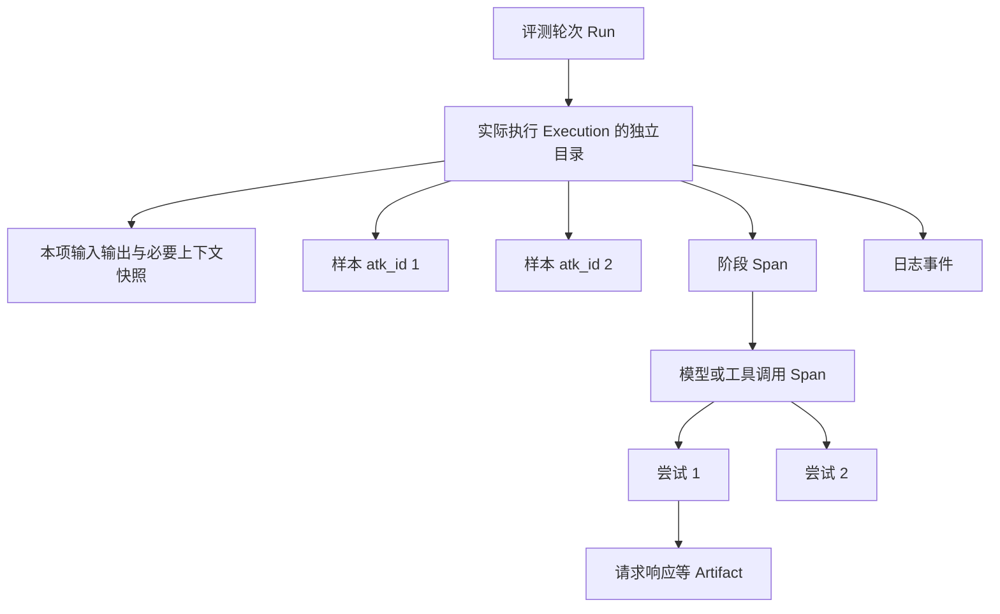
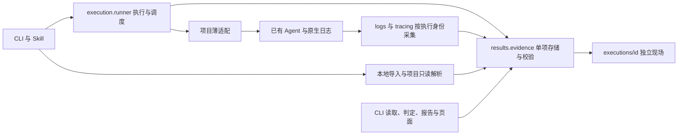

# ATK 执行项现场与调用轨迹改造实现方案

- 日期：2026-10-25，Asia/Shanghai。
- 最近设计修订：2026-10-26；对照 Magic 的 2026-10-21 双 Case 现场，首版增加外部 runner 的本地证据导入，封存后补采延后；保留执行项独立保存。
- 开发前审阅修订：补齐 Run 用途与版本选择、旧写入入口保护、受信任适配器边界、保存前留存处理和占用故障状态；新增 P0 合成格式验证，未扩大首版业务范围。
- 状态：2026-10-27 已落地首版执行、导入、读取与判定闭环；合成回归和安装制品验证见第 18 节。未迁移真实业务项目或调用真实模型。
- 基础：[CLI 与 Skill 模块化方案](cli-skill-modularization-plan.md)、模块化提交 `afd9b68` 及本次读取的共享执行、日志、结果和适配实现。
- 本次交付：存储和适配契约、实现代码、V2／导入模板、Skill 同步及回归测试；不迁移业务项目、不运行真实模型、不发布版本。
- 实现基线：前次规划基于 `1ebd2bb`；本次只读复核 ATK `36c672d`（包版本 `2.1.1`）的日志、版本分配、结果 CLI 与汇总实现。Magic 历史运行版本回源其 `run-meta.json`，当前导入／补采实现仅作设计参考；未复跑测试或业务评测，原始验收日期不变。

实施入口：先读第 2.1 节的 Magic 实践复核、第 5 节的模块分工、第 6.4／6.5 节的托管执行与本地导入契约、第 8.3／8.5 节的留存与持久格式、第 9.4 节的占用和第 10.1 节的版本选择，再从第 12 节 P0 推进。第 13 节定义最终验收，第 14 节列出文件范围，第 17 节记录待实验验证的实现取舍。本文件保持唯一方案入口，不另建重复规格。

ATK 在每轮评测中保存可核验的运行条件、实际输入输出、应用日志、模型与工具调用及业务产物，使诊断能够检查当时的事实。固定采集、导入与存储能力放在 ATK 安装包中，项目保留薄适配和必要的公共调用埋点，Skill 负责判断与归因。

承诺的完整性限于明确接入和声明可留存的范围。系统必须暴露未接入、脱敏、关联不明和写入失败，不能用一个空日志文件或成功退出码证明执行过程完整。保存现场不等于保证外部模型、远程服务或变化中的数据源能够确定性重放。

## 1 已确认范围

用户在本次讨论中确认以下三项，均为本方案的设计输入：

| 选择 | 确认内容 | 对设计的约束 |
| --- | --- | --- |
| 首版范围 | 完整同进程链路 | 首版包含运行快照、日志、模型和工具调用及重试、已有产物、诊断读取；支持同步、异步与同进程并发 |
| 接入边界 | 允许少量公共调用埋点 | 优先复用现有日志和审计；不足时在公共调用处增加观察能力，不接管业务行为 |
| 留存策略 | 完整本地保存 | 对声明可留存的内容保存正文及相关快照，排除秘密并按项目规则脱敏；不自动上传或清理历史 |

用户于 2026-10-26 进一步明确：每个执行项应独立保存输入、输出、执行轨迹和必要内容，便于直接跟踪单项。由此，目标布局以执行项为主组织单位；本方案已替换此前按整轮事件、附件类型集中存放的建议。具体文件名和接口仍为待实施设计。

首版同时支持 Python 标准 `logging` 和已在目标环境中安装的 Loguru。模型与工具不绑定某一 SDK：提供统一观察接口，并通过项目公共调用位置或已有审计获取信息。

2026-10-26 对照 Magic 实践后，用户进一步确认：

- **首版增加外部 runner 的本地证据导入。** 项目适配器读取已取得的 JSONL、原生审计、会话／工具身份及工作区产物，复用 ATK 的独立证据包与查询；导入不运行 Agent、不补做业务验证、不联网拉取 trace。
- **首版只保留封存前证据。** 封存前已取得且稳定的本地 trace 可以一并导入；封存后出现的 trace 不追加、不覆盖、不另建快照版本，保持缺口。补采快照版本留待后续明确设计。

首版不包含跨进程／分布式自动完整追踪、远程采集服务、封存后补采、自动回放、自动恢复评测、全局 SDK monkey patch、新的模型调用层或工作流引擎。本地导入能保存其他进程已有的可见证据，不代表 ATK 自动采集了其内部过程。

## 2 当前基础与缺口

当前模块化方案已经把固定能力放入 `agent_tune_kit/`。本方案以模块化后的实现为设计依据，不把已有改造的测试记录当作轨迹能力已通过验收。

| 当前入口 | 已有能力 | 本次需要补充的能力 |
| --- | --- | --- |
| [runtime.py](../agent_tune_kit/execution/runtime.py) | 选择项目解释器、加载安装包执行代码、执行旧 runner、传播退出状态 | 明确启动／中断证据及采集结束状态 |
| [runner.py](../agent_tune_kit/execution/runner.py) | 按行同步／异步调用、并发、失败重跑、增量 CSV | 执行单位、输入输出现场、调用上下文与收尾 |
| [logs.py](../agent_tune_kit/execution/logs.py) | 标准日志的全局与行级采集 | 原日志配置保护、结构化字段、Loguru、可靠归属和采集错误报告 |
| [versions.py](../agent_tune_kit/results/versions.py) | 依据当前 CSV 存在性创建／复用版本 | 已有现场保护、并发分配及运行占用 |
| [judgments.py](../agent_tune_kit/results/judgments.py) | CSV 哈希绑定、判定有效性和失败表投影 | 使用轨迹时绑定对应证据，并保留引用字段 |
| [适配模板](../templates/.atk/runner/eval_runner.py.md) | 输入构造、Agent 调用、日志设置 | 采集声明、可选执行分组及观察接口接入 |

当前日志模块会临时调整所接入 logger 的级别，且主要保存格式化文本；行上下文不能自动证明线程内部、延迟队列或后台工作的归属。结果文件哈希也不能保护独立日志和附件的内容。

2026-10-26 核对的 ATK 源码为 `2.1.1`（`241bc48`），PATH 中的 `atk --version` 返回 `2.1.0`。两者不能混为同一执行实现，历史结果也没有冻结足以证明当时引擎版本的材料。本次未安装或升级 CLI。

手术项目当前仅有 `.atk/results/v1`，执行记录时间为 2026-10-25 20:43:08–20:48:16（Asia/Shanghai）。本次只读取结构、检查引用与哈希，不复制业务正文，也不重新验收业务正确率：

- 10 条结果实际来自 5 次 Case 执行，10 个行日志按 Case 两两相同，每份仅 4–6 行；应用日志共 24 行。执行分组和日志复制见项目 `.atk/runner/eval_runner.py` 的 `run_case`、`capture_case_python_logs`。
- 已有 8 条 LLM audit、6 条 retrieval audit，以及输入工作簿、阶段 checkpoint、结果和项目 manifest。模型审计保留请求、原始与解析后响应、错误及可见的重试信息；记录数不能解释为全部物理网络尝试数。
- `agent_output` 所引用的 preflight、result、audit 文件均存在；当前 dataset 哈希与应用日志中记录一致，判定表绑定的结果哈希也一致。这证明当前可读文件一致，不证明运行期间未变或采集无遗漏。
- 项目运行日志有意排除提示词和响应正文（项目 `backend/README.md` 的日志约定）；成功模型调用使用 DEBUG，而 runner 以 INFO 接入。详细内容应从受控 audit 获取，不能以提高运行日志等级替代审计接入。
- 当前缺少 ATK 通用运行清单、实际执行与样本的显式映射、源码／runner／环境／有效配置／判定标准的冻结，以及可查询的采集覆盖与缺失状态。已有资产哈希不能替代可取得的资产内容。

因此当前优先事项是保全、索引并校验已有证据，再补确实缺失的观察点。该项目使用完整旧 runner；升级 ATK 核心不会自动迁移它，也不能把其业务审计能力当作 ATK 已提供的通用能力。

### 2.1 Magic 双 Case 现场复核（2026-10-26）

来源为 [run-2026-10-21T10-20-55](../../magic-workspace/magic-output/run-2026-10-21T10-20-55)，运行时间 2026-10-21 10:20:55–10:23:31（Asia/Shanghai）。本次只读解析清单、事件、报告和文件哈希；未运行 Agent、未导出线上 trace、未重新判分。该目录被 Magic Git 忽略，链接仅为本地取证入口；以下记录核对事实，实施测试使用脱敏合成 fixture，不将私有现场打包。

| 本地事实 | 对本方案的约束 |
| --- | --- |
| `L1a-groupBy`／`L1a-toBoolean` 分别有 52／70 行 WebSocket 事件，按 `tool_use_id` 可配对 11／16 次工具调用与结果；记录含 session、turn、event ID 和 traceparent | 导入保留原生身份及原记录定位；工具事件数不能解释为模型请求数或网络尝试数 |
| 两项 `turn.json` 均为 completed；报告的静态与行为检查均通过，但 `casePass=false`，原因均为 `.gitignore` 越界修改 | 执行状态、检查结果、业务 verdict 和证据覆盖分别保存；原报告作为原始判定记录导入，不自动变成 ATK 的新判定 |
| 两份 `pre-manifest.json` 均未记录 `.gitignore`，当前文件均为 `.max/scan-cache.json`；可见事件未给出直接创建该文件的记录 | 可以确认前清单与当前文件的差异，不能据此断定由 Agent 主动越界；责任归因需文件变化、工具／基础设施事件及规则证据 |
| `pre-manifest.json` 各有 87 个文件哈希；当前 7 个 `types/*` 文件与前清单哈希不同 | 前清单与运行后的 workspace 是两个时点；不能把当前目录当作完整的执行前正文。导入要标注 before／after／时点未知和可恢复限制 |
| 每项 manifest 的 6 个非空文件引用均为绝对路径且本机可读；未为这些产物登记内容哈希 | 原路径只作来源信息，归档引用须为包内相对路径并校验保留字节；导入时哈希只能证明导入后的完整性 |
| 两项 `traceArchive`、`nativeApeGate`、`localApeProbe` 均为 null，现场未包含冻结 trace；清单仍写 `evidence_collect=passed` | “清单写出成功”不能等同于证据齐全；按来源区分已取得、缺失、不适用和未知，缺失 Gate 不自动判 Gate 失败 |
| `run-meta.json` 保留 root/MCS/OT 提交与 Prompt 哈希，但 Prompt 目录是外部路径；未见该运行的独立有效运行时 Prompt 正文快照 | 哈希、提交或导出命令不等于可读取内容；保留能取得的版本材料，其他项列为不可恢复／未验证 |

该 run 记录的根提交 `779024cc` 中，`eval/src/mcs.ts` 会过滤 debug、部分 UI 表示和 streaming 分片，只保留结束帧等消息，并先积存在内存；`eval/src/cli.ts` 在 `runTurn` 返回后才写 `events.jsonl`。因此，这些文件是**来源已筛选的前端事件记录**，不是全量模型请求／响应或逐分片轨迹，也不能证明进程异常前的事件已经持续落盘。ATK 应完整保存实际取得且允许留存的记录，同时单列来源过滤与崩溃前落盘的缺口，不能将其升级为“全链路完整”。

当前 Magic [activeRunTraceFreeze.ts](../../magic-workspace/eval/src/evidence-attribution/activeRunTraceFreeze.ts) 支持运行后从 Langfuse 冻结 trace，并更新原 manifest 与 summary；这仅证明存在此后处理路径，不证明本次 run 已执行。ATK 首版不照搬原地补写：封存前导入已有稳定材料，封存后保持现场不变。是否补采及其版本模型已由用户明确延后。

**复核结论：** 单项现场、原生文件留存、独立状态、相对引用和哈希校验的方向合理；需补齐本地导入入口、原生身份与保真度契约、文件变化证据和真实场景验收。Python logging／Loguru 仍是托管采集入口之一，不作为所有 Agent 的必经运行方式。

## 3 设计原则与兼容边界

1. **单项现场独立，多处读取。** 每个执行项拥有完整的本地现场，日志视图、汇总和 HTML 从其派生，不能反向修改证据。不同执行可以各自保留相同来源的必要快照，以保证独立分析。
2. **固定实现集中在安装包。** 项目解释器加载同一套 ATK 执行模块，不复制第二套引擎到 `.atk/runner/`。
3. **保留业务行为。** 采集不能改变参数、返回值、异常类型、重试次数、调用顺序或流式消费方式；其性能影响必须测量。
4. **先关联，再归因。** 不用行号、相邻时间、相似输入或日志文本猜测执行身份。
5. **完整正文保存在本地，读取按需展开。** 不能为节省 AI 上下文而删除已允许保存的原始内容；阅读摘要不代表已检查全文。
6. **执行、采集、业务判定分开。** 技术失败、证据缺口与业务错误分别报告；证据不足不能自动转成业务失败或通过。
7. **保留现有交付模型。** 单一 Python 包、标准库优先、现有 CLI 与 Skill 分工、本地文件、既有 CSV 和离线页面继续使用。

本方案明确扩展现行模块化与共享版本约束，实施时需同步权威规则，而不是静默改变：

| 原约束 | 本方案的目标行为 |
| --- | --- |
| 不新增持久 metadata／manifest 等产物 | 为新托管执行增加必要的证据目录与运行清单；数据集准备流程不增加无关元数据 |
| 没有 `eval_results.csv` 就可以复用当前版本 | 只有可确认的空目录可复用；存在现场、占用或未知文件的目录不能覆盖 |
| 所有读取均使用最大 `vN`，失败重跑查找最近的失败表 | 区分最新 Run 与当前评测目标；只跳过可验证的 evidence-only Run，不跳过损坏或未完成评测；新旧 ATK 管理入口使用同一选择规则 |
| 行日志仅覆盖活动行上下文 | 保留旧行日志语义；新增执行／调用上下文，并显式表达多样本共享执行和归属缺口 |

`.atk/context.md` 继续保存用户确认的长期标准和决策，不存放运行注册信息或日志。本次只建立新方案；现行规则在实现发布前不因本文件自动生效。

## 4 执行与证据模型

### 4.1 身份与关系

| 概念 | 含义 | 身份要求 |
| --- | --- | --- |
| Run | 一轮托管评测或一次外部运行的证据导入，通常对应一个 `vN` | 独立 `run_id`、`origin=managed/imported`、`run_kind=evaluation/evidence-only`；来源与用途正交，外部原 run 身份另存，导入不是再次执行 |
| Sample | 数据集中的评测对象 | 保留 `atk_id`，并绑定当轮数据快照；不单独用 ID 推断跨数据集等价 |
| Execution | 一次真实 Agent 执行 | `execution_id`，可关联多个样本；默认一个样本一次执行 |
| Span | 有开始和结束的一次阶段或调用 | `span_id`、可空的 `parent_span_id`、所属执行 |
| Event | 一个已发生的事实 | `event_id`、所属执行或运行级事件流、流内递增序号、发生时间与来源 |
| Artifact | 请求响应、快照或业务文件等正文 | `artifact_id`、相对路径、类型、大小、保存字节哈希及来源 |

模型的逻辑调用和每次实际重试是不同 Span。顶层 Agent 重跑产生新的 Execution；正常再次评测创建新 Run，首版不自动在旧 Run 中续跑。导入为已有执行建立 ATK 身份并保留来源身份，不能把导入时间当成执行开始时间，不能因同一执行同时有事件、审计与报告就生成三次 Execution。

来源关联以带命名空间的 `source_system`、原 run/case/session/turn/event/tool-call/trace/span ID 及原文件记录定位保存。保留原 ID 与 ATK ID 的映射，缺失项留空；`traceparent` 不能替代工具调用 ID，也不由共享 trace 推导未知父子关系。多轮会话由适配器声明一次 Execution 覆盖哪些 turn；重跑和同会话续轮分别表达，核心不按目录名或时间猜测。

事件需区分 ATK 实时观察、原生日志、原生审计、前端投影和导入转换；记录来源过滤／截断／聚合、采集边界和转换器版本。原发生时间与观察／导入时间分开，与 [OTel Logs Data Model](https://opentelemetry.io/docs/specs/otel/logs/data-model/) 的 Timestamp／ObservedTimestamp 区分一致，但导入时间不能冒充上游首次观察时间。展示层可统一时间线，统计只按可核实的调用身份计数；相同内容不自动去重，同一调用的多种证据不重复计数。



来源时间、采集时间和持续时间分别保存。发生时间带时区，耗时使用单调时钟；序号在每个执行项事件文件内递增，运行级文件有自己的序号。不同文件的序号不直接比较，跨执行关系使用显式身份关联；时间排序只用于展示，不能解释为严格因果顺序。

### 4.2 分组执行与失败重跑

保留现有筛选顺序：使用 `--only-failures` 时先按失败集合筛选，再应用 `offset`／`limit`。这些参数仍按评测样本计数；`concurrency` 按同时执行的 Execution 计数，CLI 同时展示样本数和执行数。

项目适配层可以把选中的样本映射到完整业务 Case，并明确返回：本次评分的样本、执行所需的额外输入上下文、输出到样本的对应方式。默认逐行项目无需声明分组。

例如仅重跑 `atk_id=2`，但它属于包含 1、2 的同一 Case：Agent 接收完整 Case 输入，证据保存完整 Case 输出；`eval_results.csv` 仅写入本次选中的 2。未选中的 1 不被算作已重评或已通过。额外上下文只使用业务输入，不把答案列传给 Agent。

执行分组由适配层显式声明，核心不猜测业务键。缺失、重复或不明确的结果映射是适配错误，保留实际输出并停止宣称本轮完整；不能随意选一个预测结果填入 CSV。

默认一条测试样本对应一个执行目录。确实共享一次真实调用的多条样本对应一个完整执行目录，目录内保存各样本的原输入、标准、评分选择及输出定位，查询任一样本都直接返回这个目录并说明共享关系。手术项目的 10 条样本、5 次真实 Case 执行因此对应 5 个现场；不为目录数量额外执行 Agent，也不把同一轨迹复制成多次独立执行。

## 5 模块职责与依赖

以下文件为目标职责位置，新增名称属于本方案建议接口，不表示当前已可调用。

| 模块 | 责任 | 不承担的责任 |
| --- | --- | --- |
| `execution/runtime.py` | 项目进程、启动和退出、中断传播 | 业务输入解释、模型调度 |
| `execution/runner.py` | 执行规划、上下文、生命周期、调度和结果投影 | 判断业务答案、推断 Case 分组 |
| `execution/logs.py` | 标准 logging／Loguru 采集，结构化记录，来源与归属 | 重建项目日志系统、推断未记录的调用 |
| `execution/tracing.py` | 小型观察接口、Span、Event、上下文传播和 Artifact 提交 | Agent 框架、重试策略、全局 SDK patch |
| `results/evidence.py` | 证据存储、校验、封存、有界读取与本地导入协调 | 导入业务 Agent 模块、执行 Agent、内置 Magic 协议或远端拉取 |
| `results/versions.py` | 安全版本分配与占用 | 决定是否运行 Agent |
| `results/summary.py`、`judgments.py` | 汇总独立状态，校验结果与证据引用 | 根据证据数量自动决定业务判定 |
| `visualize` | 读取统一证据视图，增加失败样本轨迹入口 | 第二套证据解析与有效性规则 |
| 项目适配文件 | 托管输入／调用／映射，或外部证据只读解析、身份映射与来源声明 | 实现通用存储、线程日志路由或版本算法 |

依赖仍为 `cli → execution/results/visualize`、`execution → results`、`visualize → results`。证据领域规则不放进 `utils`。公共接口只覆盖完整操作，不公开版本创建、逐文件写入等必须按顺序组合的底层步骤。本地导入走 `cli → results.evidence → 显式项目导入适配器`，与运行 Agent 的 execution 路径分开，复用相同证据格式和读取器。

Loguru 由目标项目环境提供，仅在声明使用它时加载；ATK 核心不因此引入强制业务依赖。旧 runner 和新托管适配器仍走明确分支，不能同时执行。



新增生产模块控制为 `execution/tracing.py` 与 `results/evidence.py`；执行契约校验先留在现有 runner 中，不预建插件注册器、通用配置框架或另一套执行引擎。证据模块的写侧由执行核心调用，项目 observer 只暴露 Span、Event、Artifact；读侧统一提供 `inspect_execution(directory)`、`read_events(directory, after_seq, limit)`、`read_artifact(directory, artifact_id, offset, limit)` 和引用验证。以上名称是本方案的实现起点，接口实验后在同一文件冻结。

复用 `utils/files.py` 的 `atomic_text_writer`／`write_text_atomic` 写未封存清单，复用 `utils/csv_io.py` 解析和原子写 CSV。现有原子写工具会替换目标，因此独占创建和封存保护必须在证据模块验证；它没有目录 fsync，不能据此承诺断电零丢失。事件流使用本项锁及增量写入，不为此新增通用文件工具层。

## 6 项目接入契约

### 6.1 适配层需要声明的内容

沿用现有 `build_agent_input`／`call_agent` 的默认调用习惯。新增能力通过明确的适配契约版本与可选能力声明引入，不通过捕获 `TypeError` 猜测函数参数，不静默修改手写适配器。

接入声明集中在项目适配文件中，首版不另建一套通用配置语言。声明包括：

- 日志来源、命名空间、采集级别和已有转接关系；
- 相关代码、Prompt、配置、规则等快照范围，以及允许保存和必须脱敏的字段；
- 已有审计／checkpoint 的取得位置和归属方式；
- 需要时的执行分组和输出映射；
- 已接入的阶段、模型与工具调用；内部重试是否可见；哪些信息属于必需证据；
- 初始化、收尾和并发上下文传递方式。

声明描述能力，不是复杂的业务流程配置。`atk-init` 根据源码选择最小接入，并给出覆盖清单；缺失内容明确保留，不生成虚构的能力声明。

### 6.2 最小观察接口

项目所需的观察能力控制在三个概念内：开始／结束一个 Span，追加一个事件，提交一份 Artifact。执行身份、命名、存储、脱敏、错误统计和刷新由核心处理。具体函数名和同步／异步类型签名在接口实验后冻结。

优先从适配层注入 observer 或包装项目现有公共调用；确需修改公共函数时，保留无 observer 的原调用方式。业务包不能因埋点而要求生产环境必须安装 ATK；不运行评测时，已有业务行为继续可用。

埋点保留原参数、异常和返回对象，不为记录而重新调用函数。对生成器或异步流，只观察业务实际消费的分片，不提前耗尽流，不重复消费；未消费完或取消时记录相应状态。

### 6.3 初始化与检查

`atk eval --check` 检查契约、输入映射和声明能否解析，不创建结果版本、不调用 Agent 或模型。可检查日志路由配置与快照路径，但不能据此证明真实执行时所有事件都可见。适配模块导入和检查钩子应无业务副作用；普通 Python 导入不是沙箱，存在副作用的项目需延迟初始化。

正常评测在调用项目初始化和业务入口前建立运行证据。适配加载等轮次准备事件进入运行级文件；适配脚本等必要准备材料先在 `run-context/` 冻结，属于本项必需上下文的内容在执行开始前复制到本项 `context/`，不能只留跨目录引用。业务资源初始化在 `call_agent` 内延迟进行，其事件归属当前执行项；相关业务资产在实际使用前完成声明和冻结。无法在使用前获知的动态来源需记录实际读取版本、返回内容或明确缺口，不能用结束后的文件冒充执行时版本。

### 6.4 V2 适配契约与版本分流

新模板明确声明两个常量，适配版本与证据 schema 分别管理：

```python
ATK_MANAGED_RUNNER = True
ATK_ADAPTER_VERSION = 2
```

| 静态声明 | 执行路径 | 保证 |
| --- | --- | --- |
| 无 managed 标记 | 现有完整旧 runner | 自行执行和分配版本，ATK 不外包第二次执行 |
| managed，未声明版本或版本为 1 | 当前托管行接口 | 保留业务接口与产物语义，显示旧采集覆盖；版本保护与目标选择按新共享规则执行 |
| managed，版本为 2 | 执行项现场路径 | 开启本方案声明范围内的独立现场采集 |
| 版本值不支持或不是可识别常量 | 预执行拒绝 | 不导入业务、不分配结果版本、不静默回退 |

V2 仍由两个必需调用和两个可选扩展组成：

| 接口 | 输入与返回约定 | 是否需要项目实现 |
| --- | --- | --- |
| `build_agent_input(source)` | 将本项 source 构造成实际 Agent 入参；可返回值或 awaitable，必须排除答案及 ATK 元数据 | 必需，沿用原输入构造习惯 |
| `call_agent(agent_input, *, execution)` | 返回业务原始结果或 awaitable；execution 提供本项附件目录和观察接口 | 必需，通常只转调现有业务入口 |
| `plan_executions(selected_rows, all_rows)` | 返回项列表，每项含本次评分的 `sample_ids`、构造输入所需 `source` 与必要上下文行身份 | 可选；默认每行一项 |
| `map_agent_output(raw_output, item)` | 对每个所选 `atk_id` 返回其完整实际输出及在原始返回中的定位 | 单项单样本可缺省；共享 Case 必需 |

分组规划是无业务调用的确定性步骤，不能在这里执行 Agent；选择、offset、limit 已由核心按原契约完成。核心校验每个所选样本恰好出现一次、上下文行存在、结果映射无缺失／重复／多余项，再写 CSV；共享 Case 的上下文行不自动进入评分集合。原始返回先保存，映射失败不丢弃它。

日志来源、快照路径、脱敏与序列化策略、必需证据范围集中在适配文件的一份 `EVIDENCE` 声明中，使用普通 Python 数据和显式回调；不另建 YAML 或环境变量配置系统。执行项 observer 不暴露答案快照给业务调用，不将整份 dataset/context 随参数自动传给模型。生产业务包不导入 ATK，必要观察能力通过可选对象或已有 audit 接入。

源文件先用 AST 识别版本常量；V2 正常执行在只读参数／数据／选择校验后，先占用版本并保存运行身份，再导入适配器。V2 导入、规划和输入预检保持无业务副作用；业务资源初始化由项目在 `call_agent` 的受采集作用域内延迟完成，不另加生命周期 hooks。项目创建的受管后台任务在返回前收尾；不能等待的来源明确标为部分覆盖。

`--check` 可以验证静态声明、路径和无副作用的输入映射，但不得运行初始化、Agent、模型或创建结果目录；导入副作用必须由适配层延迟，普通 Python 导入不是安全沙箱。V1 预检行为保留兼容，不把它的成功当作 V2 采集验收。

同步与异步路径共享现场生命周期，必须覆盖同步 builder／调用、异步 builder／调用和同步函数返回 awaitable 的组合。调度差异不能改变输入快照、错误保存和结果投影语义；不再依赖仅检查 `call_agent` 是否为协程函数来推断整个链路。

### 6.5 外部 runner 的本地证据导入

这是与 V2 托管执行并列的入口，不要求外部 runner 重写成 `call_agent`，不假装运行一次空 Agent 来导入。项目提供显式指定的 Python 导入适配文件，声明独立的导入契约版本，暴露只读 `load_evidence(source_root)` 操作；其返回执行身份、来源事件迭代器、输入输出定位、文件清单、可选样本映射和覆盖限制。具体字段在 P1 的 Magic 合成现场实验中冻结；不新增插件注册系统或第三套执行引擎。

1. **核心与项目职责。** 核心负责安全占用、路径和留存校验、复制冻结、身份登记、事件持久化及封存；适配器负责 Magic 等原生协议解释。来源 run 级模型配置、版本等必要共享材料也要冻结进每项 context，不能只复制 Case 子目录。导入适配器由用户／项目显式选择，不从证据中的脚本、命令或任意路径自动加载代码。
2. **只导入已取得的稳定文件。** 不联网、不运行模型／工具／原生 Gate、不执行 manifest 中的导出命令，不改写来源。明确源根目录；原 manifest 的绝对路径仅在可验证地映射至该范围时读取，越界和无法定位项列为缺口。检查读取前后变化，变化中的必需文件不得封存为稳定证据。
3. **保留原记录及转换依据。** 每项保留允许留存的原生文件或可靠抽取片段；通用事件引用保留材料的哈希、原记录行号／JSON 指针、原生 ID 和转换器版本，来源原文哈希另按留存策略决定是否记录。脱敏改变结构时同时保存原定位与保留材料定位，无法可靠对应则标明缺口。记录转换时间与原发生时间，保留来源的过滤、摘要、未闭合和缺字段状态；不补造调用开始、模型重试或流分片。
4. **样本映射可缺省，不能猜答案。** 没有可信 `atk_id`／数据集映射时只生成可查询的证据包，不伪造 `eval_results.csv`、答案或 verdict；可凭 execution ID／目录读取。已有报告保留为来源附件，只有明确输出映射才能投影 ATK CSV，新的判定仍经原判定入口提交。
5. **导入不计作新执行。** 记录 `origin=imported`、源 run／execution 身份、导入时间、输入材料指纹与采集覆盖。导入分配新 `vN`，占用时即记录 `run_kind`：声明可信结果映射的导入为 evaluation，否则为 evidence-only；后续失败不降级用途来隐藏未完成评测。inspect 能读两类 Run；显式对 evidence-only 评分／比较／失败重跑时报告缺少映射，默认目标按 10.1 选择，不混入托管评测执行数。
6. **防止重复和隐式补采。** 导入前核对来源身份与材料指纹：同一来源身份及相同材料，在已封存包校验通过后返回既有位置；既有包损坏时报告错误而不覆盖。来源防重可读取已有 run 索引，不另建数据库；同一来源执行的材料改变则报告差异，首版不覆盖、不另建补充快照、不伪装成新执行。来源缺少稳定身份时由项目显式给出，不能仅按路径推断。中断导入保留部分现场，首版不自动重入或续写。
7. **封存前收齐，封存后保持不变。** 本地已有且稳定的 trace 可在首次导入时纳入；只有远端 locator 的来源记为缺失。ATK 不自动等待外部系统，也不承诺补齐尚未产生的文件。封存后新取得的证据属于后续补采能力，不刷新旧包和旧判定。

**信任边界：** 来源文件及其中的脚本、命令、路径均为不可信数据；用户显式选择的 Python 适配器则是按当前用户权限运行的受信任代码，包括模块顶层、回调和延迟执行的迭代器。“不联网、不改来源、不调用业务”是 ATK 核心自身的行为保证和适配器必须遵守的接入契约，不是对任意 Python 代码的强制隔离。源根目录、只读打开和真实路径校验约束经过核心的文件操作，不能限制适配器自行访问网络或文件系统。首版不接收不可信适配器，也不增加通用沙箱；测试验证受支持适配器遵守契约，不宣称测试或文件哈希能证明任意代码无副作用。

## 7 日志与调用采集

### 7.1 保留原日志系统

标准 `logging` 增加 ATK 自有 Handler；Loguru 增加自有 sink。保留原有出口、格式、级别、过滤器、传播和轮转配置，收尾时只移除 ATK 安装的对象。采集器不调用全局 `basicConfig(force=True)`、清空 handlers 或无参数 `logger.remove()`。

标准日志的源级别或 `propagate=False` 可以让 root Handler 收不到记录；这是接入能力限制，不能通过悄悄修改全局配置掩盖。确需提升日志级别，由项目评测初始化显式配置并说明原出口的影响。ATK 自有结构化调用事件独立于应用日志级别。[Python logging 文档](https://docs.python.org/3.11/library/logging.html#logging.Logger.propagate)

保存允许的结构化字段、来源模块、级别、消息和异常信息，不能只保留格式化字符串。避免修改共享 LogRecord 影响其他 Handler；对任意 `extra` 对象使用项目声明的安全序列化方式，不能直接对所有对象 `repr()`。

若项目已经将 logging 转入 Loguru，选择能覆盖所需记录的单一采集位置；确需两路时保留来源身份并消除确定的重复。不能仅凭消息文本相同就去重，两次相同的真实事件仍需保留。

Loguru sink 保留 `record.extra` 等允许字段，关闭异常局部变量展开，正确完成已声明的队列／异步写入。项目若在运行时重新配置日志，需要通过约定初始化顺序或显式重接入保持采集；不承诺自动拦截任意配置修改。[Loguru 文档](https://loguru.readthedocs.io/en/stable/api/logger.html)

### 7.2 并发和后台记录

在事件产生时写入运行、执行和 Span 身份，再进入后台队列；不能在消费队列的线程中重新读取当前 Case。ATK 管理的并发自动传递上下文；项目内部线程池需在任务提交处传递上下文，不能假设线程自动继承。异步与线程上下文的基础机制采用 `ContextVar`，但每次并发提交应有独立 Context。[Python contextvars 文档](https://docs.python.org/3.11/library/contextvars.html)／[Logging Cookbook](https://docs.python.org/3.11/howto/logging-cookbook.html#use-of-contextvars)

有身份的记录在采集时直接写入对应执行目录，不先混写再按时间或文本拆分。没有身份的记录进入 `run-events.jsonl`，不猜测归属。业务执行已结束、采集尚未封存时，迟到记录保留原关联并标记 late；已产生、仅延迟送达的队列记录仍按产生时身份归属。收尾需等待声明受管的任务与采集队列，无法等待的工作在本项清单中列为覆盖缺口，首版不承诺收集进程退出后的事件。已封存项不重新打开追加；轮次采集器仍开放时，意外晚到记录进入运行级文件，保留执行身份，并报告该项收尾约定被违反。整个 Run 已封存后不重新打开其文件；外部后续补采不属于这个运行级异常通道。

清单须记录采集截止点和已关闭的来源范围；“完整”仅指截至该点声明范围内的已知事实。不能确认相关来源关闭的执行项不得标为完整，可延迟封存或以部分现场封存。封存后的新发现不可能出现在此前复制出的目录中；仍在原运行中查询时必须同时提示这类覆盖异常，不能让内容校验通过掩盖它。

stdout/stderr 是补充来源。同进程并发时不做逐 Case 的全局重定向；父进程可保存项目进程输出为轮次证据，但必须与 CLI 的 JSON 结果和进程控制通道分开。任意二进制输出或敏感自由文本没有安全留存规则时，明确排除并报告，不能绕过脱敏。

### 7.3 模型和工具调用

对每次已接入调用保存实际请求、有效参数、实际返回、解析／校验结果、异常、耗时和来源版本。模型记录可得的模型名称、服务端版本／请求标识、usage；缺失值保留未知，不推算 token 或价格。

请求响应按业务可见范围采集，保留原始返回与解析结果的区别。Authorization、Cookie、访问令牌和密钥不进入材料。流式响应保存已收到的分片及结束状态，阅读器可以派生合并视图，但不替换原始分片证据。

重试记录区分传输重试、格式校验重试及业务再次决策，分别记录每次尝试的请求、响应或异常。只有最终响应和一个重试次数时，标记为聚合证据；不能据此补造失败尝试。SDK 内部重试没有可用观察点时明确标记不可见，不为追踪默认关闭或重写 SDK 重试。

工具返回的文件通过 Artifact 关联；工具触发的子进程只记录可观察的调用输入、退出和输出，内部事件属于首版覆盖之外。进程、网络调用和外部数据源存在副作用时，采集不增加新的重试或重放。

### 7.4 复用已有 audit 和 checkpoint

业务文件在留存策略允许时保持原格式，登记来源、所属执行／调用、用途与内容哈希。只有已由项目在写入前落实留存策略、明确允许直接保存的受信任产物，才能直接写入本项 `artifacts/` 并在稳定后原地登记；需要 ATK 脱敏或尚未判定的材料经 8.3 的保存路径处理后才能进入证据区，不能先写原文再靠登记时脱敏。项目原有业务输出由项目自身策略负责，ATK 不修改来源或额外创建未脱敏副本。不用软链接、硬链接或指向可变工作区的路径代替独立快照。若源审计混有多个执行项，项目适配负责给出可靠的记录归属和本项原格式片段及来源定位；无法可靠拆分时报告缺口，不向每项复制整轮混合日志冒充独立现场。

已有审计可以经项目适配转换为通用事件，本项保留策略允许的原始文件或可靠抽取的记录片段，登记保存字节哈希、原始记录定位和“导入审计”来源；来源哈希及脱敏转换按 8.3 处理，无法保留所需记录时报告缺口。抽取或脱敏片段不能冒充完整源文件。缺少时间、开始事件或父子关系时保留缺口，不编造实时轨迹。已有日志与审计共同覆盖同一调用时建立关联，不把它们计为两次模型请求。对前端投影、已截断工具输出和仅含摘要的来源，覆盖清单分别报告“来源自身的信息缺口”和“ATK 导入／持久化失败”；完整复制摘要不能成为完整响应的证明。

## 8 运行快照与本地存储

### 8.1 快照内容

| 材料 | 保存方式 | 完整性限制 |
| --- | --- | --- |
| 数据集 | 保存实际选用行和必要上下文行、字段顺序、来源文件哈希、筛选条件和稳定 ID | 输入与答案用途区分；快照不改变 Agent 入参 |
| 实际输入输出 | 执行前保存构造后的输入，结束／异常时保存已产生输出；导入保存来源实际取得的对应材料 | 文本回复与文件交付分别登记；无法序列化时需要明确的项目序列化器，不悄悄转摘要 |
| 代码与适配 | 保存相关声明文件的实际内容、路径和哈希；记录 Git commit 与 dirty 状态作为辅助 | 不自动 commit、checkout 或恢复代码；不扫描整个仓库 |
| Prompt 与有效配置 | 保存实际使用内容及允许的解析后配置 | 不保存 `.env`、密钥或整份环境变量 |
| 环境 | 托管执行保存 Python、平台、ATK 版本、实际引擎来源摘要、依赖锁与可得的已安装依赖版本；导入分别记录来源运行时与导入器环境 | 锁文件不等于已安装环境；当前 Python／Node 版本不补填历史运行环境；不归档整个虚拟环境 |
| 规则、目录、索引等 | 声明后冻结相关文件，或保留可追溯的不可变版本及读取结果 | 仅有哈希且原内容不可取得时标记不可恢复 |
| 外部依赖 | 保存实际请求、响应及可得的版本信息 | 不宣称保存了远端全部状态或未暴露的内部过程 |
| 当轮标准上下文 | 若存在，保存当时读取的 `.atk/context.md` 及相关标准引用 | 后续标准修订不修改旧现场；重新判定需说明所用标准 |

本项所需的样本与标准、源码、Prompt、有效配置和环境记录保存到本项 `context/`，实际输入输出直接保存在本项目录中。首版接受不同执行的必要快照重复，不要求读取其他执行目录或整轮附件仓库才能理解本项。内部可复用已经冻结且确认适用于本项的源字节，但落盘必须是独立文件，不用共享可变引用替代。

对 coding Agent，声明必要的工作区初始材料、允许修改范围和实际新增／修改／删除文件，保留相关 before／after 正文、阶段、路径与差异定位；删除文件要保留可取得的原文，新增文件记录前态不存在。只留最终回复或前态哈希不等于保存了交付结果与变更原因。文件由 Agent、工具或基础设施产生的责任，只在有明确来源时登记，否则保留未知，不从规则失败反推修改者。Magic 的 `.gitignore` 场景作为对应验收用例；ATK 核心不内置具体越界规则。

快照时点与来源是否可恢复分别标注；历史目录读取时新算出的哈希只证明导入时字节，不能追认运行当时未被修改。实际生效的 Prompt／Guide／Skill 和工具制品按声明保留内容或可取得的不可变来源；仅有外部目录和哈希的项目仍为缺口。

答案、隐藏断言和 Judge 配置只供评测／诊断读取。文件型 Agent 的工作区与证据区应通过项目现有工作区边界或权限隔离，不能仅因 `build_agent_input` 未包含答案就认为 Agent 无法读取相邻 `context/`。接入验收检查真实工具可读范围；无法隔离时明确评测泄漏风险，不新增通用沙箱实现。

独立现场只覆盖声明的必要材料，不克隆整个仓库、虚拟环境或远端数据库。大型资产无法在本项保留时列明外部依赖、版本和不可恢复限制，不能声称目录已包含其全部内容。检查声明文件在运行期间的变化；存在变化时记录 drift，不能把结束时文件当作执行时版本。未来若需要透明去重，须继续保证单项目录的独立读取和复制语义，首版不引入共享对象存储。

### 8.2 目录与权威内容

```text
.atk/results/vN/
├── run.json                        # 轮次身份、待执行项、样本索引与汇总
├── run-events.jsonl                # 轮次准备、调度及无法可靠归属的事件
├── run-context/                    # 按需保留调度、适配加载阶段的必要材料
├── eval_results.csv                # 仅有可信结果映射时存在；evidence-only 导入不伪造
├── judgments.csv
├── failure_cases.csv
├── report.md
├── tuning_plan.md
├── app.log                         # 可选，仅轮次公共日志与未归属输出
└── executions/
    └── <execution_id>/
        ├── execution.json          # 本项身份、状态、覆盖、文件清单与校验
        ├── input.json              # 实际交给 Agent 的输入
        ├── output.json             # 实际返回；失败未产出时不伪造
        ├── events.jsonl            # 仅本项生命周期、调用、重试、日志与异常
        ├── app.log                 # 本项日志的人可读视图
        ├── context/                # 本项样本、标准、代码、Prompt、配置和环境快照
        └── artifacts/              # 本项请求响应、审计、checkpoint 及其他原生产物
```

每个执行目录是本项现场的权威位置。`execution.json` 保存 `run_id`、`execution_id`、关联样本及输出定位、起止时间、执行状态、采集覆盖与缺口、文件清单和证据摘要；状态是本项事件的可核对投影。原始数据行及预期标准放入 `context/`，与真正传给 Agent 的 `input.json` 区分，答案不得混入业务输入。非 JSON 原生输入输出保留在本项附件中，由输入输出描述文件明确类型与路径；序列化失败不悄悄转为摘要。

本项 `events.jsonl` 是执行轨迹和结构化日志的事实来源，包含调用开始／结束、attempt、错误、取消及正文引用；`app.log` 从其中的日志事件派生，不成为第二套轨迹。首版按执行项串行写入各自文件，不同执行可以并行写各自目录，运行级文件有独立串行写入。无需一份全轮事件文件，也不另建全轮模型请求、响应或日志目录。

`run.json` 只保存轮次身份、选择和调度信息、样本到执行目录的定位及逐项摘要索引；本项数据不再汇总复制到其中。单项事件 ID 在运行内唯一，分页序号只在所属流内有效。事件的外层保留 schema、执行／Span 身份、来源、时间、序号、允许属性及正文引用，业务 payload 不要求统一 Schema。运行级记录不能靠填入虚构执行 ID 来消除归属缺口。

单项附件、输入输出描述与清单中的文件引用以本执行目录为基准，只能指向目录内的实体文件。外部来源路径仅是溯源信息，不作为必需正文的读取入口；无法归档的外部依赖必须列为缺口。执行目录名和采集文件名由 ATK 生成，业务 ID 不直接拼路径；保留原生目录布局时仍检查路径穿越、越界软链接和读取范围。所有哈希针对实际保留字节，脱敏前原文不另存暗副本。

实际 Agent 入参中的原始路径或 URL 属于输入事实，不为目录自包含而改写。清单另将声明的文件入参映射到本项冻结附件；仅有原始路径、没有冻结内容时列为缺口。目录内相对路径约束针对 ATK 的证据引用，不要求改变业务参数。

新运行保留现有 CSV 的源字段、`agent_output` 和 `log_path`；`log_path` 指向 `executions/<execution_id>/app.log`。共享一次真实执行的样本指向同一现场，单项查询返回具体样本的输入、标准及输出位置，不复制日志成多个执行。旧 `logs/row_*.log` 继续只读兼容，新格式不再额外生成一套行日志目录。

独立性验收：将一个已稳定的执行目录复制到测试目录后，只依靠该目录即可读取并校验其声明保存的输入、输出、事件、上下文和附件。不得扫描其他执行或整轮日志来拼出本项；截至采集截止点已知的外部依赖及未归属记录限制必须能从本项覆盖说明中看到，独立校验不证明此后没有新发现。后续业务判定仍保存在轮次 `judgments.csv`，其引用指向本项证据，不把可变判定写回已封存现场。

### 8.3 脱敏、容量与留存

保存前执行项目允许范围和脱敏规则，覆盖 Artifact、日志、异常、URL、配置及 stdout/stderr。自由文本不能依靠通用正则保证所有敏感信息都已识别；需要项目明确可留存范围。无法安全处理的字段不落盘，记录字段级原因。异常默认不保存局部变量值，异常消息和源码片段同样需要检查。

留存契约使用现有 `EVIDENCE` 中的普通数据与显式回调，不新增规则语言或策略框架。每类材料声明字段／路径／媒体类型范围、是否必需、直接允许保存还是需要转换，以及策略标识与版本；转换返回可保存内容，或拒存及不含敏感值的原因。执行顺序固定为“范围校验 → 安全序列化与留存转换 → 保存允许字节 → 计算保存字节哈希 → 登记引用”。不能安全处理的自由文本、二进制或未知类型默认拒存，不尝试通用正则后直接放行。

策略异常与拒存均不得回退保存原文。可选材料拒存留下缺口；必需材料无法保存按 9.3 报采集失败，调用前失败不得启动 Agent，调用后失败不得触发业务重试。异常本身只输出安全错误码和位置。ATK 创建的临时文件、事件、CSV 投影、app.log、stderr 与 HTML 预览均受同一允许范围约束；派生内容复用已允许的数据。若脱敏使评分所需字段不可用，应报告不可评分或停止该路径，不能悄悄改变答案／输出后继续判分。V1 历史行为不因此被宣称已具备 V2 脱敏保证。

流式材料只有在转换器能安全处理跨分片内容时才逐片提交，否则拒存并报告；不把原文落临时盘后再清洗。保存字节哈希用于完整性校验，来源原文哈希只有项目允许时另记，二者不得混用；脱敏／抽取后的材料明确标识转换，不能称为原文逐字节副本。策略说明和拒存原因本身不得包含被删除的秘密。

完整保存不做默认采样或静默截断，也不只保存失败样本。用户可显式配置存储预算；触及预算时停止安排新执行并报告采集失败，保留已有证据，不覆盖旧轮次。查看器的预览上限只限制显示，不删除原文，并返回继续读取的定位。

文件默认仅本机当前用户可读写，结果目录避免进入 Git；安装包不携带真实现场。首版无自动上传、压缩清理、过期删除或后台保留策略。后续清理由显式操作另行设计。

### 8.4 现有产物的保留、精简与新增（2026-10-26 讨论补充）

以下是目标产物与清理条件的建议，尚未实施，不授权删除历史结果。首版沿用 8.2 的兼容布局；减少重复内容与取消文件类型分开处理。

| 现有产物 | 建议 | 清理或变更前提 |
| --- | --- | --- |
| `eval_results.csv` | 保留样本输入字段、实际输出和技术状态，作为结果与评测入口 | 当前诊断、判定哈希、比较和版本分配均依赖它；不能直接删，也不静默改变 `agent_output` 契约 |
| `judgments.csv` | 保留当时的判定、理由，扩展证据引用 | 判定是决策记录，不能从执行轨迹机械恢复 |
| `failure_cases.csv` | 首版保留；未来可成为按需生成的失败视图 | 先保全仅存在此表的扩展归因字段，并迁移失败重跑、报告和页面的直接依赖，证明可完整重建 |
| `report.md`、`tuning_plan.md` | 继续按诊断／优化阶段生成并保留 | 当时的根因假设、调优意图、人工修订不能靠重新生成恢复；未执行优化无需空建 tuning plan |
| 轮次 `app.log` | 旧文件保留；新运行只承载公共或未归属输出，按需生成 | 不再复制所有执行日志到全局文件；无法归属的 stdout/stderr 不伪装成本项日志 |
| `logs/row_*.log` | 新运行改为每项 `executions/<id>/app.log`，共享 Case 的样本引用同一份 | 诊断和页面跟随有效 `log_path`；历史文件及路径不改写 |
| `failure_cases.html` | 继续按需生成；是优先考虑清理的展示产物 | 来源齐全、无独有人工修改；浏览器 localStorage 的复核反馈先导出并保存，不能当作页面缓存丢弃 |
| 原生 `audit`、checkpoint、preflight、输入文件、项目 manifest | 保留并登记为证据 | 多数是唯一的业务事实；项目 manifest 描述业务资产，ATK run 清单描述整轮证据，两者职责不同 |
| 业务结果工作簿等导出文件 | 首版保留；纯展示副本以后可按需导出 | 只有能从保留证据完整重建、无人工修改且不是需保留的实际交付结果时，才适合精简 |

本次对手术项目 v1 的只读核对还发现：10 行 `agent_output` 中，完整 `pipeline` payload 按 5 个 Case 各重复两次。未来新适配器可以将完整 Case 输出保留一份，样本行保留完整的对应样本输出与证据引用；实施前必须迁移读取这些嵌套字段的判定、报告和展示逻辑。首版不直接删减旧 CSV 内容。

项目的 `input.xlsx` 与阶段 checkpoint 的 `.input.xlsx` 表达不同处理时点；名称相似不构成重复证据。当前可编辑的数据集与当轮冻结样本也各有用途，不能只保留当前数据集再依赖哈希找回旧输入。

新增产物采用 8.2 的按执行项布局：轮次清单与公共事件、每项 `execution.json`／实际输入输出／事件文件，以及本项 `context/` 和 `artifacts/`。原生产物只有满足 7.4 的保存前留存条件才直接写入本项附件目录；其他位置在内容稳定并经 8.3 处理后复制冻结，第一版不自动搬移或清理原文件。

不另增与单项清单重复的 `summary.json`、`coverage.json`、`error.json` 或第二份通用 manifest。必要上下文可以跨执行重复快照，但不在同一执行内重复保存同一正文；格式化日志和页面是派生视图。原生审计转换出的事件需引用本项保留的原记录，不能把同一次调用重复计数。

历史清理应另行确认具体文件；新格式上线不自动触碰旧 vN。完整性承诺会增加需要保留的信息总量，减少副本不代表总体磁盘占用必然下降。

### 8.5 最小持久格式与校验规则

首个证据格式使用独立 `schema_version: 1`，不与包版本或适配版本绑定。先用标准库和集中校验函数实现，不增加 schema 服务或运行时依赖。

| 文件／记录 | 最小字段组 | 规则 |
| --- | --- | --- |
| `run.json` | schema、run 身份、origin、run_kind、导入时的来源身份与指纹、选择参数、待执行项、样本到执行目录映射、运行级状态与文件清单、逐项摘要、轮次摘要 | 用途在最小身份中写入且不随成败改变；已开始项可在无 CSV 时定位；索引不能代替本项文件校验 |
| `execution.json` | schema、run/execution 身份、origin 与来源执行身份／指纹、选中与上下文样本映射、起止及导入时间、执行／导入状态、采集截止点及覆盖、文件清单、封存状态与 evidence_id | 封存与采集完整性独立；一个字段不能同时表示执行成功和证据完整 |
| Event | 事件 ID、执行／Span／父 Span 身份、流内 seq、发生与观察／导入时间、kind、来源身份及原记录定位、转换版本、保真度限制、属性、正文引用 | 每项 seq 严格递增；发生时间缺失可为未知，不能用导入时间冒充 |
| 文件清单项 | artifact ID、角色、目录内相对路径、媒体类型、字节数、保存字节 SHA-256、来源、留存策略标识／版本与转换说明 | 来源哈希按允许范围单列；检查真实解析路径，拒绝越界及软链接逃逸；实际业务入参路径不受此引用格式替换 |
| `judgments.csv` 新列 | `evidence_refs`，JSON 数组，绑定 run、execution、本项摘要、事件／附件及内容哈希 | 原四列继续有效；空引用代表仅依据 CSV，不能表示已查完整轨迹 |

执行状态采用待执行、运行、完成、技术失败、取消、中断，以及导入来源无法确定时的未知；导入过程状态另记，不冒充原执行状态。覆盖采用完整声明范围、部分、不可用；封存采用开放、已封存，读取时另报告缺失／改变／损坏。未开始项只在运行计划中登记，不生成虚假的失败输出。

JSON 原子写入、事件逐条追加；已保存字节按固定 UTF-8 和确定性 JSON 序列化规则计算摘要，禁止 NaN／Infinity 和随意 `repr()`。大正文流式写入本项文件；临时正文未完成时不得登记为完整附件，清单和事件保留未完成原因。事件损坏只允许把末尾半行识别为中断；中间坏行、重复身份或引用断裂必须报错。

摘要输入使用去除自身摘要字段后的清单语义字段及按相对路径排序的文件条目；清单自身不作为文件清单元素递归求哈希。文件哈希针对保存字节，JSON 正文不在读取时重写；本项来源路径作为事实保留，现场存放位置不参与摘要。

文本按字符分页并返回范围、总长度、下一游标和完整文件哈希；实现不得直接复用按字节切片且可能截断 UTF-8 的 `read_text_bounded`。正文读取始终受本项清单和目录范围约束，二进制只返回元信息与安全本地定位。

格式识别集中在 evidence 模块：版本根目录存在 `run.json`、`executions/` 现场结构，或判定表含 `evidence_refs` 列，任一标识存在即进入新格式验证；识别不以清单能成功解析为前提。独立目录模式始终按新格式验证。未知主版本停止解释，保留原文件可读；清单损坏、丢失或版本未知时报告证据不可用，只有不存在任何新格式标识才走 legacy 路径，不能通过删坏清单恢复旧失败表回退。

## 9 生命周期与故障处理

### 9.1 托管执行顺序

1. 验证参数、数据和已有失败集合；`--check` 到此完成其只读检查，不分配版本。
2. 正常评测先取得项目写入占用；失败重跑在占用内重新核验并固定来源与失败集合，然后独占分配版本并生成 `run_id`，落最小运行身份、evaluation 用途和已选择样本，再加载项目适配声明。
3. 加载适配声明、冻结可得材料，生成执行单位映射并记录待执行清单；缺少必需材料时在 Agent 调用前失败。运行级初始化失败留在运行现场，不伪造已开始的执行项。
4. 每个执行在构造输入前原子创建独立目录，写入 `execution.json`、原始样本与上下文，再记录输入构造、实际调用和内部 Span。构造失败也有该项目录和失败事件；尚未产生的 input/output 文件在清单中注明原因，不伪造空的成功结果。
5. 每个执行先持久化本项实际输入、原始输出或异常、事件及产物，再单路径写入其选中样本的 CSV；写入并刷新后才宣布结果已落盘。每项独立更新技术状态，业务完成不代表采集已封存。
6. 每项受管任务、队列和产物稳定后校验并封存本项；无法证明无后续写入时保留采集中或部分状态。轮次结束再关闭运行级采集，核对所有执行项并原子写入轮次摘要；某项中断不阻止已封存项独立读取和校验。

本地导入不经过上述 Agent 生命周期：先校验显式适配器及来源身份，检查重复导入，再占用版本、登记 imported 来源、冻结每项取得的材料、校验并封存。缺少可评分 CSV 不阻止证据查询；导入中断留下已保存材料及采集错误，不修改来源或宣称原执行失败。

尚未成功启动项目解释器、因而没有任何 Agent 执行时，CLI 明确报告“未启动”，不伪造执行记录。解释器启动后但业务初始化前，应已建立可定位的运行现场。

### 9.2 独立状态

| 维度 | 需要表达的情况 |
| --- | --- |
| 执行状态 | 待执行、运行中、完成、技术失败、取消、异常中断；导入来源无法确定时为未知，导入自身状态另记，不能把未开始当作失败结果 |
| 采集覆盖 | 完整接入声明范围、部分接入、不可用；列出日志、调用、重试和资产分别的覆盖 |
| 证据完整性 | 收尾校验通过、尚在采集、异常中断、文件缺失／改变、写入失败 |
| 证据归属 | 明确属于某执行／调用、仅属于轮次、迟到或无法关联 |
| 业务判定 | 沿用 passed／failed／unknown，由诊断负责 |

运行失败仍可能具有完整的失败现场；运行成功也可能缺少关键证据。脱敏与不可恢复材料作为独立限制展示，不能被“校验通过”掩盖。统计分别给出选中样本、已有结果行、已开始／完成的执行数；开始过执行不等于所有关联样本都已有可评分结果。空选择不调用 Agent，也不产生业务通过结论。

覆盖按来源保存一份小型结构化列表，不另建全维度枚举框架。每项记录声明范围（阶段／调用／正文）、来源过滤／采样／聚合限制、执行关联能力、采集起止与截止点、关闭／排空依据、已知丢失或持久化错误及留存排除项。默认只声明“已观察到”，不能凭文件存在、零条事件、成功退出或哈希通过提升为完整。仅当声明来源已接入、约定生命周期已关闭、队列与文件已稳定、范围内记录均已保存且没有已知采集缺口时，才能标为“声明范围内完整”；来源本身的过滤和内部不可见范围始终单列。无法证明这些条件时为部分或不可用，未观察到不能用于证明某事没有发生。

### 9.3 失败与中断

- 输入构造、调用、输出映射、序列化和采集错误分别定位。已知单行 Agent 执行异常保留原契约；未处理配置／程序异常不能被吞掉并报告整轮完成。
- 任一必需证据的持久化失败，停止调度新执行，最终返回非零并保留已有材料。观察回调不抛出替代业务异常；原始业务异常与采集异常都必须可见。
- 对已经发出的外部调用不做额外重试；正在运行的任务按原有取消机制收尾。同步线程不能被安全强杀，不承诺立即停止其副作用。
- 中断时刷新可保存内容；强制退出或掉电不能保证最后一条记录完整。读取器允许识别末尾未完成行并报告损坏，不能默默忽略中间损坏或修写原证据。
- 若记录系统本身无法写入，使用独立、脱敏的 stderr 和退出状态报告，不递归记录到故障日志 Handler。
- 保存起始事件后尚未出现结束事件的调用必须保留为未闭合，不推断成功或伪造结束时间。

进程崩溃后 `run.json` 和未封存项的 `execution.json` 可能仍显示采集中。读取器结合占用状态和各项事件提供中断判断，不自动恢复、补跑或改写现场。已封存项仍可独立检查；无法确认进程是否仍活动时显示未知，不自行清理占用。

### 9.4 版本占用与封存

ATK 管理的 V1、V2 评测和本地导入共用单项目原子写入占用；同项目存在活动或无法确认失效的占用时，拒绝再启动另一轮写入，避免共享资产及导入防重检查竞争。来源防重检查在获得占用后再确认一次。每次运行只有一个占用持有者，入口与子进程不能重复抢占；一轮内仍支持执行单元并发。旧完整 runner 保留自身执行和分配职责，但通过 ATK 启动时须经过兼容门禁：存在新格式现场且无法确认其分配与占用符合本节约束时，在启动前拒绝并提示迁移，不能先运行再检查是否覆盖。直接绕过 ATK 启动的旧脚本不在保护承诺内，迁移文档必须说明。

持有项目写入占用后，只有确认完全为空的版本目录可复用；有 CSV、run 清单、executions、日志或其他文件的目录均视为已用，按所有目录的最大编号加一。无法解释的项目占用会阻止写入，不能绕过它另开版本。此保护覆盖共享分配器及 V1 调用者，不只新增 V2 分支；现有“没有 CSV 就复用”的逻辑必须先替换。正常重跑产生新 Run 和新执行目录，不在中断目录续写；内部调用重试仍属于原执行项。

占用记录至少包含随机 owner token、主机标识、PID、可取得的进程启动身份、取得时间和关联 run_id。PID 或超时单独不能证明持有者已退出；跨主机、权限不足、记录半写和身份不匹配均按未知处理。只有当前持有者在核对 token 后释放自身占用，且必须等仍能写入的受管任务结束、文件关闭后释放。首版不引入租约、心跳或自动接管。

| 状态／故障窗口 | 写入与读取规则 |
| --- | --- |
| 无占用 → 原子取得占用 → 落 owner 与最小 Run 身份 | 竞争者拒绝；中途崩溃留下的半记录视为未知占用，不自动删除或复用版本 |
| 持有中，执行项开放 | 仅 owner 写入；读者可观察已落盘内容，但不当作封存集合 |
| 单项已封存，Run 尚开放或中断 | 单项按摘要独立校验；Run 保持未完成，不能重开单项追加；迟到记录按 7.2 处理 |
| 封存写入、fsync 或关闭失败 | 不宣布封存成功；读取器根据实际完整清单和文件校验报告状态，保留不确定性，不自动重盖哈希 |
| Run 已收尾，占用释放失败 | 证据仍可读取；后续写入继续拒绝，错误单独报告，不为解锁改写证据 |
| 已确认 owner 退出但遗留占用，或无法确认存活 | 不自动接管；前者可按人工恢复说明处理，后者继续阻止写入 |

人工恢复说明属于 P1 交付：先停止该项目全部写入者，保留占用记录和中断现场，核对主机／进程身份；确认退出后仅移除残留占用，再由新运行分配新版本，不删除、续写或伪造封存旧目录。无法确认时不解除占用；首版无需新增强制修复 CLI。持久化点至少覆盖最小运行身份、调用前必需输入、结果落盘和封存；文件与目录刷新能力及失败语义由 P1 故障测试固定，不把原子 rename 等同于断电保证。

每个执行项在自己的写入停止后，计算身份、样本映射、输入输出、事件、上下文和附件的哈希与大小，生成本项 `evidence_id` 并原子写入 `execution.json`。本项摘要不包含摘要字段自身、现场存放位置的绝对路径或其他执行内容；因此整体复制目录后仍可独立校验。是否封存与采集是否完整分别记录，已封存的部分现场仍须展示缺口。

轮次收尾通过各项摘要、CSV 和运行级材料生成 `run_evidence_id`，写入 `run.json`。运行汇总只是索引，不能把单项材料被改写的问题藏起来；读取本项时必须重新核验本项文件。本项 `app.log` 在封存前由事件生成并纳入文件校验，避免直接阅读时误用已修改的日志视图；轮次 `app.log` 若保留唯一的 stdout/stderr 原始记录，同样纳入轮次校验。两个层级的摘要均排除后续可修改的报告、判定和 HTML，输入序列化规则随 schema 固定；内容哈希不是防恶意篡改签名。

封存以后不追加“补采集”到旧事件。诊断、报告、可视化可以继续更新派生产物；删除、改写或丢失原始证据会让校验失败。异常中断而未封存的现场仍可读取，但不能冒充已完整校验的集合。

## 10 CLI 与 Skill 的读取流程

### 10.1 目标命令

保留 `atk eval` 的主流程，采集随新契约托管执行启用，不增加每轮逐项开关和确认。版本选择集中在 results 层，区分以下目标，不再让一个“当前版本”同时承担所有含义：

| 目标 | 默认选择 | 使用者 |
| --- | --- | --- |
| 最新 Run | 数值最大的 `vN`，不按文件存在性过滤 | inspect 的运行概览、未指定版本的 evidence 查询 |
| 当前评测目标 | 从最大编号向前，仅跳过能验证为 `run_kind=evidence-only` 的 Run，遇到 evaluation 或 legacy 评测目录即停止 | 诊断、规则、判定、报告、优化、失败页面及新评测的失败来源 |
| 上一评测目标 | 当前评测目标之前按同一规则选择 | 比较、历史评测趋势；可比性仍单独检查 |

V2 托管运行固定为 evaluation；导入用途按 6.5 在写入之初确定。没有新格式标识的历史 `vN` 按 legacy 评测目标处理，即使为空或缺 CSV 也不跳过。遇到新格式身份缺失、损坏、未知 schema 或无法验证的 evidence-only 标识时报告选择受阻，不能把它当作可跳过的证据 Run。选定评测目标之后再检查 CSV、映射和有效判定；失败时不继续寻找更早可用文件。这是按用途选择，不是按成功状态回退。

`inspect` 返回最新 Run、当前／上一评测目标的版本与路径（或选择受阻原因），并分别标注各自计数、哈希、状态与缺口，不混用不同目标的字段。evidence-only 可读但不可评分；没有评测目标时明确报告未有评测，不提示修复一个本来就无需 CSV 的导入包。普通新评测不依赖上轮 CSV，按 9.4 安全分配新编号；`--only-failures` 使用当前评测目标的有效失败集合，不再搜索更早的失败表。

结果读取／规则／判定入口统一支持 `--version` 显式绑定，Skill 使用 inspect 给出的评测目标；`--source-results` 与显式版本同时提供时必须指向同一结果。证据查询使用该目标版本或用户明确指定的 Run。显式绑定后不随新 Run 出现而切换，提交校验绑定版本的 CSV 哈希及证据引用，不再仅因它不是最大 `vN` 就拒绝；依赖文件改变仍须拒绝。失败重跑在取得写入占用后、分配新版本前固定来源与有效失败集合。历史页面只把评测用途纳入评测趋势，evidence-only 的存在和缺口可在运行概览展示，不计入评分分母。

新增一个完整的只读操作 `atk results evidence`，用于按样本或执行定位现场，并读取指定事件或正文。以下为待实现的目标示例：

```sh
atk results inspect --json
atk results evidence --version v3 --atk-id 7 --json
atk results evidence --version v3 --execution-id <id> --after-seq 120 --limit 50 --json
atk results evidence --version v3 --execution-id <id> --event-id <id> --json
atk results evidence --version v3 --execution-id <id> --artifact-id <id> --offset 0 --limit 8000 --json
atk results evidence --execution-dir <本地执行目录> --json
```

上述 evidence 命令缺省使用最新 Run；诊断流程必须传入已绑定的评测目标版本，避免导入或新运行使查询漂移。普通流程不要求用户手填版本。样本与执行选择互斥；事件或 Artifact 定位需绑定所选执行，二者互斥，不根据一个附件 ID 扫描整轮正文。未选择执行时返回运行级概览与索引。

`--execution-dir` 用于直接读取一个执行目录，与版本／样本／执行 ID 定位互斥，但可配合本项事件、附件或分页选择。该入口和底层读取模块只依赖本项清单及目录，根 Run 索引不存在也能校验；显示独立读取模式和采集截止点，不声称检查了轮次后续状态。按样本或版本定位时才检查 Run 映射及已知晚到异常。

事件分页按本项序号，游标绑定 `run_id + execution_id + seq`，运行级事件使用独立作用域；不能把一个执行的游标用于另一个执行。文本正文分页按解码后的字符位置；返回单位、下一位置、是否截断、完整长度／字节大小和文件哈希。二进制材料返回类型、大小、哈希与受限本地路径，不假装转换为文本。查询早期失败的轮次或单项不要求 CSV 存在。

按样本首次定位返回对应执行目录、本项状态、输入输出位置、上下文、调用概览与缺口；根索引与本项样本映射必须一致。单项校验覆盖本项目录的全部声明文件，具体正文读取再校验所读文件，检测两次读取间变化；无需加载其他执行的正文。查询整轮状态时汇总逐项结果，不把单项校验说成全轮校验。首版不需要全文搜索服务、数据库或单独的导出打包命令。

本地导入另提供一个显式写入操作，目标命令如下；不是 `evidence` 只读命令的隐式副作用：

```sh
atk results import-evidence --source <本地原生运行目录> --adapter <项目导入适配文件> --json
```

该命令不执行评测。返回新建或已存在的版本、来源身份、run_kind、执行映射和缺口；无样本映射时提示按 execution ID 读取。首版不增加远端同步、补采版本和自动识别任意目录的命令。evidence-only 导入成为最新 Run 后，不改变当前评测目标；有映射的 evaluation 导入则参与评测目标选择，映射或 CSV 写入失败时明确阻断依赖它的后续评测读取。

### 10.2 各 Skill 的变化

| Skill | 新的责任 |
| --- | --- |
| `atk-init` | 区分托管采集与本地导入，生成对应薄适配及覆盖声明；已有外部 runner 不强制改运行方式，必要时再补公共调用埋点 |
| `atk-eval` | 明确选择运行或显式导入入口，说明执行／导入／采集状态及缺口；导入绝不触发 Agent 重跑，不把成功退出等同于业务通过 |
| `atk-diagnose` | 先固定结果版本和本项证据身份，按样本直接进入执行目录；区分已观察事实、原因假设和缺失信息 |
| `atk-report` | 归因引用实际事件／Artifact；跨轮比较运行条件与采集差异，不把增加可见性当作 Agent 改善 |
| `atk-optimize` | 先核验报告引用；只针对证据支持的问题修改 Agent；缺证据时优先补采集并安排后续验证 |
| `atk-visualize-failures` | 在现有详情中展示共享执行、调用顺序、缺口及证据链接，不建立第二套判定逻辑 |
| `atk-dataset`、`atk-visualize-dataset` | 保留既有职责；修订答案不改写历史执行证据 |

诊断从概览进入相关调用，再读取正文及必要源码。仅看摘要不能声称读完了整条轨迹。轨迹中的工具输出、日志和文档内容属于不可信资料，不能变成对 Codex 的新指令。

### 10.3 结果与证据绑定

现有 `judgments.csv` 的 `atk_id,verdict,reason,results_sha256` 保持有效。增加可选的结构化证据引用：每条引用绑定 `run_id`、`execution_id`、本项 `evidence_id` 以及实际使用的 Event／Artifact 和内容哈希。涉及多个执行时分别列明，确需运行级事实时另引用 `run_evidence_id`。提交和读取均保留这些字段，不能像当前固定字段写入那样丢弃它们。

仅依据 CSV 的判断继续使用原契约，不因无轨迹而失效。导入的原报告属于来源记录，不因其中有 passed/failed 就自动成为 ATK verdict；可确定的结果与尚未证实的责任归因分别表达。缺少原生 Gate 不自动推翻能由现存材料支持的其他检查结论，也不被解释为 Gate 通过。依赖轨迹的判定必须验证其引用及所提供的 `evidence_id`；依赖来源变化时该判定失效，不能继续证明通过或失败。结果汇总、页面和新格式失败重跑不能通过遗留的 `failure_cases.csv` 绕过这项校验；旧格式失败表仍按原兼容规则处理。报告中的根因结论同样需要绑定证据；业务结果可确定而根因未知时分别表述。

其他执行的附件变化不使本项证据引用自动失效；整份 CSV 改变仍按已有 `results_sha256` 契约失效，不能把单项证据隔离解释为放宽结果校验。运行级晚到记录若指向已封存项，读取器须另报该项采集覆盖存在异常，不能用其内容哈希仍一致证明收集无遗漏。

正在写入的证据可以用于观察，不作为封存证据提交。确认执行进程已退出后，未封存现场仍可按具体事件和 Artifact 的哈希引用已稳定内容，记录“局部证据、集合未封存”，不要求为了调查崩溃先修改原现场。这些片段可以支持其中直接可观察的事实；依赖缺失内容或需要证明全程未发生某事的判断仍为 unknown。异常退出留下已稳定的 CSV 时，也可仅依据 CSV 判定。首版不增加隐藏修复或自动“重盖哈希”。

`apply-judgments` 校验来源版本、CSV 哈希、可选证据摘要和引用后，继续沿用已有中断安全的写入顺序。旧结果读取不要求补填新字段；失败重跑仍只由明确的失败样本驱动。

### 10.4 离线展示

继续使用现有离线失败浏览页。首版增加轨迹概览、采集限制、日志和正文预览，完整正文通过安全本地链接或 CLI 读取；不向单文件 HTML 嵌入无限量原始数据。

页面明确“摘要／预览”和完整文件的区别，保持转义、路径校验及无外部 CDN。文件或 schema 不可识别时保留现有结果浏览，显示证据不可用，不让新增轨迹破坏旧页面。

## 11 历史兼容与迁移

| 对象 | 策略 |
| --- | --- |
| 现有历史 `vN` | 只读兼容，显示 legacy／覆盖未知，不补造轨迹、不重写结果 |
| 旧完整 runner | 保留原执行分支与单次执行；新格式现场共存时按 9.4 检查写入兼容，未满足则启动前拒绝；不自动重写脚本 |
| 当前薄适配器 | 保留 V1 业务接口；共享分配器、占用和目标选择同步安全修正，不继续复用非空无 CSV 目录；迁移不静默覆盖手工内容 |
| 新适配器 | 使用新契约，默认启用声明范围内的完整留存；缺失内部观察点明确列出 |
| 已有 `log_path` | 历史路径继续可读；新路径指向 `executions/<id>/app.log`，共享执行的样本可指向同一文件 |
| 判定与浏览器 | 无新字段时沿用原判断；有新引用时验证其含义与哈希 |
| 安装和发布 | 保持单包、配套模板与 Skill；在项目解释器中显式加载安装包实现 |

证据目录包含独立的 schema 版本，便于长期读取，不要求它等同于包补丁版本。读到未知主版本时停止解释轨迹并说明原因；CSV 与原文件仍可查看。未知可选字段可以保留，不把它们当作已理解的事实。

新读取器不负责迁移历史证据格式。未来格式迁移必须保留来源和身份，另作显式设计。多项目验证不把手术项目的字段、Case 键、审计文件名或规则固化进 ATK 核心。

## 12 分阶段实施

以下任务在本次规划时均未实施。阶段按顺序推进，每个阶段提交可验证的一段能力；全部通过才交付“声明范围内的同进程采集与外部本地证据导入”；不以导入成功宣称跨进程完整追踪。先完成 P0 合成格式验证，再以普通 logging、Loguru 加内部线程、共享 Case 加 audit、Magic 风格本地运行目录四类合成适配检查契约表达能力，P2/P3 验证实际接入行为。第 6.4／6.5、8.5 节为接口起点，实验后再冻结字段与函数名，不调用真实付费模型。Magic fixture 来自第 2.1 节观察到的结构，移除私有正文、环境地址和机器路径；验收重点是从失败样本定位原生调用和文件变更，并诚实显示证据缺口。

| 阶段 | 文件与工作包 | 可审阅产物 | 退出门槛 |
| --- | --- | --- | --- |
| P0 合成格式验证 | evidence 最小写入、封存、复制、读取和校验；只用受信任合成数据 | 可运行的格式实验与测试、修订后的 8.5 字段 | 独立目录可读；改字节、缺文件、路径逃逸、未知格式、尾部半行可识别；不连接 runner/import，不开放真实数据写入 |
| P1 契约和安全存储 | runtime 静态分流与兼容门禁；versions 目标选择和原子占用；统一留存路径；四类合成契约 fixture | V1/V2 边界、占用状态与人工恢复说明、留存回调契约、用途选择矩阵 | 非空目录不覆盖；未知占用拒绝；脱敏无落盘旁路；Magic 身份／缺口可表达；格式与契约按实验冻结 |
| P2 执行闭环 | runner 接入实际输入输出、分组映射、同步／异步共用生命周期、有界调度和故障收尾 | 合成 Agent 经实际 `atk eval` 生成单项现场和兼容 CSV | 构造／调用／映射失败都留现场；5 执行映射 10 样本；只选 1 条仍带必要 Case 输入；取消及采集失败不启动新项 |
| P3 日志与调用、外部导入 | logs 新路由、tracing observer、可选 Loguru、审计接入、独立本地导入路径 | 本项日志与可见调用、Magic 风格原生事件／产物导入、来源映射 | 原日志配置与业务返回／异常／重试行为不变；并发不串线；完整正文未静默截断；队列、背景任务、未闭合调用的缺口可见；导入零业务调用、不覆盖来源、重复来源不重复计数 |
| P4 消费闭环 | results evidence CLI、summary、judgments、失败集合、页面、相关 Skill | 单项查询、用途一致的版本绑定、证据引用判定、失败详情入口 | 独立读取不依赖 Run；证据变更使引用失效；导入不遮蔽评测，损坏评测不被跳过；失败表不能绕过校验；旧页面与 CSV 可用 |
| P5 迁移与制品验证 | adapter 模板、保留 V1 fixture、检查器、wheel/sdist 烟测、文档及下游迁移步骤 | 可安装制品中的完整采集与读取路径、迁移差异说明 | 仓库外项目解释器运行成功；未安装 Loguru 的普通项目可用；旧完整 runner 只执行一次；未触碰历史结果或全局安装 |

### 12.0 P0：先验证单项持久格式

使用一个受信任的合成执行目录验证“写入 → 封存 → 复制 → 独立读取与校验”，包括输入输出、一个事件流和一份附件；复制后不依赖原目录、Run 根或工作树。测试修改字节、缺文件、引用越界、未知 schema 和末尾半行。只验证格式与故障识别，不接版本分配、runner、日志框架或外部适配器；schema 此时仍为实验稿，允许依据结果修订 8.5。沿用目标 evidence 模块和测试，不另建一套原型引擎。该步骤只用合成数据，权限、留存与占用未完成前不得开放真实数据写入。

### 12.1 P1：补齐安全存储与接入契约

1. 为现有 legacy、managed V1 保存独立 fixture；新增 V2 声明解析与错误测试。契约检测在业务导入前完成，不通过捕获调用 TypeError 猜版本。
2. 在 versions 中实现 9.4 的单项目占用及 10.1 的目标选择，覆盖共享分配器的 V1 调用者；runtime 对旧完整 runner 加兼容门禁。逐项测试 owner 半写、身份未知、重复启动、释放失败、非空无 CSV 目录保护，交付人工恢复说明，不增加自动回收或强制修复命令。
3. 在 P0 基础上补目录独占创建、Run 身份、逐项事件并发串行化及明确持久化点。通过占用／封存故障矩阵，不以正常复制测试代替中断验证。
4. 私有目录与文件权限、8.3 留存回调和容量失败进入统一写入路径；测试直接业务产物的允许条件、策略异常、流分片、二进制拒存、临时文件与派生出口，使用合成敏感值断言未落盘。必需材料失败遵守调用前停止与调用后不重试的边界。
5. 四类 fixture 在本阶段仅验证数据契约表达能力，不提前集成日志框架或业务调用。Magic 合成目录包含两项执行、session/turn/tool/trace 身份、来源已过滤的事件、缺失 trace、绝对来源路径和文件前后差异；验证来源覆盖列表与无 CSV 用途，再冻结具体字段，不将业务协议硬编码到核心。

### 12.2 P2：复用 runner，统一生命周期

1. `run_evaluation` 在新路径中先验证选择，再落运行身份、导入无副作用的适配声明；业务初始化归属 `call_agent` 的执行项作用域。将 adapter 与 execution 对象显式传递，不继续扩展模块级 `build_agent_input`／`call_agent` 和 logs 全局配置。
2. 复用现有样本筛选、CSV 字段和逐行 fsync，保留 V1 的序列化行为。V2 证据使用严格 JSON 编码，非有限数或无法序列化时明确失败；原生文本、二进制及 gzip audit 按实际保存字节校验，不做 JSON 重编码。同步／异步共用“建立现场 → 构造并保存输入 → 调用 → 保存原始返回 → 映射并写 CSV → 收尾”语义；共享执行写多行结果时仍验证每个所选 ID。
3. 当前代码会一次提交全部 futures/tasks。V2 改为最多 `concurrency` 个在途 Execution，处理本批已完成任务的全部故障及共享停止状态后才补位；排队任务进入业务调用前再次检查停止状态。采集失败或未处理错误后停止补位、取消未开始任务，再等待或取消已开始任务并保全现场，避免同批成功结果抢先触发新项。
4. 只保存证据失败与原业务失败的独立信息；观察回调不能用自己的异常替换原业务异常。必需输入证据保存失败时不得调用 Agent，调用后的采集失败不得触发业务重试。同步线程不能强杀，采集器必须活到仍运行的受管任务退出。
5. 保留已知 `AgentExecutionError` 的现有结果语义；新增采集失败由外层非零退出报告。未处理异常、取消、映射失败和无输出分别记录，CSV 未落盘时单项目录仍可调查。
6. 采集器、占用和文件收尾放在 `finally` 保护中，覆盖 `KeyboardInterrupt` 与异步取消；不得只处理普通 Exception，也不能吞掉中断后报告成功。

### 12.3 P3：接入日志、公共调用与本地导入

1. 每轮安装一次 ATK 自有日志出口，按产生时的执行身份路由。logging 复制允许字段，Loguru 读取 record；不改项目级别，不修改共享 LogRecord，不在消费线程重新取 ContextVar。
2. 项目内部线程、队列与日志重配通过明确接入约定处理，已知桥接选择单一采集位置；同文本重复事件不能当作同一调用去重。
3. observer 负责 Span、事件、附件三种操作，异常透传、attempt 独立、流只观察已消费分片；不新增 SDK 调用代理或重试策略。
4. 原生 audit/checkpoint 先登记或冻结，转换事件保留原记录定位；只有聚合重试次数时明确不含逐次网络尝试。
5. Loguru 加入测试环境依赖以运行必须通过的集成测试，保持生产依赖可选；缺失 Loguru 但声明使用时预执行报配置错误，不能静默漏采。
6. 实现 6.5 的独立本地导入协调及项目解析接口；以 Magic 合成 fixture 验证允许的原始记录保留、工具配对、来源保真度、before/after 文件、导入幂等和无映射 evidence-only 结果。验证核心及受支持适配器不调用 Agent、模型、工具和网络，来源文件哈希不变；来源中的脚本和命令不会自动执行。这不构成对任意 Python 适配器的沙箱保证。
7. 导入路径复用安全占用、写入与错误处理；同一来源出现新材料、来源文件读取中变化及封存后 trace 到达均不得改写旧包或生成隐藏补采版本。

### 12.4 P4：把有效证据贯通到判定与展示

1. CLI 将参数解析交给统一 evidence 读取模块；`--execution-dir` 不要求 CSV／Run，版本定位则核对 Run 与本项映射。页面复用同一读取模块，保留安全转义和有界预览。
2. judgments 保留原四列及新增 `evidence_refs`，同时保全现有失败表中的扩展归因字段。沿用“失效旧判定 → 原子写失败投影 → 原子写新判定”的中断安全顺序。
3. 在 results 层集中实现有效判定与失败集合读取。必须同时替换 `summary.effective_verdicts` 的失败表覆盖、runner 的失败重跑取数、`visualize/history.py` 的直接回退，以及 `visualize/failures.py::generate_failure_browser` 直接把失败表样本标为异常的路径。新格式失败表只能补解释，状态必须来自有效判定；无 CSV 或证据失效时不能恢复 failed，legacy 保持原兼容行为。
4. 页面不自行解析新 manifest 或跟随任意附件路径；现有 `safe_log_href` 的词法校验不足以防软链接越界，新证据链接统一检查实际路径。
5. init/eval/diagnose/report/optimize/失败可视化的 Skill 更新读取责任；诊断先固定版本与执行项，再引用事件／附件，不用当前工作树补造历史原因。
6. `execution/rules.py` 的旧过滤器只生成失败表，其 V2 输出作为待确认候选，不能自动成为有效 failed；需经 `apply-judgments` 形成显式判定，或迁移为已有 `judge(row)` 接口。旧规则配旧结果继续兼容，不新增规则引擎。
7. 所有读取者迁移到 10.1 的目标选择和显式绑定，包括 inspect、规则、判定提交、失败重跑、比较、页面历史和六个 Skill；移除直接取最大目录或搜索最近失败表的旁路。判定提交保留绑定版本及内容校验，新增 evidence-only Run 不使旧绑定自动失效。验收“v1 评测 → v2 evidence-only → 诊断／比较／失败重跑／新评测”，以及最新 evaluation 缺 CSV、损坏或类型未知时不回退。

### 12.5 P5：模板、迁移和安装验证

1. 更新新模板与 `validate_skill_pack.py` 的契约检查，保留 V1/legacy fixture；不能通过把全部旧测试换成 V2 而失去兼容验证。
2. 汇总中英文 README、共享版本规则和使用说明；目标选择、非空保护、绑定提交和旧 runner 门禁的规则随对应实现同步，不拖到本阶段才修订权威说明。实际代码实现后才将能力状态改为已实现。新源码模块按现有包路径打包，无需新增强制 OTel、Loguru 或远程服务。
3. 扩展 wheel 和 sdist 的仓库外安装烟测：实际执行 V2 合成项目并导入 Magic 风格合成目录，再将各自一个执行目录复制到独立位置并通过安装后的 CLI 读取；同时覆盖目标 Python 环境未预装 ATK 的启动模型。
4. 手术项目先使用合成 Case 验证其分组、输出映射、Loguru 和 audit 适配，再准备真实 `.atk/runner` 的可审阅迁移差异。迁移真实项目、调用模型、全局重装、发版和历史清理仍按各自任务授权，不作为本次方案编写动作。

## 13 验收与风险验证

### 13.1 必须通过的场景

| 场景 | 可判定结果 |
| --- | --- |
| 单行与共享 Case | 身份和选中样本映射唯一；共享现场不复制成虚构调用 |
| Magic 风格外部现场 | 两项现场可导入，原 session/turn/tool/trace ID 与记录位置可追溯；无 ATK 数据集也可读取，导入不产生新业务执行 |
| 原始来源与通用事件 | 来源过滤、截断、聚合和缺失单列；11／16 对工具事件不推算成模型请求数，映射不丢弃未知原字段或编造父子关系 |
| 文件交付与归因 | before/after、删除与新增可定位；`.gitignore` 差异与“谁修改”分开，前态只有哈希时不宣称有完整原文 |
| 导入后封存及迟到 trace | 来源不被修改；相同材料重复导入不重复计数；封存后新材料明确不支持补采，不修改旧包及旧判定 |
| 混合用途版本 | v1 评测、v2 evidence-only 时，概览／默认 evidence 指向 v2，诊断／报告／规则／失败页面仍绑定 v1；失败重跑读取 v1 有效失败，新评测分配 v3；v2 字节不变 |
| 未完成／损坏目标 | 最新 evaluation 缺 CSV 或中断时不退到旧评测；新格式用途无法验证时选择受阻；显式 evidence-only 不可评分；legacy 无 CSV 目录也不被跳过 |
| 已绑定判定 | 新导入出现后仍向原绑定版本提交；原 CSV 或所依赖证据改变则拒绝，不能静默改投新版本 |
| 旧写入路径与新证据共存 | V1 共享分配器不复用 evidence-only 目录；未满足兼容条件的旧完整 runner 经 ATK 启动前被拒绝，既有 app.log 与证据均不变 |
| 答案读取边界 | 评测上下文保留答案但 Agent 工具无法越过项目声明边界读取；无法隔离则显示评测泄漏限制 |
| 单项独立读取与校验 | 复制一个执行目录即可读取并验证其声明的全部材料，无需全轮日志、全局附件或当前工作树；外部依赖缺口可见 |
| 单项失败与其他项隔离 | 输入构造失败已有目录；一个执行中断不破坏已完成项，修改甲项附件不影响乙项证据校验 |
| 失败重跑与 limit | 保留原筛选语义；额外 Case 输入不被计作已评分样本 |
| sync、async、线程与嵌套任务 | 已声明传播的事件无串线；未传播和后台迟到记录明确标记 |
| logging、Loguru、桥接及重新配置 | 原出口未被 ATK 清空；采集不重复计数，配置丢失能暴露 |
| 多次模型／工具重试 | 每次实际可见尝试均有独立记录；仅聚合审计不被解释为完整尝试 |
| 流式调用和取消 | 不提前消费、不重复消费；分片顺序和未完成状态可检查 |
| 输入构造、调用、映射、序列化失败 | 错误位置不同，已生成正文保留；未执行样本不伪装成业务失败 |
| SIGINT、进程崩溃和尾部损坏 | 已落盘内容可读，不伪造结束，不自动覆盖或续跑 |
| 写入失败和预算耗尽 | 停止新调度，采集失败可见，退出非零，不覆盖原始业务异常 |
| 并发启动两轮 | 不共享同一版本写入，不因新版本让旧诊断静默绑定新结果 |
| 占用与封存故障窗口 | owner 半写、PID 重用／身份未知、单项先封存、Run 未封存、刷新失败和释放失败均有可判定状态；未知占用阻止新写入，人工解除不改旧证据 |
| 快照与运行中变化 | 未提交代码和动态配置按声明保存；无法冻结或发生变化有明确限制 |
| 脱敏和路径越界 | 所有采集渠道一致应用策略；秘密、越界文件及日志注入不进入允许范围外 |
| 留存失败与直接写入 | 策略拒绝／异常不保存原文；临时文件、CSV、日志、stderr 无合成秘密；未授权直接产物被拒绝；跨分片敏感值与未知二进制不绕过策略；必需证据失败不重试业务 |
| 覆盖状态提升 | 空文件、成功退出、哈希通过和完整复制前端摘要均不证明全链路完整；缺来源关闭／排空依据时只能声明部分或不可用 |
| 导入代码信任 | 只加载显式受信任适配器；来源内脚本／导出命令不执行，越界引用拒绝；文档与 CLI 不宣称对适配器实现权限隔离 |
| 证据缺失或被修改 | 校验失败；依赖它的判断不能继续证明通过 |
| 旧结果／旧 runner | 历史结果继续读取；兼容 runner 只执行一次，不兼容写入路径在启动前明确拒绝，无历史改写 |
| 安装包和目标解释器 | 无源码 cwd 依赖；无 ATK 预装的项目解释器可加载引擎；可选 Loguru 不变成全局必装 |

测试保留在 ATK 的 `tests/`，复用现有执行、日志、版本和判定测试；不为目录对称复制测试。业务项目接入回归按其自身测试目录规则处理。

### 13.2 性能与可靠性

用同一组确定性 fixture 比较采集前后输出、异常、重试次数、调用顺序、耗时、内存和磁盘增长。对日志密集、长响应及并发场景单独测量，报告实际量级，不预先宣称零开销。

首版优先同步提交必要记录并流式写正文，避免无界内存缓冲。实现若增加内部队列，必须有界、有背压和可核验的排空；不能以静默丢弃事件换吞吐。性能预算由实验记录确定，未达到时优化采集实现，不缩减已确认的留存范围冒充达标。

文件刷新策略需区分 Python flush、操作系统持久化和硬件故障保证。关键身份、输入、输出和收尾应设明确持久化点；不承诺强杀或断电时绝对零丢失，必须能识别未完成现场。

### 13.3 最终完成定义

1. 新托管评测的每个已开始 Execution 都有独立现场目录，通过样本或执行 ID 直接定位；其输入、输出或失败位置、事件和必要上下文无需扫描其他执行即可读取和校验。
2. 已声明采集的同进程日志、模型与工具调用、重试和产物可关联，缺口不会被隐藏。
3. 相关代码、Prompt、配置与实际外部返回按留存声明保存；不可恢复部分明确可见。
4. 旧现场不会被再次评测、诊断或生成 HTML 覆盖；修改证据能够被检测。
5. AI 可以通过固定 CLI 有界读取证据并引用，判定有效性不依赖当前工作树猜测。
6. 原有业务调用和日志出口通过回归；历史 CSV、现有 Skill 和打包安装行为保持兼容，旧 runner 按 9.4 门禁明确可运行或需迁移，不以兼容为由允许覆盖新现场。
7. 外部本地证据经显式适配可独立导入和读取，原生身份、原记录和来源缺口不丢失；不调用业务、不改来源、不将封存后补采伪装成新执行。
8. 上述测试和接口实验通过，文档区分真实已实现能力、未覆盖范围与后续扩展。

### 13.4 测试落点与执行门禁

| 测试位置 | 重点用例 | 所属阶段 |
| --- | --- | --- |
| 新 `tests/test_execution_evidence.py` | P0 独立复制、完整性、路径越界及损坏识别；P1 占用故障矩阵、留存旁路、私有权限与容量失败；P4 UTF-8 分页及甲项损坏隔离 | P0、P1、P4 |
| `tests/test_cli_workflow.py`、`tests/test_runtime_contracts.py` | legacy/V1/V2 分支与旧写入门禁、混合用途目标选择、已绑定版本不漂移、项目解释器、sync/async、分组与失败重跑、中断及采集失败停止补位；导入无业务调用 | P1～P5 |
| 新 `tests/test_evidence_import.py` | Magic 合成现场、显式适配器信任边界、来源脚本不执行、原生映射、来源过滤／关闭依据、文件时点、缺失 trace、路径迁移、重复导入、来源变化、封存后不补采 | P1、P3、P4 |
| `tests/test_runner_template_row_logging.py` 与新 `tests/test_execution_tracing.py` | 保留旧行日志 fixture；新 logging/Loguru 原配置不变、并发归属、内部线程、重试、流式取消、队列与迟到事件 | P3 |
| `tests/test_diagnosis.py`、`tests/test_runtime_contracts.py` | 引用失效不恢复有效 verdict、失败表不得绕过、unknown 不算通过、扩展归因字段保全、判定写入中断安全 | P4 |
| `tests/test_generate_failure_browser.py` | 单项目录定位、安全路径、有界预览、引用失效后当前页与历史图不再显示有效失败、旧结果继续显示、人工反馈未丢失 | P4 |
| `tests/test_atk_init_contract.py`、`scripts/validate_skill_pack.py`、`scripts/check-release.py` | 模板契约、打包内容、wheel/sdist 仓库外执行和独立目录读取 | P5 |

各阶段先运行涉及的定向测试；新文件在对应阶段创建后再加入命令。最终代码门禁使用现有一体化检查，避免重复手工跑同一组全量测试和构建：

```sh
# 开发期间，按实际改动选择这一组中的相关文件
uv run pytest tests/test_execution_evidence.py tests/test_evidence_import.py tests/test_execution_tracing.py tests/test_runtime_contracts.py tests/test_cli_workflow.py tests/test_diagnosis.py tests/test_generate_failure_browser.py

# 全部实施完成后，执行完整 lint、Skill 校验、pytest、wheel/sdist 与安装烟测
uv run python scripts/check-release.py
```

`check-release.py` 会执行格式化／自动修复，清理本项目 `build/`、`dist/`，并创建隔离安装环境；它不是只读文档校验，执行前检查工作树和构建目录内容，结束检查真实 diff。本次方案编写不运行它，也不以现有测试名称或历史通过记录代替本方案验收。

## 14 实施时的变更范围

| 文件／范围 | 必须修改的职责 | 复用与限制 |
| --- | --- | --- |
| `execution/runtime.py` | 静态版本识别、三类执行路径、旧 runner 写入兼容门禁、初始化失败与退出传播 | 保留项目解释器发现和已安装核心注入，旧完整 runner 不预分配版本，不重复抢占 |
| `execution/runner.py` | V2 适配校验、项规划、统一生命周期、有界调度、结果投影 | 复用样本筛选、CSV 结构和逐行落盘；保留 V1 分支 |
| `execution/rules.py` | V2 中旧过滤器候选与显式判定分开 | 复用已有 `judge(row)` 和 apply-judgments，不从失败表补造有效判定 |
| `execution/logs.py`、新增 `execution/tracing.py` | logging／Loguru 路由、上下文、Span/Event/Artifact observer | V2 不改业务 logger 配置，不引入模型调用层 |
| 新增 `results/evidence.py` | 单项读写、留存处理、来源覆盖、schema、冻结、校验、封存与分页、本地导入协调及来源身份防重 | 一个证据规则实现供 CLI、判定和页面共用；不宣称隔离 Python 适配器 |
| `results/versions.py` | 最新 Run／评测目标选择、V1/V2 与导入共享占用、非空保护与故障状态 | 不能把旧 runner 外包两层分配；未知占用不清除；不按缺 CSV 回退 |
| `results/judgments.py`、`results/summary.py` | 引用保留与校验、统一有效判定／失败集合、状态概览 | 原 CSV 哈希契约及失败表扩展解释字段保留 |
| `cli/results.py`、`cli/evaluation.py`、`results/__init__.py`、`execution/__init__.py`、`errors.py` | evidence 与 import-evidence 参数、结果操作显式版本绑定、对外导出、覆盖状态和采集／导入错误 | 参数解析与业务证据校验分开，不扩展无关 CLI |
| `visualize/failures.py`、`visualize/history.py`、`visualize/assets/failures/app.js` | 单项详情、证据限制、有效判定、安全附件定位 | 保留现有离线页面和反馈机制，不创建第二个前端 |
| `templates/.atk/runner/eval_runner.py.md` 与六个相关 Skill | V2 薄适配模板、来源声明、执行／诊断／报告／优化／浏览的单项读取流程 | 数据集准备流程不增加无关产物；旧模板行为由 fixture 保留 |
| `tests/`、`scripts/validate_skill_pack.py`、`scripts/check-release.py`、`pyproject.toml`／锁文件 | 新行为回归、测试用 Loguru、制品内容及隔离烟测 | 核心生产依赖仍保持可选接入；不自动提升包版本 |
| README 中英文、共享版本规则、使用说明和本方案 | 实现后的契约、产物与迁移说明 | 文档不提前宣称完成 |
| 下游示例与可选导入适配模板 | 四类合成项目先验证，提供 Magic 风格导入样例；随后准备真实手术项目适配差异 | 不打包私有数据，不重写旧结果，不替用户更新父仓 gitlink |

实施不授权升级用户全局 CLI、重装活动会话插件、发布版本、调用真实模型或修改下游历史结果。需要这些操作时按对应任务授权执行。

## 15 设计依据

- [CLI 与 Skill 模块化方案](cli-skill-modularization-plan.md)：固定能力、项目解释器、职责分工、兼容和安装模型。
- [共享版本与确认规则](shared-versioning-and-confirmation.md)：当前路径、版本、判定与历史读取的权威契约，实施时需同步更新受影响部分。
- [本地调优上下文](local-context.md)：长期标准与运行事实分开保存。
- [当前执行入口](../agent_tune_kit/execution/runner.py)、[日志实现](../agent_tune_kit/execution/logs.py)、[结果判定](../agent_tune_kit/results/judgments.py)：当前能力与联动位置。
- Python 与 Loguru 官方文档链接位于相关设计段落，支持所用日志和上下文机制；执行身份、存储布局、CLI 和分阶段方案是针对 ATK 的设计选择。

## 16 行业实践核验（2026-10-26）

本节记录本次讨论的一手资料核验与设计推论，不新增已确认承诺，也不表示相关能力已经实现。
核验日期为 2026-10-26，Asia/Shanghai；官方文档的当前状态不能代替 ATK 的实现与验收证据。
Context7 的 Python、Loguru 查询因月额度耗尽未返回资料，本次改用对应官方文档核对。

### 16.1 日志接入应保留项目原出口

**一手事实：** Python 标准日志支持增加 Handler；源 logger 的有效级别会过滤消息，
`propagate=False` 会停止向祖先传播，同时在多个祖先挂 Handler 可能产生重复记录。
因此，挂在 root 的采集器只能覆盖实际传播到它的记录。
来源：[Python logging](https://docs.python.org/3.13/library/logging.html#logging.Logger.propagate)。

**对 ATK 的推论：** 用附加 Handler 接入已有日志是合理的最小接口，但不能据此宣称全覆盖。
接入检查应展示声明来源、有效级别、传播路径及桥接关系；缺失来源作为证据缺口报告。
项目显式调整评测日志级别，与 ATK 静默改变全局配置，需要在契约中区别处理。

### 16.2 Loguru 上下文和收尾有明确条件

**一手事实：** Loguru 的 `add()` 增加 sink，`contextualize()` 基于 `contextvars` 保存上下文；
`complete()` 等待队列消息，并提供 awaitable 完成当前事件循环内的相关异步 sink。
`diagnose=True` 会展示异常中的变量值，官方建议生产环境关闭以避免泄漏。
来源：[Loguru logger API](https://loguru.readthedocs.io/en/stable/api/logger.html)。

**对 ATK 的推论：** 保存允许的结构化 record，按自身 sink ID 清理，并核验队列排空结果。
事件身份应在产生时绑定；日志队列排空不能证明所有项目后台任务已经结束。
标准日志 Cookbook 的上下文方案也支持线程与异步请求隔离，但任务传播仍需明确接入。
来源：[Python Logging Cookbook](https://docs.python.org/3/howto/logging-cookbook.html#use-of-contextvars)。

### 16.3 可映射 OTel 语义，不依赖其默认导出保证完整性

**一手事实：** OTel 日志模型包含发生时间、观察时间、TraceId、SpanId、结构化正文和来源信息。
这些字段用于关联日志和调用，不要求先将结构化记录压平为文本。
来源：[OTel Logs Data Model](https://opentelemetry.io/docs/specs/otel/logs/data-model/)。

标准 Simple／Batch SpanProcessor 导出的是已经结束的 span；常规 exporter 不是实时事件日志。
SDK 允许按上限丢弃事件与链接，规范默认事件数上限为 128；批处理队列满也会丢 span。
`ForceFlush` 可以失败或超时，成功返回不能恢复之前已经丢弃的数据。
来源：[OTel Tracing SDK](https://opentelemetry.io/docs/specs/otel/trace/sdk/)。
Collector 的内存队列、重试超时和进程故障也存在丢失窗口；持久队列只能降低对应风险。
来源：[OTel Collector Resiliency](https://opentelemetry.io/docs/collector/resiliency/)。

**对 ATK 的推论：** 保留 OTel 可映射的身份和父子关系，完整正文与增量事实先按本地证据契约保存。
后续可以导出观测视图；单纯安装一个文件 exporter，不能满足中断现场和全量事件留存要求。
接入已有 OTel 时，应记录采样、限制和导出状态；不能用“有 trace”代替完整性校验。

### 16.4 Run、Trace 与版本快照分别承担不同责任

**一手事实：** MLflow Run 保存参数、指标、时间等元信息及产物；Trace 展示调用树、输入输出、
异常等执行信息，且可以关联所属 Run 和加载的 Prompt 版本。
来源：[MLflow Tracking](https://mlflow.org/docs/latest/ml/tracking/)、
[MLflow View Traces](https://mlflow.org/docs/latest/genai/tracing/observe-with-traces/ui)。
其 Git 应用版本能力会关联 trace 与代码版本，并捕获未提交 diff；该能力被官方标为实验性。
来源：[MLflow Git Application Versions](https://mlflow.org/docs/latest/genai/version-tracking/track-application-versions-with-mlflow/)。
LangSmith 对数据集增删改建立版本，历史版本只读，评测可以指定使用的版本。
来源：[LangSmith Manage Datasets](https://docs.langchain.com/langsmith/manage-datasets)。

**对 ATK 的推论：** 轮次条件、单次执行轨迹和冻结正文应通过引用关联，而不是混成一份长日志。
Git commit 只是版本证据的一部分；未提交代码、实际 Prompt、动态配置和外部资产需要另行冻结或声明缺口。
上述产品能力支持版本关联的设计方向，不证明它们自动保存了任意应用的全部现场。

### 16.5 GenAI 规范需固定映射版本，正文按声明留存

**一手事实：** OTel GenAI 语义规范现位于独立仓库，仍标记为 Development。
其逻辑操作 span 包含自动重试；请求与响应正文可能敏感且较大，规范建议显式启用采集，
也允许正文独立存储、在 span 上记录引用。
来源：[GenAI 规范状态](https://github.com/open-telemetry/semantic-conventions-genai/blob/main/docs/gen-ai/README.md)、
[GenAI Spans](https://github.com/open-telemetry/semantic-conventions-genai/blob/main/docs/gen-ai/gen-ai-spans.md)。

**对 ATK 的推论：** ATK 证据 schema 与外部语义映射分别版本化，不将当前字段名当成永久契约。
逐次 attempt 可作为补充子 span，逻辑请求数量与尝试数量分开统计。
已允许留存的正文保存完整文件；预览、摘要和外部导出可以有界，但不能覆盖原始证据。

### 16.6 本次核验支持的取舍

本次建议继续以本地证据包为核心，先复用 logging、Loguru 与已有 audit/checkpoint，
在公共模型和工具调用位置补充必要观察；暂不引入远程观测平台作为强制依赖。
LangSmith 已提供标准 OTel 接入，可作为后续互操作路径的实例，而非首版必须部署的服务。
来源：[LangSmith OpenTelemetry 接入](https://docs.langchain.com/langsmith/trace-with-opentelemetry)。
是否采用某个 SDK 或增加导出模块，应由实际接入实验决定；本次未做性能、故障恢复或业务效果验收。

## 17 实现取舍与待验证事项

### 17.1 本次实施方案采用的取舍

| 选择 | 采用方案及原因 | 状态 |
| --- | --- | --- |
| 现场组织 | 每项独立目录，必要上下文实体快照；允许跨项重复以支持独立读取 | 用户明确目标 |
| 通用性 | 核心管理身份、生命周期和存储；受信任薄适配负责业务输入／调用／映射或原生证据解析 | P0 验证格式，P1 验证适配契约；不新增沙箱 |
| 采集位置 | 原生日志附加出口、已有审计、公共调用观察点 | 延续已有接入方向，P3 验证真实覆盖 |
| 持久化 | 本地文件、原子清单、逐项事件流和内容校验 | 延续本地交付，不新增数据库或远程采集依赖 |
| 版本用途 | 最新 Run 与评测目标分开；只跳过已验证的 evidence-only，保护旧写入入口 | 开发前契约，P1／P4 贯通验证 |
| 留存与占用 | 保存前统一处理；owner 独占与保守人工恢复 | P1 故障验证，不新增规则语言、租约或自动接管 |
| 外部接入 | 显式项目适配导入已有本地事件和产物，复用证据核心 | 用户于 2026-10-26 确认纳入首版 |
| 封存后补采 | 首版不支持；已封存现场和判定不改，缺失 trace 保持缺口 | 用户于 2026-10-26 确认延后证据快照版本 |
| 迁移 | 显式 V2 分支，历史只读，旧 runner 保留 | 防止静默更改手写适配与历史数据 |

### 17.2 开放项及处理方式

当前无需重新确认已明确的按项保存、同进程采集、本地留存、外部本地导入，以及首版不补采的方向。以下为实现阶段的技术验证，不作为虚构的业务审批问题：

- P0 验证最小格式，P1 用四类合成适配冻结 `EVIDENCE` 留存回调、覆盖字段、规划项、输出映射、导入来源与身份字段及 observer 函数名；保持第 6.4／6.5、8.3／8.5 节同步，不能在代码和模板中各定义一套契约。
- P2/P3 验证共享日志队列、内部线程及异步取消的收尾条件。无法可靠关闭的来源标为部分覆盖，不通过提前封存来满足测试。
- P3 记录关闭采集／开启采集的输出一致性、耗时、内存及磁盘增长，再确定可接受的性能预算；没有实验数字前不承诺零开销或固定资源上限。
- 下游具体可留存字段、敏感数据脱敏和外部大资产范围按项目现行规则与显式接入声明确定；存在真实歧义时展示具体字段和两种接入取舍再对齐，不为通用方案扩大敏感数据范围。

本节之前的“本次核验”记录属于规划阶段：当时只核对源码、测试结构、Magic 历史现场与设计一致性，没有以文档回写代替接入验收。以下独立记录后续实现与实际验证，不将合成测试外推为真实业务效果。

## 18 首版实现与验证记录（2026-10-27）

### 18.1 已落地接口

- `results/evidence.py` 提供执行／Run 清单、严格 JSON、私有文件、保存前留存处理、哈希与封存、独立目录读取、字符分页、来源导入和引用校验。`execution/tracing.py` 提供 ContextVar 关联、嵌套 Span、事件／附件观察、附加 logging Handler 与可选 Loguru sink。
- V2 托管接口为 `build_agent_input(source)`、`call_agent(input, *, execution)`；同步、异步和同步返回 awaitable 均可。分组使用 `plan_executions(selected_rows, all_rows)`，输出映射使用 `{atk_id: {"output": ..., "location": ...}}`。只按所选样本写 CSV，已保存输出不因映射失败被删除。
- `EVIDENCE.retain(role, value)` 返回安全值或抛出拒存异常；不提供回调不能运行 V2。`retain_chunks(role, chunks)` 是大文件的显式流式留存入口，必须处理跨分片敏感内容。`optional_roles` 只允许非必需附件拒存并留下缺口，不能放宽输入、输出或评分字段要求。
- `max_bytes` 当前是跨执行共享的留存正文／事件预算，清单、索引和派生文件还有额外开销，不能当成文件系统硬配额。直接业务附件仅在 `allow_direct_artifacts=True` 且项目已在写入前处理留存规则时开放；封存前登记稳定实体文件。
- 日志不修改业务 logger 级别或已有出口；事件记录父子 Span 与安全序列化后的 extra。内部线程需显式复制上下文，来源关闭通过 `source.closed` 事件声明。没有全部声明来源的关闭记录时保持部分覆盖；`complete_declared` 只表达适配器声明范围，仍展示来源过滤及不可见 SDK／后台范围。
- 默认冻结适配源码、存在的 `.atk/context.md` 和常见依赖锁，另按 `snapshots` 冻结项目声明材料。记录实际解释器、平台、包版本和执行模块哈希；运行中来源变化保留旧快照并报告 drift。`atk_truth` 仅保留在评测结果／context，不传入 V1/V2 builder 或分组规划器。
- CLI 新增 `results evidence`、`results import-evidence`；结果、规则、判定及失败页面可绑定 `--version`。inspect 区分 `latest_run` 与 `evaluation_target`。新格式的失败表不能恢复失效判定，证据损坏影响依赖该项的引用，不连带取消其他项的有效引用。
- 导入器使用 `ATK_IMPORT_VERSION = 1`、`EVIDENCE` 和 `load_evidence(source_root)`，结构见[导入模板](../templates/.atk/runner/import_evidence.py.md)。来源事件迭代器经留存后进入私有临时流，不先整体转 list；来源身份、材料和适配器指纹共同控制防重。未封存导入不自动续写，新增材料不隐式补采。

### 18.2 验证证据

新增六组证据测试：`test_execution_evidence.py`、`test_evidence_versions.py`、`test_execution_tracing.py`、`test_evidence_import.py`、`test_evidence_judgments.py`、`test_evidence_packaging.py`。覆盖独立复制、留存拒绝、流式正文、预算、非空版本保护、占用冲突／释放异常、同步异步混合、SIGINT、嵌套关联、日志线程、分组、来源漂移、引用失效及旧失败表旁路。

2026-10-27 最终联合工作区验证：`uv run pytest -q` 为 **211 passed、15 subtests passed**，其中包含并行真值／评分改造的回归；证据专用测试共 52 项。`ruff check`、Skill 结构校验和 `git diff --check` 通过。开发并发编辑期间曾出现一次未复现的 Loguru 用例失败，随后该用例独立连续 20 次和最终全量均通过；不能将此记录解释为真实环境的可靠性上限。

四类合成接入均有回归：普通 logging、Loguru 加内部线程、5 次共享 Case 对应 10 条样本及 audit、Magic 风格两项执行与 11／16 组工具结果。Magic fixture 明示过滤、缺失 trace、未知修改者及 before/after 文件，不使用私有现场或付费模型。旧 V1 模板另存 fixture，原行日志兼容测试仍运行。

已通过 wheel 与 sdist 的仓库外安装烟测：V1 兼容执行、未预装 ATK 的项目解释器执行 V2、单项目录复制读取、本地导入、防重及评测目标不被导入遮蔽。测试使用临时安装和制品目录，没有升级全局 CLI、重装活动插件或清理共享 build/dist；并行会话开发时分别运行门禁组件，避免一体脚本对另一会话的文件自动格式化。

20 条确定性样本、并发 4 的一次本机对照：输出与业务调用次数一致。含 CLI／解释器启动的墙钟时间，V1 为约 0.098 秒，V2 为约 0.203 秒；结果目录分别约 428 与 101,462 字节。另一次启用 tracemalloc 的进程内采样，Python 分配峰值约 276 KB 与 896 KB，耗时约 0.004 与 0.342 秒。两组计时条件不同，不能互相相减，也不是性能上限；它们说明本地证据写入有实际成本，不宣称零开销。

### 18.3 留存与兼容边界

首版不隔离受信任 Python 适配器，不接管原应用自身的日志／文件权限，不证明未接入的 SDK 尝试或第三方队列全部可见。没有流式留存回调时，文件使用普通留存回调处理；大资产应显式接入流式路径并实测预算。未进行断电／硬件故障或真实生产数据脱敏验收。

新旧共享分配器保护非空目录；旧完整 runner 与新格式目录共存时保守拒绝启动并要求迁移。残留占用需人工核实并解除，不能凭超时或 PID 猜测失效。已封存现场不改写，后续报告和判定是独立派生产物。真实业务项目的接入差异、性能预算和留存白名单仍需在对应项目中验证；本次没有把合成测试当作真实调优收益。
