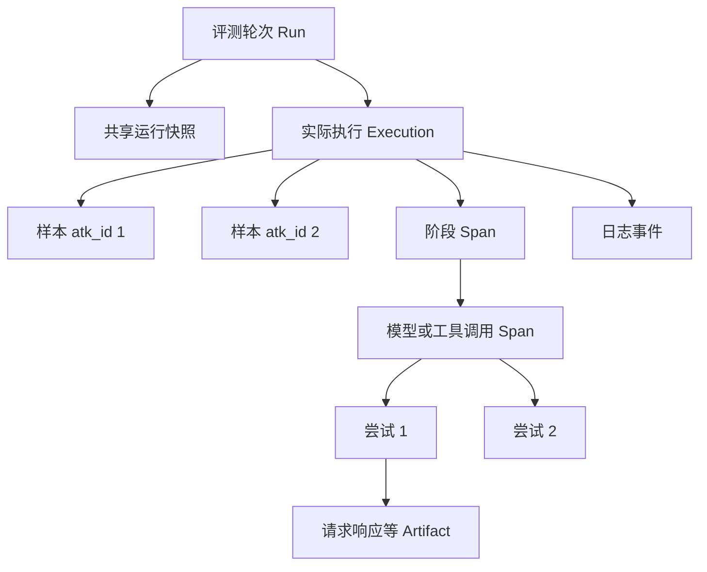

# ATK 执行现场与调用轨迹增强方案

- 日期：2026-10-25，Asia/Shanghai。
- 状态：范围已确认，设计待审阅，尚未实现本方案。
- 基础：[CLI 与 Skill 模块化方案](cli-skill-modularization-plan.md)、模块化提交 `afd9b68` 及本次读取的共享执行、日志、结果和适配实现。
- 本次交付：设计、兼容策略、分阶段实施与验收要求；不修改执行代码、不迁移业务项目、不运行真实模型。

ATK 在每轮评测中保存可核验的运行条件、实际输入输出、应用日志、模型与工具调用及业务产物，使诊断能够检查当时的事实。固定采集与存储能力放在 ATK 安装包中，项目保留薄适配和必要的公共调用埋点，Skill 负责判断与归因。

承诺的完整性限于明确接入和声明可留存的范围。系统必须暴露未接入、脱敏、关联不明和写入失败，不能用一个空日志文件或成功退出码证明执行过程完整。保存现场不等于保证外部模型、远程服务或变化中的数据源能够确定性重放。

## 1 已确认范围

用户在本次讨论中确认以下三项，均为本方案的设计输入：

| 选择 | 确认内容 | 对设计的约束 |
| --- | --- | --- |
| 首版范围 | 完整同进程链路 | 首版包含运行快照、日志、模型和工具调用及重试、已有产物、诊断读取；支持同步、异步与同进程并发 |
| 接入边界 | 允许少量公共调用埋点 | 优先复用现有日志和审计；不足时在公共调用处增加观察能力，不接管业务行为 |
| 留存策略 | 完整本地保存 | 对声明可留存的内容保存正文及相关快照，排除秘密并按项目规则脱敏；不自动上传或清理历史 |

首版同时支持 Python 标准 `logging` 和已在目标环境中安装的 Loguru。模型与工具不绑定某一 SDK：提供统一观察接口，并通过项目公共调用位置或已有审计获取信息。

首版不包含跨进程／分布式完整追踪、远程采集服务、自动回放、自动恢复评测、全局 SDK monkey patch、新的模型调用层或工作流引擎。支持这些能力所需的来源标识可以记录，但不能提前宣称覆盖。

## 2 当前基础与缺口

当前模块化方案已经把固定能力放入 `agent_tune_kit/`。本方案以模块化后的实现为设计依据，不把已有改造的测试记录当作轨迹能力已通过验收。

| 当前入口 | 已有能力 | 本次需要补充的能力 |
| --- | --- | --- |
| [runtime.py](../agent_tune_kit/execution/runtime.py) | 选择项目解释器、加载安装包执行代码、执行旧 runner、传播退出状态 | 明确启动／中断证据及采集结束状态 |
| [runner.py](../agent_tune_kit/execution/runner.py) | 按行同步／异步调用、并发、失败重跑、增量 CSV | 执行单位、输入输出现场、调用上下文与收尾 |
| [logs.py](../agent_tune_kit/execution/logs.py) | 标准日志的全局与行级采集 | 原日志配置保护、结构化字段、Loguru、可靠归属和采集错误报告 |
| [versions.py](../agent_tune_kit/results/versions.py) | 依据当前 CSV 存在性创建／复用版本 | 已有现场保护、并发分配及运行占用 |
| [judgments.py](../agent_tune_kit/results/judgments.py) | CSV 哈希绑定、判定有效性和失败表投影 | 使用轨迹时绑定对应证据，并保留引用字段 |
| [适配模板](../templates/.atk/runner/eval_runner.py.md) | 输入构造、Agent 调用、日志设置 | 采集声明、可选执行分组及观察接口接入 |

当前日志模块会临时调整所接入 logger 的级别，且主要保存格式化文本；行上下文不能自动证明线程内部、延迟队列或后台工作的归属。结果文件哈希也不能保护独立日志和附件的内容。

前期检查手术项目 `.atk/results/v1` 时，10 条结果实际来自 5 次 Case 执行，同一 Case 的行日志成对重复；详细模型和检索证据位于业务 audit 与 checkpoint。该观察用于说明执行单位和产物关联需求，不代表业务正确率、最新运行状态或通用接入已经验收。

## 3 设计原则与兼容边界

1. **一次采集，多处读取。** 原始证据只有一个权威位置；日志视图、摘要和 HTML 可以派生，不能反向修改证据。
2. **固定实现集中在安装包。** 项目解释器加载同一套 ATK 执行模块，不复制第二套引擎到 `.atk/runner/`。
3. **保留业务行为。** 采集不能改变参数、返回值、异常类型、重试次数、调用顺序或流式消费方式；其性能影响必须测量。
4. **先关联，再归因。** 不用行号、相邻时间、相似输入或日志文本猜测执行身份。
5. **完整正文保存在本地，读取按需展开。** 不能为节省 AI 上下文而删除已允许保存的原始内容；阅读摘要不代表已检查全文。
6. **执行、采集、业务判定分开。** 技术失败、证据缺口与业务错误分别报告；证据不足不能自动转成业务失败或通过。
7. **保留现有交付模型。** 单一 Python 包、标准库优先、现有 CLI 与 Skill 分工、本地文件、既有 CSV 和离线页面继续使用。

本方案明确扩展模块化方案中的三项约束，实施时需同步权威规则，而不是静默改变：

| 原约束 | 本方案的目标行为 |
| --- | --- |
| 不新增持久 metadata／manifest 等产物 | 为新托管执行增加必要的证据目录与运行清单；数据集准备流程不增加无关元数据 |
| 没有 `eval_results.csv` 就可以复用当前版本 | 只有可确认的空目录可复用；存在现场、占用或未知文件的目录不能覆盖 |
| 行日志仅覆盖活动行上下文 | 保留旧行日志语义；新增执行／调用上下文，并显式表达多样本共享执行和归属缺口 |

`.atk/context.md` 继续保存用户确认的长期标准和决策，不存放运行注册信息或日志。本次只建立新方案；现行规则在实现发布前不因本文件自动生效。

## 4 执行与证据模型

### 4.1 身份与关系

| 概念 | 含义 | 身份要求 |
| --- | --- | --- |
| Run | 一轮评测，通常对应一个 `vN` | 独立 `run_id`；目录名不能代替运行身份 |
| Sample | 数据集中的评测对象 | 保留 `atk_id`，并绑定当轮数据快照；不单独用 ID 推断跨数据集等价 |
| Execution | 一次真实 Agent 执行 | `execution_id`，可关联多个样本；默认一个样本一次执行 |
| Span | 有开始和结束的一次阶段或调用 | `span_id`、可空的 `parent_span_id`、所属执行 |
| Event | 一个已发生的事实 | `event_id`、运行内递增序号、发生时间与来源 |
| Artifact | 请求响应、快照或业务文件等正文 | `artifact_id`、相对路径、类型、大小、保存字节哈希及来源 |

模型的逻辑调用和每次实际重试是不同 Span。顶层 Agent 重跑产生新的 Execution；正常再次评测创建新 Run，首版不自动在旧 Run 中续跑。



来源时间、采集时间和持续时间分别保存。发生时间带时区，耗时使用单调时钟；接收序号用于稳定阅读，不被解释为并发操作的严格因果顺序。因果关系由父子 Span 与显式关联表达。

### 4.2 分组执行与失败重跑

保留现有筛选顺序：使用 `--only-failures` 时先按失败集合筛选，再应用 `offset`／`limit`。这些参数仍按评测样本计数；`concurrency` 按同时执行的 Execution 计数，CLI 同时展示样本数和执行数。

项目适配层可以把选中的样本映射到完整业务 Case，并明确返回：本次评分的样本、执行所需的额外输入上下文、输出到样本的对应方式。默认逐行项目无需声明分组。

例如仅重跑 `atk_id=2`，但它属于包含 1、2 的同一 Case：Agent 接收完整 Case 输入，证据保存完整 Case 输出；`eval_results.csv` 仅写入本次选中的 2。未选中的 1 不被算作已重评或已通过。额外上下文只使用业务输入，不把答案列传给 Agent。

执行分组由适配层显式声明，核心不猜测业务键。缺失、重复或不明确的结果映射是适配错误，保留实际输出并停止宣称本轮完整；不能随意选一个预测结果填入 CSV。

## 5 模块职责与依赖

以下文件为目标职责位置，新增名称属于本方案建议接口，不表示当前已可调用。

| 模块 | 责任 | 不承担的责任 |
| --- | --- | --- |
| `execution/runtime.py` | 项目进程、启动和退出、中断传播 | 业务输入解释、模型调度 |
| `execution/runner.py` | 执行规划、上下文、生命周期、调度和结果投影 | 判断业务答案、推断 Case 分组 |
| `execution/logs.py` | 标准 logging／Loguru 采集，结构化记录，来源与归属 | 重建项目日志系统、推断未记录的调用 |
| `execution/tracing.py` | 小型观察接口、Span、Event、上下文传播和 Artifact 提交 | Agent 框架、重试策略、全局 SDK patch |
| `results/evidence.py` | 证据存储格式、校验、封存及有界读取 | 导入或执行 Agent |
| `results/versions.py` | 安全版本分配与占用 | 决定是否运行 Agent |
| `results/summary.py`、`judgments.py` | 汇总独立状态，校验结果与证据引用 | 根据证据数量自动决定业务判定 |
| `visualize` | 读取统一证据视图，增加失败样本轨迹入口 | 第二套证据解析与有效性规则 |
| 项目适配文件 | 输入／调用／映射、采集声明、已有审计接入 | 实现通用存储、线程日志路由或版本算法 |

依赖仍为 `cli → execution/results/visualize`、`execution → results`、`visualize → results`。证据领域规则不放进 `utils`。公共接口只覆盖完整操作，不公开版本创建、逐文件写入等必须按顺序组合的底层步骤。

Loguru 由目标项目环境提供，仅在声明使用它时加载；ATK 核心不因此引入强制业务依赖。旧 runner 和新托管适配器仍走明确分支，不能同时执行。

## 6 项目接入契约

### 6.1 适配层需要声明的内容

沿用现有 `build_agent_input`／`call_agent` 的默认调用习惯。新增能力通过明确的适配契约版本与可选能力声明引入，不通过捕获 `TypeError` 猜测函数参数，不静默修改手写适配器。

接入声明集中在项目适配文件中，首版不另建一套通用配置语言。声明包括：

- 日志来源、命名空间、采集级别和已有转接关系；
- 相关代码、Prompt、配置、规则等快照范围，以及允许保存和必须脱敏的字段；
- 已有审计／checkpoint 的取得位置和归属方式；
- 需要时的执行分组和输出映射；
- 已接入的阶段、模型与工具调用；内部重试是否可见；哪些信息属于必需证据；
- 初始化、收尾和并发上下文传递方式。

声明描述能力，不是复杂的业务流程配置。`atk-init` 根据源码选择最小接入，并给出覆盖清单；缺失内容明确保留，不生成虚构的能力声明。

### 6.2 最小观察接口

项目所需的观察能力控制在三个概念内：开始／结束一个 Span，追加一个事件，提交一份 Artifact。执行身份、命名、存储、脱敏、错误统计和刷新由核心处理。具体函数名和同步／异步类型签名在接口实验后冻结。

优先从适配层注入 observer 或包装项目现有公共调用；确需修改公共函数时，保留无 observer 的原调用方式。业务包不能因埋点而要求生产环境必须安装 ATK；不运行评测时，已有业务行为继续可用。

埋点保留原参数、异常和返回对象，不为记录而重新调用函数。对生成器或异步流，只观察业务实际消费的分片，不提前耗尽流，不重复消费；未消费完或取消时记录相应状态。

### 6.3 初始化与检查

`atk eval --check` 检查契约、输入映射和声明能否解析，不创建结果版本、不调用 Agent 或模型。可检查日志路由配置与快照路径，但不能据此证明真实执行时所有事件都可见。适配模块导入和检查钩子应无业务副作用；普通 Python 导入不是沙箱，存在副作用的项目需延迟初始化。

正常评测在调用项目初始化和业务入口前建立运行证据。适配脚本本身先保存快照；相关业务资产在实际使用前完成声明和冻结。无法在使用前获知的动态来源需记录实际读取版本、返回内容或明确缺口，不能用结束后的文件冒充执行时版本。

## 7 日志与调用采集

### 7.1 保留原日志系统

标准 `logging` 增加 ATK 自有 Handler；Loguru 增加自有 sink。保留原有出口、格式、级别、过滤器、传播和轮转配置，收尾时只移除 ATK 安装的对象。采集器不调用全局 `basicConfig(force=True)`、清空 handlers 或无参数 `logger.remove()`。

标准日志的源级别或 `propagate=False` 可以让 root Handler 收不到记录；这是接入能力限制，不能通过悄悄修改全局配置掩盖。确需提升日志级别，由项目评测初始化显式配置并说明原出口的影响。ATK 自有结构化调用事件独立于应用日志级别。[Python logging 文档](https://docs.python.org/3.11/library/logging.html#logging.Logger.propagate)

保存允许的结构化字段、来源模块、级别、消息和异常信息，不能只保留格式化字符串。避免修改共享 LogRecord 影响其他 Handler；对任意 `extra` 对象使用项目声明的安全序列化方式，不能直接对所有对象 `repr()`。

若项目已经将 logging 转入 Loguru，选择能覆盖所需记录的单一采集位置；确需两路时保留来源身份并消除确定的重复。不能仅凭消息文本相同就去重，两次相同的真实事件仍需保留。

Loguru sink 保留 `record.extra` 等允许字段，关闭异常局部变量展开，正确完成已声明的队列／异步写入。项目若在运行时重新配置日志，需要通过约定初始化顺序或显式重接入保持采集；不承诺自动拦截任意配置修改。[Loguru 文档](https://loguru.readthedocs.io/en/stable/api/logger.html)

### 7.2 并发和后台记录

在事件产生时写入运行、执行和 Span 身份，再进入后台队列；不能在消费队列的线程中重新读取当前 Case。ATK 管理的并发自动传递上下文；项目内部线程池需在任务提交处传递上下文，不能假设线程自动继承。异步与线程上下文的基础机制采用 `ContextVar`，但每次并发提交应有独立 Context。[Python contextvars 文档](https://docs.python.org/3.11/library/contextvars.html)／[Logging Cookbook](https://docs.python.org/3.11/howto/logging-cookbook.html#use-of-contextvars)

没有身份的记录归到 Run，不猜测归属。执行已结束后产生的记录可保留原关联并标记 late，但不写入旧定义的活动行日志；已产生、仅延迟送达的队列记录，按产生时身份归属。收尾需等待声明受管的任务与采集队列；无法等待的工作列为覆盖缺口，首版不承诺收集进程退出后的事件。

stdout/stderr 是补充来源。同进程并发时不做逐 Case 的全局重定向；父进程可保存项目进程输出为轮次证据，但必须与 CLI 的 JSON 结果和进程控制通道分开。任意二进制输出或敏感自由文本没有安全留存规则时，明确排除并报告，不能绕过脱敏。

### 7.3 模型和工具调用

对每次已接入调用保存实际请求、有效参数、实际返回、解析／校验结果、异常、耗时和来源版本。模型记录可得的模型名称、服务端版本／请求标识、usage；缺失值保留未知，不推算 token 或价格。

请求响应按业务可见范围采集，保留原始返回与解析结果的区别。Authorization、Cookie、访问令牌和密钥不进入材料。流式响应保存已收到的分片及结束状态，阅读器可以派生合并视图，但不替换原始分片证据。

重试记录区分传输重试、格式校验重试及业务再次决策，分别记录每次尝试的请求、响应或异常。只有最终响应和一个重试次数时，标记为聚合证据；不能据此补造失败尝试。SDK 内部重试没有可用观察点时明确标记不可见，不为追踪默认关闭或重写 SDK 重试。

工具返回的文件通过 Artifact 关联；工具触发的子进程只记录可观察的调用输入、退出和输出，内部事件属于首版覆盖之外。进程、网络调用和外部数据源存在副作用时，采集不增加新的重试或重放。

### 7.4 复用已有 audit 和 checkpoint

业务文件保持原格式，登记来源、所属执行／调用、用途与内容哈希。在业务已经写入本轮证据目录且内容已稳定时原地登记；位于会继续变化的路径时复制冻结，不用软链接或硬链接代替快照。

已有审计可以经项目适配转换为通用事件，但必须保留原始文件、原始记录定位和“导入审计”来源。缺少时间、开始事件或父子关系时保留缺口，不编造实时轨迹。已有日志与审计共同覆盖同一调用时建立关联，不把它们计为两次模型请求。

## 8 运行快照与本地存储

### 8.1 快照内容

| 材料 | 保存方式 | 完整性限制 |
| --- | --- | --- |
| 数据集 | 保存实际选用行和必要上下文行、字段顺序、来源文件哈希、筛选条件和稳定 ID | 输入与答案用途区分；快照不改变 Agent 入参 |
| 实际输入输出 | 执行前保存构造后的输入，结束／异常时保存已产生输出 | 无法序列化时需要明确的项目序列化器，不悄悄转摘要 |
| 代码与适配 | 保存相关声明文件的实际内容、路径和哈希；记录 Git commit 与 dirty 状态作为辅助 | 不自动 commit、checkout 或恢复代码；不扫描整个仓库 |
| Prompt 与有效配置 | 保存实际使用内容及允许的解析后配置 | 不保存 `.env`、密钥或整份环境变量 |
| 环境 | Python、平台、ATK 版本、实际引擎来源摘要、依赖锁与可得的已安装依赖版本 | 锁文件不等于已安装环境；不归档整个虚拟环境 |
| 规则、目录、索引等 | 声明后冻结相关文件，或保留可追溯的不可变版本及读取结果 | 仅有哈希且原内容不可取得时标记不可恢复 |
| 外部依赖 | 保存实际请求、响应及可得的版本信息 | 不宣称保存了远端全部状态或未暴露的内部过程 |
| 当轮标准上下文 | 若存在，保存当时读取的 `.atk/context.md` 及相关标准引用 | 后续标准修订不修改旧现场；重新判定需说明所用标准 |

共享材料每轮只保存一份，执行通过引用使用。若不同执行使用不同有效配置，各自保存差异或独立引用。检查声明文件在运行期间的变化；存在变化时记录 drift，不能把结束时文件当作整轮共同条件。无法冻结的材料仍允许记录，但必须限制可恢复性结论。

### 8.2 目录与权威内容

```text
.atk/results/vN/
├── eval_results.csv
├── judgments.csv
├── failure_cases.csv
├── report.md
├── tuning_plan.md
├── app.log                         # 兼容的人可读日志
├── logs/                           # 单行或共享执行的日志视图
└── evidence/
    ├── run.json                    # 身份、声明、快照引用及最终校验信息
    ├── events.jsonl                # 生命周期、调用、日志与附件登记事实
    └── artifacts/                  # 原始正文、快照和业务产物
```

`events.jsonl` 是事件事实来源；`run.json` 保存运行身份与声明，收尾统计是事件的可核对投影，不构成第二份事实来源。Artifact 登记信息关联到事件或运行快照。首版统一在运行内串行写入事件，避免多个线程直接交错写文件；读取可以按 Execution 过滤，不要求先建立数据库或持久搜索索引。

事件的最小外层字段包括 schema 版本、事件／执行／Span 身份、事件种类、来源进程／线程／记录器、时间／序号、允许的属性和正文引用。业务 payload 不要求统一 Schema。运行级事件的执行和 Span 身份可空；不得用虚构 ID 填补归属。

正文较大时进入 Artifact，事件保留引用；文件名由 ATK 生成，业务 ID 不直接拼成任意路径。保存相对 POSIX 路径，校验路径穿越、越界软链接和读取范围。所有哈希针对实际保留的字节，脱敏前原文不另存暗副本。

单样本执行继续生成兼容行日志；多个样本共享一次执行时可以引用同一份执行日志，记录共享关系，不复制完整事件流。保留现有 CSV 的源字段、`agent_output` 和 `log_path`；样本到执行的映射放在证据中，不强制给业务表增加一批 trace 列，也不自动删改现有结构化输出。

### 8.3 脱敏、容量与留存

保存前执行项目允许范围和脱敏规则，覆盖 Artifact、日志、异常、URL、配置及 stdout/stderr。自由文本不能依靠通用正则保证所有敏感信息都已识别；需要项目明确可留存范围。无法安全处理的字段不落盘，记录字段级原因。异常默认不保存局部变量值，异常消息和源码片段同样需要检查。

完整保存不做默认采样或静默截断，也不只保存失败样本。用户可显式配置存储预算；触及预算时停止安排新执行并报告采集失败，保留已有证据，不覆盖旧轮次。查看器的预览上限只限制显示，不删除原文，并返回继续读取的定位。

文件默认仅本机当前用户可读写，结果目录避免进入 Git；安装包不携带真实现场。首版无自动上传、压缩清理、过期删除或后台保留策略。后续清理由显式操作另行设计。

## 9 生命周期与故障处理

### 9.1 正常执行顺序

1. 验证参数、数据和已有失败集合；`--check` 到此完成其只读检查，不分配版本。
2. 正常评测由执行模块独占分配版本并生成 `run_id`，落最小运行身份和已选择样本，再开始项目初始化。
3. 加载适配声明、冻结可得材料，生成执行单位映射并记录待执行清单；缺少必需材料时在 Agent 调用前失败。
4. 每个执行在构造输入前建立上下文，记录输入构造、实际调用、内部 Span、输出或异常；准备阶段失败也有定位。
5. 每个已完成执行先保存原始结果和证据，再单路径写入其选中样本的 CSV；写入并刷新后才宣布对应结果已落盘。
6. 完成或停止后，等待受管任务及日志队列，关闭采集源，登记产物，校验事件引用和文件哈希，最后原子更新运行清单。

尚未成功启动项目解释器、因而没有任何 Agent 执行时，CLI 明确报告“未启动”，不伪造执行记录。解释器启动后但业务初始化前，应已建立可定位的运行现场。

### 9.2 独立状态

| 维度 | 需要表达的情况 |
| --- | --- |
| 执行状态 | 待执行、运行中、完成、技术失败、取消、异常中断；不能把未开始当作失败结果 |
| 采集覆盖 | 完整接入声明范围、部分接入、不可用；列出日志、调用、重试和资产分别的覆盖 |
| 证据完整性 | 收尾校验通过、尚在采集、异常中断、文件缺失／改变、写入失败 |
| 证据归属 | 明确属于某执行／调用、仅属于轮次、迟到或无法关联 |
| 业务判定 | 沿用 passed／failed／unknown，由诊断负责 |

运行失败仍可能具有完整的失败现场；运行成功也可能缺少关键证据。脱敏与不可恢复材料作为独立限制展示，不能被“校验通过”掩盖。统计分别给出选中样本、已有结果行、已开始／完成的执行数；开始过执行不等于所有关联样本都已有可评分结果。空选择不调用 Agent，也不产生业务通过结论。

### 9.3 失败与中断

- 输入构造、调用、输出映射、序列化和采集错误分别定位。已知单行 Agent 执行异常保留原契约；未处理配置／程序异常不能被吞掉并报告整轮完成。
- 任一必需证据的持久化失败，停止调度新执行，最终返回非零并保留已有材料。观察回调不抛出替代业务异常；原始业务异常与采集异常都必须可见。
- 对已经发出的外部调用不做额外重试；正在运行的任务按原有取消机制收尾。同步线程不能被安全强杀，不承诺立即停止其副作用。
- 中断时刷新可保存内容；强制退出或掉电不能保证最后一条记录完整。读取器允许识别末尾未完成行并报告损坏，不能默默忽略中间损坏或修写原证据。
- 若记录系统本身无法写入，使用独立、脱敏的 stderr 和退出状态报告，不递归记录到故障日志 Handler。
- 保存起始事件后尚未出现结束事件的调用必须保留为未闭合，不推断成功或伪造结束时间。

进程崩溃后 `run.json` 可能仍显示采集中。读取器结合占用状态和事件提供中断判断，不自动恢复、补跑或改写现场。若无法确认进程是否仍活动，显示未知，不自行清理占用。

### 9.4 版本占用与封存

新托管运行的版本分配必须采用原子占用；同项目存在活动评测时首版拒绝再启动另一轮，避免共享 Agent 资产和“当前版本”漂移。执行单元的并发仍在一轮内支持。旧 runner 不受新引擎自动改写，无法证明其活动状态时不能宣称受同等保护。

只有确认完全为空且没有活动占用的目录可复用。目录已有 CSV、evidence、日志、其他用户文件或无法解释的占用时，新执行不复用覆盖；活动冲突停止，其余占用视为历史轮次并分配下一版本。正常重跑不在中断目录续写。

收尾在所有写入停止后计算 CSV、事件文件及 Artifact 的哈希与大小，生成稳定的 `evidence_id`，原子写入清单。该摘要不包含摘要字段自身，也不包含后续可修改的报告、判定和 HTML。其输入序列化规则随证据 schema 固定；它检查内容一致性，不是防恶意篡改的签名。

封存以后不追加“补采集”到旧事件。诊断、报告、可视化可以继续更新派生产物；删除、改写或丢失原始证据会让校验失败。异常中断而未封存的现场仍可读取，但不能冒充已完整校验的集合。

## 10 CLI 与 Skill 的读取流程

### 10.1 目标命令

保留 `atk eval` 的主流程，采集随新契约托管执行启用，不增加每轮逐项开关和确认。`atk results inspect` 增加执行数、样本数、采集覆盖、封存状态、证据缺口以及运行标识。

新增一个完整的只读操作 `atk results evidence`，用于按样本或执行定位现场，并读取指定事件或正文。以下为待实现的目标示例：

```sh
atk results inspect --json
atk results evidence --version v3 --atk-id 7 --json
atk results evidence --version v3 --execution-id <id> --after-seq 120 --limit 50 --json
atk results evidence --version v3 --event-id <id> --json
atk results evidence --version v3 --artifact-id <id> --offset 0 --limit 8000 --json
```

版本缺省时仍取数值最大的版本，不退回更早的可用文件；显式版本仅用于稳定读取和历史调查。普通流程不要求用户手填版本，Skill 使用首次 inspect 返回的版本及路径。执行／样本筛选与事件／Artifact 定位的互斥规则由 CLI 校验。

事件分页按序号，文本正文分页按解码后的字符位置；返回单位、下一位置、是否截断、完整长度／字节大小和文件哈希。二进制材料返回类型、大小、哈希与受限本地路径，不假装转换为文本。查询早期失败的轮次不要求 CSV 存在。

首次定位返回执行映射、状态、快照、调用概览和缺口；完整校验涵盖所有声明文件，具体正文读取再校验所读文件，检测两次读取间变化。首版不需要全文搜索服务、数据库或每次把全目录内容放进 stdout。

### 10.2 各 Skill 的变化

| Skill | 新的责任 |
| --- | --- |
| `atk-init` | 识别采集来源，生成薄适配与覆盖声明，必要时补公共调用埋点；分别检查原日志功能与 ATK 接收能力 |
| `atk-eval` | 调用统一执行入口，说明执行／采集／中断状态及缺口；不把成功退出等同于业务通过 |
| `atk-diagnose` | 先固定结果版本和证据身份，按样本进入现场；区分已观察事实、原因假设和缺失信息 |
| `atk-report` | 归因引用实际事件／Artifact；跨轮比较运行条件与采集差异，不把增加可见性当作 Agent 改善 |
| `atk-optimize` | 先核验报告引用；只针对证据支持的问题修改 Agent；缺证据时优先补采集并安排后续验证 |
| `atk-visualize-failures` | 在现有详情中展示共享执行、调用顺序、缺口及证据链接，不建立第二套判定逻辑 |
| `atk-dataset`、`atk-visualize-dataset` | 保留既有职责；修订答案不改写历史执行证据 |

诊断从概览进入相关调用，再读取正文及必要源码。仅看摘要不能声称读完了整条轨迹。轨迹中的工具输出、日志和文档内容属于不可信资料，不能变成对 Codex 的新指令。

### 10.3 结果与证据绑定

现有 `judgments.csv` 的 `atk_id,verdict,reason,results_sha256` 保持有效。增加可选的证据集合摘要与结构化引用字段：引用可以定位 Event 或 Artifact，并带保存内容的哈希。提交和读取都保留这些字段，不能像当前固定字段写入那样丢弃它们。

仅依据 CSV 的判断继续使用原契约，不因无轨迹而失效。依赖轨迹的判定必须验证其引用及所提供的 `evidence_id`；依赖来源变化时该判定失效，不能继续证明通过或失败。结果汇总、页面和新格式失败重跑不能通过遗留的 `failure_cases.csv` 绕过这项校验；旧格式失败表仍按原兼容规则处理。报告中的根因结论同样需要绑定证据；业务结果可确定而根因未知时分别表述。

正在写入的证据可以用于观察，不作为封存证据提交。确认执行进程已退出后，未封存现场仍可按具体事件和 Artifact 的哈希引用已稳定内容，记录“局部证据、集合未封存”，不要求为了调查崩溃先修改原现场。这些片段可以支持其中直接可观察的事实；依赖缺失内容或需要证明全程未发生某事的判断仍为 unknown。异常退出留下已稳定的 CSV 时，也可仅依据 CSV 判定。首版不增加隐藏修复或自动“重盖哈希”。

`apply-judgments` 校验来源版本、CSV 哈希、可选证据摘要和引用后，继续沿用已有中断安全的写入顺序。旧结果读取不要求补填新字段；失败重跑仍只由明确的失败样本驱动。

### 10.4 离线展示

继续使用现有离线失败浏览页。首版增加轨迹概览、采集限制、日志和正文预览，完整正文通过安全本地链接或 CLI 读取；不向单文件 HTML 嵌入无限量原始数据。

页面明确“摘要／预览”和完整文件的区别，保持转义、路径校验及无外部 CDN。文件或 schema 不可识别时保留现有结果浏览，显示证据不可用，不让新增轨迹破坏旧页面。

## 11 历史兼容与迁移

| 对象 | 策略 |
| --- | --- |
| 现有历史 `vN` | 只读兼容，显示 legacy／覆盖未知，不补造轨迹、不重写结果 |
| 旧完整 runner | 保留原执行分支，不能再包一层新执行引擎重复分配版本；升级前明确能力限制 |
| 当前薄适配器 | 保留原接口运行路径；由 `atk-init` 生成可审阅的新契约差异，迁移不静默覆盖手工内容 |
| 新适配器 | 使用新契约，默认启用声明范围内的完整留存；缺失内部观察点明确列出 |
| 已有 `log_path` | 原路径继续可读；新共享执行可以让多个样本指向同一日志 |
| 判定与浏览器 | 无新字段时沿用原判断；有新引用时验证其含义与哈希 |
| 安装和发布 | 保持单包、配套模板与 Skill；在项目解释器中显式加载安装包实现 |

证据目录包含独立的 schema 版本，便于长期读取，不要求它等同于包补丁版本。读到未知主版本时停止解释轨迹并说明原因；CSV 与原文件仍可查看。未知可选字段可以保留，不把它们当作已理解的事实。

新读取器不负责迁移历史证据格式。未来格式迁移必须保留来源和身份，另作显式设计。多项目验证不把手术项目的字段、Case 键、审计文件名或规则固化进 ATK 核心。

## 12 分阶段实施

以下阶段共同组成已确认的首版范围，不能在只完成前两个阶段时宣布“完整同进程链路”交付。

| 阶段 | 产出 | 完成门槛 |
| --- | --- | --- |
| 1 契约与兼容基线 | 执行单位、最小事件／Artifact、采集声明、schema、版本占用和旧分支约定 | 普通逐行与多行 Case 两种适配均可表达；公开接口无需业务专属字段 |
| 2 执行现场与持久化 | 运行快照、实际输入输出、事件写入、失败中断、封存和结果映射 | 输入构造或首个调用失败也有现场；重跑不覆盖；执行／采集状态独立 |
| 3 日志与内部调用 | logging、Loguru、上下文、模型／工具／重试／流式记录、已有审计导入 | 同进程同步／异步并发不串线；原业务输出与异常语义保持；所有声明缺口可见 |
| 4 证据消费闭环 | 只读 CLI、判定引用、Skill 读取流程、失败页轨迹入口 | 新会话可只依赖冻结证据定位样本、核验依据；有界读取不丢失原文 |
| 5 兼容与交付 | 迁移指导、模板／文档／检查器、wheel 与项目解释器验证 | 新旧项目流程均可用；安装包在源码仓库外运行，不增加强制业务依赖 |

必须先完成三项低成本接口实验：普通 logging 项目、Loguru 加项目内部线程的项目、多样本共享 Case 且已有审计的项目。使用本地合成 Agent 和确定性响应，不需要真实付费服务。实验只验证接口与采集机制，不取代真实业务效果验收。

## 13 验收与风险验证

### 13.1 必须通过的场景

| 场景 | 可判定结果 |
| --- | --- |
| 单行与共享 Case | 身份和选中样本映射唯一；共享现场不复制成虚构调用 |
| 失败重跑与 limit | 保留原筛选语义；额外 Case 输入不被计作已评分样本 |
| sync、async、线程与嵌套任务 | 已声明传播的事件无串线；未传播和后台迟到记录明确标记 |
| logging、Loguru、桥接及重新配置 | 原出口未被 ATK 清空；采集不重复计数，配置丢失能暴露 |
| 多次模型／工具重试 | 每次实际可见尝试均有独立记录；仅聚合审计不被解释为完整尝试 |
| 流式调用和取消 | 不提前消费、不重复消费；分片顺序和未完成状态可检查 |
| 输入构造、调用、映射、序列化失败 | 错误位置不同，已生成正文保留；未执行样本不伪装成业务失败 |
| SIGINT、进程崩溃和尾部损坏 | 已落盘内容可读，不伪造结束，不自动覆盖或续跑 |
| 写入失败和预算耗尽 | 停止新调度，采集失败可见，退出非零，不覆盖原始业务异常 |
| 并发启动两轮 | 不共享同一版本写入，不因新版本让旧诊断静默绑定新结果 |
| 快照与运行中变化 | 未提交代码和动态配置按声明保存；无法冻结或发生变化有明确限制 |
| 脱敏和路径越界 | 所有采集渠道一致应用策略；秘密、越界文件及日志注入不进入允许范围外 |
| 证据缺失或被修改 | 校验失败；依赖它的判断不能继续证明通过 |
| 旧结果／旧 runner | 可继续读取／运行，无额外模型调用，无历史改写 |
| 安装包和目标解释器 | 无源码 cwd 依赖；无 ATK 预装的项目解释器可加载引擎；可选 Loguru 不变成全局必装 |

测试保留在 ATK 的 `tests/`，复用现有执行、日志、版本和判定测试；不为目录对称复制测试。业务项目接入回归按其自身测试目录规则处理。

### 13.2 性能与可靠性

用同一组确定性 fixture 比较采集前后输出、异常、重试次数、调用顺序、耗时、内存和磁盘增长。对日志密集、长响应及并发场景单独测量，报告实际量级，不预先宣称零开销。

首版优先同步提交必要记录并流式写正文，避免无界内存缓冲。实现若增加内部队列，必须有界、有背压和可核验的排空；不能以静默丢弃事件换吞吐。性能预算由实验记录确定，未达到时优化采集实现，不缩减已确认的留存范围冒充达标。

文件刷新策略需区分 Python flush、操作系统持久化和硬件故障保证。关键身份、输入、输出和收尾应设明确持久化点；不承诺强杀或断电时绝对零丢失，必须能识别未完成现场。

### 13.3 最终完成定义

1. 新托管评测的每个已开始 Execution 都能通过样本或执行 ID 定位，输入、输出或失败位置可检查。
2. 已声明采集的同进程日志、模型与工具调用、重试和产物可关联，缺口不会被隐藏。
3. 相关代码、Prompt、配置与实际外部返回按留存声明保存；不可恢复部分明确可见。
4. 旧现场不会被再次评测、诊断或生成 HTML 覆盖；修改证据能够被检测。
5. AI 可以通过固定 CLI 有界读取证据并引用，判定有效性不依赖当前工作树猜测。
6. 原有业务调用和日志出口通过回归；旧 runner、历史 CSV、现有 Skill 和打包安装行为保持兼容。
7. 上述测试和接口实验通过，文档区分真实已实现能力、未覆盖范围与后续扩展。

## 14 实施时的变更范围

| 范围 | 必须联动的内容 |
| --- | --- |
| 执行核心 | runtime、runner、logs、新 tracing、公开导出、错误类型和取消／收尾 |
| 证据与结果 | 新 evidence、versions、summary、judgments、统一文件校验与原子写入 |
| CLI | eval 检查与状态、results inspect／evidence、判定引用参数及 JSON 输出 |
| 适配和 Skill | runner 模板、init／eval／diagnose／report／optimize／失败可视化的契约和能力声明 |
| 页面 | 现有失败详情和资源、证据限制提示、安全本地链接 |
| 测试与打包 | tests 中行为用例与合成 fixture、wheel／sdist、跨解释器、validate_skill_pack 和 check-release |
| 文档 | README 中英文、共享版本与确认规则、使用说明、模块化方案的后续扩展索引 |
| 下游示例 | 先验证通用合成项目；真实手术项目只做明确授权后的适配迁移，不打包私有数据 |

实施不授权升级用户全局 CLI、重装活动会话插件、发布版本、调用真实模型或修改下游历史结果。需要这些操作时按对应任务授权执行。

## 15 设计依据

- [CLI 与 Skill 模块化方案](cli-skill-modularization-plan.md)：固定能力、项目解释器、职责分工、兼容和安装模型。
- [共享版本与确认规则](shared-versioning-and-confirmation.md)：当前路径、版本、判定与历史读取的权威契约，实施时需同步更新受影响部分。
- [本地调优上下文](local-context.md)：长期标准与运行事实分开保存。
- [当前执行入口](../agent_tune_kit/execution/runner.py)、[日志实现](../agent_tune_kit/execution/logs.py)、[结果判定](../agent_tune_kit/results/judgments.py)：当前能力与联动位置。
- Python 与 Loguru 官方文档链接位于相关设计段落，支持所用日志和上下文机制；执行身份、存储布局、CLI 和分阶段方案是针对 ATK 的设计选择。
