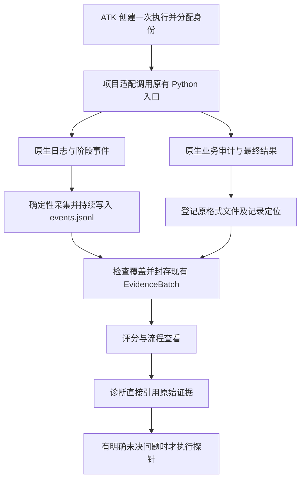

# ATK Python 执行日志与证据采集改造方案

状态：主体已实施并完成本地对比核验；适用范围与限制见[验收记录](python-execution-evidence-validation.md)。方案日期：2026-10-12；验收日期：2026-10-13，Asia/Shanghai。

本方案面向已有 Python Agent 或服务的批量评测：为每个测试项的每次实际执行保存可定位的日志，关联原生业务审计与结果，让评分和诊断直接使用同一份执行事实，并减少会话临时生成的中间资产。

总体方案是由 ATK 统一负责执行关联、日志采集、证据登记和完整性检查；项目通过一次性适配提供原有日志来源、关键阶段与业务审计映射。ATK 保证已声明且经过验证的采集行为，不承诺自动观察未埋点的业务过程。

## 目标与预期价值

| 目标 | 改造后预期行为 | 用户获得的价值 |
| --- | --- | --- |
| 每次执行可独立追溯 | 一个 Case 的重复运行和重试分别保存，按执行编号关联日志、结果和审计 | 不再从全局日志按时间猜测归属，也不会把重试覆盖为一次成功 |
| 关键流程可还原 | 在声明的观测范围内串联阶段、分支、调用、校验和终止状态 | 能检查实际执行路径，定位最早出现异常或结果偏差的位置 |
| 采集与读取可预测 | 使用固定文件入口、版本化格式和确定性查询规则 | AI 使用稳定的诊断步骤，无需每轮重新编写提取脚本 |
| 原生事实只保存必要副本 | 直接登记原生审计；摘要和判定引用原记录 | 减少重复内容、引用漂移和多份数据不一致 |
| 接入可复用 | 同一采集实现支持标准 logging 和 Loguru 项目，业务映射在接入时完成 | 后续批次复用已验证适配，减少项目接入和维护成本 |
| 缺失范围可见 | 将执行结果、日志采集状态、流程覆盖状态分别记录 | 不把日志缺失误判为业务失败，也不把局部记录宣传为完整归因 |

“确定性”指同一输入记录与同一转换版本得到一致的索引和流程视图。它不要求模型输出、耗时或并发事件顺序固定；采集顺序也不等于因果顺序。

## 现状与问题

本次源码核对基于 ATK `4dfee08`，Python 包版本为 `1.1.0`。实际使用问题来自此前通过 `1.0.0` 生成的本地 Python 流水线评测记录；历史运行没有因为源码版本更新而重新验收。

| 已有能力或现象 | 当前缺口 | 改造方向 |
| --- | --- | --- |
| runner 已为每次 attempt 分配独立目录和执行编号 | stdout 和 stderr 通过 `communicate()` 收集，stderr 在该调用结束后才写入文件 | 持续采集，异常终止时保留已收到的记录 |
| EvidenceBatch 已有 records、指纹和证据索引 | 原生业务审计未统一作为可直接定位的事件或附件登记 | 扩展现有证据索引，不再为引用原始审计而重复导入整批数据 |
| Python 服务通常已有日志或业务审计 | 调用业务函数不一定执行原有日志初始化；默认文本格式可能丢失关联字段 | 接入时核对真实初始化路径、输出出口和字段覆盖 |
| 会话可通过源码摘录、导入和探针完成调查 | 请求/响应、评分脚本副本、映射表和大块诊断预览持续累积 | 统一工具承担机械操作，临时材料不作为默认长期产物 |
| Assessment 和 Issue 保存判定及解释 | 摘要可能再次复制完整输入、答案、输出及审计正文 | 保留唯一事实来源；展示按需读取，结论带稳定引用 |

本地 Python 流水线样本已经分别保存运行事件、检索审计和模型请求/响应。接入不足以及后续再次提取、转换的做法，说明文件多并不代表观测完整。该样本用于发现问题，不作为所有 Python 项目日志质量的假设。

## 范围与责任

### 本期范围

- 可由 ATK 在本地启动的 Python 入口，默认每次实际执行使用独立进程；支持被测入口内部的线程与 asyncio。
- 标准库 `logging` 与 Loguru 的日志接入，以及项目已有 JSON/JSONL 审计的确定性映射。
- 单次执行日志持续保存、原生证据登记、稳定读取、覆盖检查和相应 Skill 流程调整。
- 跨项目验证：标准 logging 的独立合成 Python 项目与一个 Loguru 真实 Python 项目。

有内部子进程的项目必须声明采集方式，并通过该模式的关联与中断检查；不能默认继承父进程日志能力。常驻服务或共享进程保留既有执行方式，不能为方便分文件而改变热缓存、会话状态或请求语义。本期不交付通用远程日志平台连接器；没有服务端关联与取数能力时，只声明客户端可观测范围。

### 职责划分

| 责任方 | 负责内容 | 保证范围 |
| --- | --- | --- |
| ATK runner 与采集工具 | 分配执行身份，采集已配置来源，持续写入，记录异常退出，检查引用与落盘结果 | 在已验证运行模式下提供可检查的采集结果；明确中断或缺失 |
| 项目适配 | 沿用原有入口和日志初始化，声明 logger、关键阶段、原生运行编号及审计位置 | 不把配置中期望发生的流程当作实际观察 |
| ATK 评分与诊断 | 从固定入口读取事实，按版本化标准判定，记录解释和缺口 | 判定与原始执行分离；诊断推测不回写为原始事件 |

本期不建设新的日志平台、通用自动函数追踪器或多语言 SDK；不强制项目更换日志库。不将本改造作为历史 `.atk` 的清理、迁移、覆盖授权，也不改变已有候选采用、预算和最终验证要求。

## 执行与证据流程



1. 接入时检查原有日志及审计，保存项目映射和验证结果。
2. 批量执行时，为每次 attempt 分配独立目录；重复和重试产生新执行身份。
3. 项目仍按原有方式执行业务。日志由受控采集出口持续写入；原生审计保持原格式。
4. 执行结束或中断后，ATK 核对采集状态、声明的覆盖范围和证据引用，保存到现有批次对象。
5. 评分和诊断通过同一读取入口查看流程与原生明细。新标准产生新 Assessment，原始执行不重新生成。

### 执行身份与日志隔离

沿用 `batch_id`、`case_id`、`execution_id`、`repeat_index` 和 `retry_of`。Case 表示测试任务，attempt 表示一次实际执行；一个 Case 可以有多个 attempt。

项目已有 `run_id`、请求编号、业务子项编号或调用编号时，显式建立关联。不得用时间接近、业务文本相同或“最后一条输出”推断归属。同一次测试含多个业务子项时，保留它们的子项关联，不把它们误拆成独立 Case。

本地独立进程使日志自然归属到 attempt，但内部阶段与并行调用仍需各自的关联信息。共享进程中的请求必须显式传递上下文；缺少可靠关联时保留为未归属事件，并降低覆盖结论。

### 采集与持续落盘

标准 logging 使用受控 Handler，Loguru 使用原生 sink。通用采集代码由 ATK 随包提供，不由会话为每个批次重新编写。目标 Python 环境不强制安装整个 ATK；实现优先沿用现有标准库 runner 和随包适配资源，Loguru 只在目标项目原本使用时接入。

在业务执行前完成日志初始化和采集接入，核对日志级别、过滤器、传播关系及重复出口。保留项目原有行为，不默认清空全部 Handler、全局启用 DEBUG 或记录所有变量。初始化之后再次修改日志配置的行为必须纳入接入检查。

stdout 保持既有结果通道，不能把日志混入后再靠文本猜测最终 JSON。stderr 提供底层异常与未结构化日志的补充来源；同一来源已可靠采集时，不再默认长期保留第二份同内容副本。

采集采用有界缓冲并持续写入，正常退出时排空已接收记录。截断、队列溢出、磁盘写入失败和输出解码异常必须可观察，不能静默丢失后标记完整。子进程被杀时，外部 runner 记录终止原因并保留已接收前缀；runner 自身被杀后，恢复检查标记未闭合执行，不伪造服务发出的结束事件。无法保证恢复进程尚未输出或尚未刷出的末尾内容。

每个 attempt 的目标事件文件只有一个写入者。需要内部多进程汇集时，使用显式队列采集或独立来源文件后确定性汇集，禁止多个普通 FileHandler 无协调地写入同一文件。记录生产端顺序和可用的父子关系，不将汇集顺序强行解释为业务因果。

### 固定事件记录与原生审计

在现有路径增加固定入口：

```text
.atk/evidence/<batch-id>/attempts/<execution-id>/events.jsonl
```

输入、结果、批次 manifest 和 records 继续沿用既有对象。事件文件只承担执行轨迹；不再添加一套可以独立修改的 Execution 副本或新的批次元数据目录。

事件记录采用版本化格式，最小信息为事件 ID、执行身份、事件类别、来源、采集顺序及时间。原始时间缺失时记录接收时间并标明时间依据。普通日志保留级别和消息；阶段、调用、父子关系、异常类别和原生引用在可观察时记录，不填造未知字段。

流程映射优先使用已有结构化事件。缺少关键开始、结束、跳过或失败记录时，仅在项目入口或关键阶段补充必要事件。映射必须支持合法分支，不能假设每个任务必经完全相同的阶段。映射与采集配置变化要版本化，并在正式对照中冻结，避免两侧采集条件不同却声称可比。

模型提示词、原始响应、检索候选和工作簿等保留在原有受控审计或结果中。ATK 登记来源身份、文件内容指纹、记录选择方式和所属执行，通过现有 `evidence_index` 为必要事件或附件分配可引用 ID。Issue 和 Assessment 继续使用明确的证据引用，读取时解析到原生记录，不要求先复制为另一批导入证据。

指纹验证必须覆盖实际被引用的内容；只校验索引 JSON 不足以证明原生附件未被改动。对会轮转、覆盖或过期的来源，在封存前保存一次受控快照；对已有稳定且可验证的本地保存位置直接引用。同一内容用于多个判断时复用引用，禁止因生成报告再次复制正文。

### 覆盖状态与能力边界

接入验证记录在现有项目配置/运行说明中，本次执行覆盖结果记录在批次及对应 Record 中，避免再为每项检查生成独立说明文件。

| 可声明的能力 | 必须具备的证据 | 可支持的分析 |
| --- | --- | --- |
| 执行外壳可观察 | 明确的执行身份、启动和终止状态、可获得的输出或异常 | 是否启动、退出、超时及可观察的结果 |
| 关键流程可观察 | 声明范围内的阶段、分支、调用关系和终止情况通过检查 | 在声明范围内确认实际执行路径和定位异常阶段 |
| 具备语义归因材料 | 相关原始输入输出、业务审计、校验和结果可定位，且覆盖问题所需范围 | 支持有证据的语义分析；不自动证明某个机制具有因果性 |

上述能力与“本次采集完整/部分/未知”分别记录；执行成功也可能日志不完整，执行失败也可能留下完整的故障轨迹。覆盖完整仅针对声明范围，不代表内部所有行为均可观察。

评分按所需证据逐维判断。缺少无关日志不应自动否定可核验的最终结果；缺少某维度必需证据时，该维度保持未知或证据不足，不能用总体采集标签替代原有门禁。

### 固定读取与诊断方式

在现有内部操作入口提供只读执行查看能力，支持按批次、Case、execution、阶段或失败事件定位，并按页读取事件和原生引用。具体操作名在实现时确定，不新增公共 Skill 或独立日志服务。

同一封存来源、相同映射版本和相同查询条件返回相同内容；读取和重建视图不运行 Agent、不调用模型、不新建 EvidenceBatch。界面或 HTML 是可重建视图，不成为第二份评分权威来源。

诊断沿用固定路径：评分差异 → 对应执行 → 最早可观察的异常或偏差 → 原生审计 → 源码或契约核对 → 结论及未决问题。正常日志级别不表示答案正确，因此不能只搜索 ERROR。需要探针时先说明它将排除什么解释、改变什么修复决策，再按现有许可和预算执行。

## 中间资产产生规则

精简发生在执行和工具设计中。历史对象不因新规则就地删除或重写。

| 资产 | 改造后的产生规则 | 预期减少的负担 |
| --- | --- | --- |
| 内部请求与响应 JSON | 临时传输，操作结束后清理；恢复必需的信息进入既有 Operation/批次状态，重要失败原因保留 | 不再永久留存每次工具调用的双份文档 |
| 原生审计的摘录与再次导入 | 为原记录登记直接引用；只有独立外部导入或必要转换才创建对应对象 | 不再为诊断引用制造第二份执行现场 |
| 评分器、规格、校准材料 | 作为版本化评测资产维护，运行绑定其版本和指纹；实际修订才产生新版本 | 不再按每次批量测试复制整套材料 |
| 摘要中的完整正文 | 保存统计、失败差异、适用范围和引用；大块输入输出由查询读取 | 避免多个摘要携带同一份原始数据 |
| ID 和证据映射表 | 由现有对象与索引确定性查询 | 会话无需手工生成额外映射文件 |
| 源码摘录 | 保留必要证据；可在同次调查中批量登记，可靠源码可绑定提交、路径、内容指纹及范围 | 减少一段摘录一套批次和操作副本的开销 |
| 探针脚本与重放样本 | 仅为明确的未决假设产生，保留实验条件和原始证据关系 | 避免为重复展示已有事实预制实验材料 |
| Knowledge | 仅保存独立可复用结论，不默认复制每个 Issue | 减少没有新增用途的总结 |

原业务执行真正需要的输入转换、checkpoint、结果工作簿和关键版本证据不因文件数量而取消。日志采集不能取代标准答案、评分规则、修复对照或 Git 检查点。

## 改造位置与交付物

以下路径是现有实现入口；新增帮助模块的具体拆分由实现决定，不要求为每项交付新建独立文件。

| 工作项 | 主要改造位置 | 预期交付结果 |
| --- | --- | --- |
| 执行采集 | `templates/runner.py`、`execution.py` | 按 attempt 持续采集，保留既有结果通道，支持超时和中断检查 |
| Python 日志适配 | 随包模板资源、`initialize_project` | 可复用 logging/Loguru 接入及项目日志映射，保持目标环境独立 |
| 原生证据登记 | `evidence.py`、`core.py`、`execution.py` | 事件和附件可直接引用，读取时验证实际内容与来源身份 |
| 执行查看 | `cli.py`、证据读取及已有报告能力 | 固定只读查询和按需流程视图，不生成新的事实副本 |
| 判定与诊断 | `governance.py`、`core.py` | 兼容原生证据引用，按维度处理缺失证据，保留原有门禁 |
| 工作流与文档 | `skills/WORKFLOW.md`、`atk-init`、`atk-eval`、`atk-diagnose` 等相关入口、使用指南 | 一次接入、重复使用、先读原始轨迹、临时材料及时清理 |
| 分发与兼容 | 包资源声明、安装器及模板复制检查 | 仓库外安装也能使用采集资源；现有项目不会被静默覆盖 |

实施后，每次批量评测预期得到：现有数据集及评分版本引用、每次执行的一份主事件记录、必要原生审计与结果、封存证据索引、Assessment，以及有需要时的 Issue。人读摘要只汇总，不再把工具操作文件和多次提取结果当作交付主体。

项目总入口和各批次报告入口保留为后续展示方向。本期先提供稳定的读取方式与证据关系，不把增加入口页当作信息精简已经完成。

## 实施顺序

| 阶段 | 完成内容 | 阶段退出条件 |
| --- | --- | --- |
| 一 约定与最小执行闭环 | 确定事件格式、日志出口、覆盖字段；打通标准 logging 项目的单次执行 | 能从固定入口读取启动、业务日志、结果和退出；原有结果协议不变 |
| 二 原生证据与中断处理 | 打通 Loguru、业务审计直接引用、持续落盘、线程/异步关联及声明的子进程模式 | 并发不串日志；异常、中断、来源变化均有正确状态；无二次导入即可引用审计 |
| 三 评分诊断与产物精简 | 固定只读查看方式、按需报告、版本化评测资产和 Skill 产生规则 | 评分、诊断能沿原生证据完成；不依赖持久请求/响应或手工映射表 |
| 四 跨项目验收与交付 | 合成项目和真实项目验收，补全兼容、分发与使用文档 | 下述验收项通过，记录真实限制后才宣称交付 |

用户已于后续执行任务授权实施及手术项目对比，前后各五次执行沿用原已核验运行限制。发布和其他外部修改不由本文触发。

## 验收标准

| 编号 | 验收场景 | 预期结果 |
| --- | --- | --- |
| A1 | 两个带不同标记的 Case 并发执行，包含重复和重试 | 日志归属准确；每次实际执行独立且关联可查，无跨 Case 混入或成功覆盖失败 |
| A2 | 标准 logging 与 Loguru 项目分别发出日志 | 原有出口行为保留；声明级别的记录可读且无重复采集；结果通道不混入日志 |
| A3 | logger 禁止传播、提高过滤级别或运行中更改配置 | 接入检查或本次覆盖检查识别缺口，不声明完整 |
| A4 | 线程池、asyncio，以及声明支持的内部子进程 | 关联在声明范围内正确；无法归属的记录显式暴露，不按时间猜测 |
| A5 | 正常结束、业务异常、超时、runner 被杀及损坏尾行 | 已落盘有效前缀可读；恢复后终态或未知状态准确；没有虚构结束事件 |
| A6 | 磁盘写入失败、有限缓冲溢出及来源截断 | 明确采集故障；不可用证据不被评分或诊断当作完整事实 |
| A7 | 从一个错误结果追到原生模型响应和校验记录 | 通过稳定引用直接定位；不需新建摘录导入批次或手写映射表 |
| A8 | 修改、删除或轮转已引用的原生内容 | 校验拒绝漂移；必要快照仍可读；缺失不能静默通过 |
| A9 | 对同一封存执行反复查询或重建流程视图 | 来源、事件 ID、关联及内容一致；不调用模型，不增加 EvidenceBatch |
| A10 | 无 ERROR 日志但业务结果错误，或合法跳过某阶段 | 依据评分差异调查；合法分支不误报缺失，正常退出不被直接判为答对 |
| A11 | 使用同一评分版本完成后续批次与诊断 | 不复制评分器/校准材料；不留下非恢复必需的临时请求/响应；摘要不复制完整审计正文 |
| A12 | 脱敏测试值跨输出块出现，或敏感内容位于异常/审计字段 | 秘密不进入持久日志；业务正文仅进入声明的受控证据范围；脱敏或裁剪限制可见 |
| A13 | 旧批次、旧 runner 及现有 import/reassess 流程 | 仍可读取原记录；缺少新日志时明确能力未知，不自动升级旧证据资格 |
| A14 | 仓库外安装并在目标 Python 环境运行 | 采集资源可用，不要求目标环境安装 ATK 全套依赖，不改变原入口加载方式 |

ATK 自动化测试放在仓库 `tests/`。目标业务项目新增的持久测试遵循其项目规则，不再因接入方便默认放入 `.atk/checks/`。涉及模板和 Skill 修改时完成项目要求的完整 pytest、Skill 包校验及相应构建/隔离安装检查。

跨项目验收至少包括一个与业务项目无关、覆盖线程和异步的标准 logging 合成入口，以及一个具备原生模型/检索审计的 Loguru 真实 Python 项目。合成测试可确定性验证机制，真实项目检查能否用于实际失败分析，两者不能互相替代。

价值验证记录同等任务下的人工/AI 临时提取脚本数、重复正文副本数、持久操作文件数、定位失败所需步骤，以及采集耗时、内存和日志量。验收要求机械取数不再依赖逐轮新脚本；不预先承诺未经测量的节省百分比。性能结果要注明样本、日志量、并发与采集条件，不把进程冷启动差异当作 Agent 回归。

## 兼容性与风险处理

- 原有 Execution、EvidenceBatch、Assessment 和 Round 继续承担各自职责。新增字段采用明确版本和能力声明；旧读写路径的兼容策略先验证再发布，无法安全兼容时显式升级协议，不静默解释旧字段。
- 既有 `.atk` 不原地清理或补造历史事件。模板升级需核对项目定制，保留旧 runner 身份；冻结轮次不替换采集器、日志映射或评分器，变更后重新建立可比条件。
- 原生日志缺少业务语义时，采集器无法补齐。使用少量必要埋点或降低能力声明；不能让 AI 推断出的流程进入原始事件文件。
- 日志完整不证明根因成立，更不证明修改有效；必要探针与正式对照继续遵循已有协议。
- 秘密在落盘前处理，不先写明文再事后清洗。结构化字段优先；流式文本需处理跨块匹配。业务审计沿用其受控权限，采集不得默认扩大正文范围。
- 权限、内容指纹和稳定保存位置要同时考虑。普通日志轮转策略不能直接作为封存证据的保留策略；过期或缺失必须可见。
- 大日志使用分页读取和有限缓冲，不能为方便 AI 一次加载全部正文。限制导致截断时保留明确状态，不能用“摘要已生成”掩盖事实缺口。

## 依据

- 用户在 2026-10-11 至 2026-10-12 的讨论：先从执行方式减少无关中间信息，再组织结果；逐测试执行保存日志并串联流程；首期聚焦多个 Python 项目。
- [runner 实现](../templates/runner.py)：`run_one` 的独立执行目录、进程输出捕获与结果写入。
- [执行编排](../src/agent_tune_kit/execution.py)、[证据导入与源码摘录](../src/agent_tune_kit/evidence.py)、[证据校验及评分](../src/agent_tune_kit/core.py)、[诊断与门禁](../src/agent_tune_kit/governance.py)：现有实现接点。
- [共享流程](../skills/WORKFLOW.md)、[使用指南](vnext-usage-guide.md)、[既有架构方案](agent-tune-kit-vnext-refactor-plan.md)：现有执行、不可变证据及重判约束。本方案是待实施的补充，不表示这些现有契约已经修改。
- [Python logging 传播和级别](https://docs.python.org/3.13/library/logging.html#logging.Logger.propagate)：采集出口可见范围的限制。
- [Python 多进程日志](https://docs.python.org/3.13/howto/logging-cookbook.html#logging-to-a-single-file-from-multiple-processes)、[上下文管理](https://docs.python.org/3.13/library/contextvars.html)：跨并发执行的关联与写入约束。
- [Loguru 输出接口](https://loguru.readthedocs.io/en/stable/api/logger.html#loguru._logger.Logger.add)：复用原生日志出口。外部资料核对日期为 2026-10-12；Python 3.13 用于本次行为核对，ATK 包现有最低版本仍为 Python 3.11。
